<div align="center">

# 元 · Meta_Kim

**欲しい成果を伝える。調査、設計、協働、受け入れ確認、次の改善までつなげる。**

[English](README.md) · [简体中文](README.zh-CN.md) · [日本語](README.ja-JP.md) · [한국어](README.ko-KR.md)

</div>

<p align="center">
  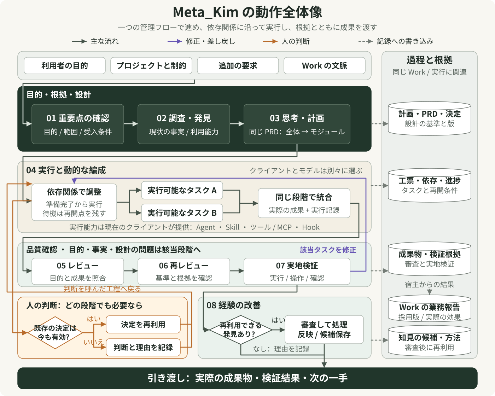
</p>

01–08 を上から順に読みます。濃い緑の領域で目的と根拠を確認し、一つの PRD でシステム全体とモジュールを設計します。実行領域は現在のクライアントが提供する能力を使い、品質確認で実際の成果を検証します。橙色は必要に応じた人の判断で、有効な既存の決定は再利用します。紫色は実行上の問題を該当タスクへ戻す経路です。目的・事実・設計の問題は、それぞれの段階に戻ります。破線は記録への書き込みで、Work の採用と効果は宿主が報告します。経験は審査して反映または候補として保存し、反映不要なら理由を残して引き渡します。

[拡大できる原図を開く](docs/images/system-panorama.ja-JP.svg)

## 一言で依頼した後、何が起きる？

> 「小さな予約アプリを作りたい。お客さんはスマートフォンで時間を選び、スタッフは予約を管理できるようにしたい。二度押しても予約は一件だけにしてほしい。」

**Meta_Kim は、この依頼を実行でき、確認でき、改善を続けられる仕事に変えるよう AI を支えます。** いつもの AI クライアントの中で、問題の理解、既存プロジェクトと参考資料の調査、体験に関わる選択肢の比較、システムの構成、モジュールの詳細化、作業の連携、成果の確認を組み立てます。

受け取る成果は具体的です。この例なら、動く予約画面、管理画面、関連ソース、起動方法、そして通常の予約、重複送信、満席の場合を確かめた結果です。以下では予約アプリを共通の例として、各段階がどうつながるかを説明します。

AI クライアントでプロジェクトを開き、依頼、既存資料、制約を伝えます。**Live は継続する仕事の統一ワークスペースです。** 八段階、システム全体の PRD、各モジュールの詳細、採用した版、修正依頼と受領記録を確認できます。実際の作業は現在の AI ホストが引き継ぎます。

<p align="center">
  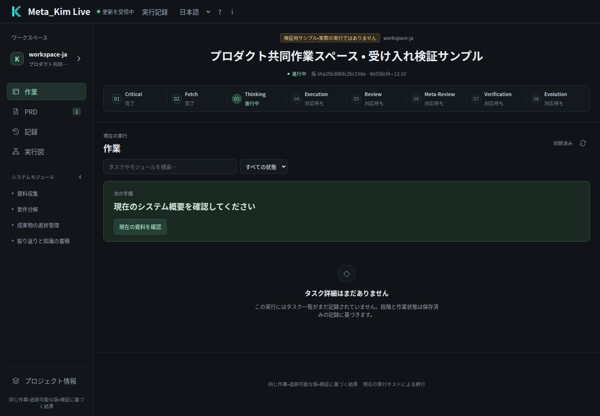
</p>

*受入テスト用サンプルと明示された、実際に動作する Live ワークスペースです。ブラウザーは実際の Hub、レビュー操作、現在のホスト CLI を使用し、モデルは呼び出していません。PRD からシステム概要と各モジュールの詳細を読めます。*

## Live で内容を読み、判断し、次へ進める

「仕事」で現在の段階と次の操作を確認し、「PRD」でシステム概要とモジュール詳細を切り替えます。現在のファイル版を採用、修正依頼、差し戻しとして記録できます。モジュールの採用後は次の作業がホストに渡されます。「記録」と「実行マップ」から成果と根拠を確認できます。

要求の保存、ホストの受領、ファイルの報告、結果の検証は別の状態です。ホストが動いていなければ待機を維持します。長い資料は完全な原文を保存して必要なページだけを読み込みます。[統一ワークスペースとホスト連携](docs/live-workspace.md)に手順と境界を記載しています。

## マインドマップで全体をつかむ


**利用者の目標から、四つの枝をたどります。** 目的の理解、設計、タスク、交付が目標とどう関わるかを見ます。役割の分担も確認してください。Meta_Kim が全体を組み立て、専門能力が具体的な作業を担います。

- **目標**：誰が、どの場面で使い、何を達成したいか。守る条件は何か。
- **設計**：根拠を調べ、実現可能な方法を比較し、重要な決定を一つの要件設計に残す。
- **タスク**：入力、担当、成果物を定め、依存関係に沿って直列・並列の作業を組む。
- **品質**：成果を審査し、実際に検査して、問題を該当タスクへ戻す。
- **継続と改善**：決定、進捗、結果を保存し、有効な成果から再開する。根拠のある方法を次へ残す。

価値が生まれるのは、このつながりです。モジュールのインターフェースを変えれば関係する作業も見直せます。ある分岐が判断待ちでも、独立した仕事は進められます。効果のなかった方法を再び試すときは、新たな根拠が必要になります。

## 一回目の PRD：アイデアからシステム構成とモジュールの概要へ

**PRD は製品要求文書です。「何を作るか、なぜ必要か、何をもって良しとするか」を明確にします。** Meta_Kim のシステム概要とモジュール詳細は、同じ PRD を二段階で具体化したものです。先に決めた内容が、後の設計にも引き継がれます。


**生成の一巡を追ってください。** 一言の依頼から現状確認と調査、案の比較へ進み、同じ PRD の利用者の流れ、技術と範囲、モジュール概要、共通の取り決めにまとまります。

### 利用者の一連の行動を確かめてから、システムを組み立てる

1. **依頼を観察できる成果にする。** 誰が予約し、誰が管理するか。時間を選んだ後に何を表示するか。重複送信をどう扱うか。利用者、主な流れ、制約、受け入れ基準を整理します。
2. **すでにあるものを調べる。** プロジェクト構成、実際のコード、技術とバージョン、既存データ、作業中の変更を読みます。うまく機能している選択は引き継ぎます。
3. **判断を左右する不明点を調査する。** 実現できる機能かは公式ドキュメントで確認し、予約体験は一連の操作と関連ソースから学びます。GitHub の事例にある状態管理、インターフェース、復旧方法も設計の根拠になります。
4. **実質的に異なる方法を比較する。** 外部の予約サービス、既存アプリの拡張、独立サービスの開発では、体験、作業量、保守、データ管理が変わります。利用者が決めるべき方向には、比較理由と推奨案を示します。
5. **選んだ方向をシステム概要にする。** 技術とバージョン、構成、モジュールの責務、接続と共有状態、主な受け入れ基準、追加調査や判断が必要な点をまとめます。

予約アプリなら、概要には次の内容が入ります。

- **利用の流れ**：空き時間を見る、情報を入力する、予約を確定する。スタッフは予約を確認・変更する。
- **システム構成**：表示層が画面と状態を示し、アプリケーション層が予約ルールを組み立て、データ層が時間枠と予約を保存する。
- **モジュール**：空き枠の検索、予約の作成、管理画面。それぞれの目的と担当範囲から始める。
- **共通の約束**：残り枠数を誰が管理するか、予約の状態は何か、登録とキャンセルの接続をどうするか。
- **今回の基準と未決事項**：スマートフォンで予約を完了でき、重複送信の結果が一致すること。SMS 通知を初回に含めるかは、明示的な製品判断として残す。

たとえば「二度押しても予約は一件だけ」は受け入れ条件になり、「予約作成」へ割り当てられます。同じ送信の識別と空き枠の管理を誰が担うかは、連携仕様と共有データの取り決めになります。利用者の流れと、この責任の分け方からモジュールの境界を決めます。

**全体が成立するかを見てから、実装の詳細へ進みます。** 探索中は未決事項を残せます。モジュールを実行に移す前に、必要な決定と接続条件を確定します。小さな修正では合意済みの設計を使い、影響する部分だけ詳しくします。

<p align="center">
  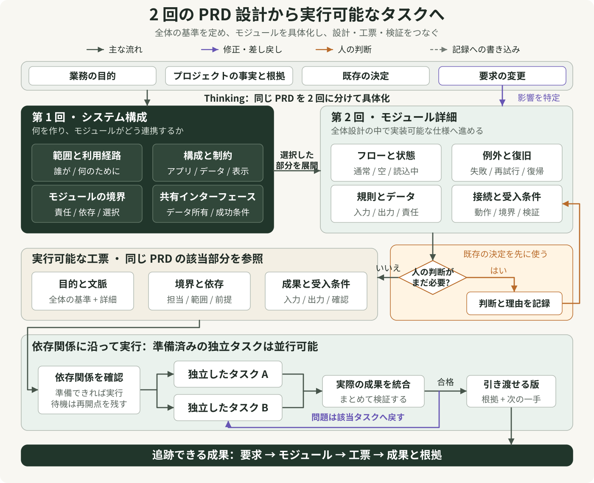
</p>

まず左右の 2 回の設計を読み、矢印に沿って下の工票と実行へ進みます。第 1 回は範囲、構成、モジュールの境界、共有インターフェースを定めます。第 2 回は同じ全体設計の中で、フロー、状態、例外、データ、受入条件を具体化します。工票はその PRD の該当部分を参照し、文脈、範囲、依存関係、成果要件を引き継ぎます。判断の分岐は一つのモジュールの例です。既存の決定を先に使い、必要な人の判断と理由を記録して該当設計へ戻ります。待機するのは影響を受ける依存関係だけで、その他の実行可能な独立タスクは宿主の能力に応じて並行できます。要求変更は影響するモジュールと設計基準を特定して関連工票を更新し、検証失敗は該当タスクへ戻します。

[拡大できる原図を開く](docs/images/prd-to-tasks.ja-JP.svg)

<p align="center">
  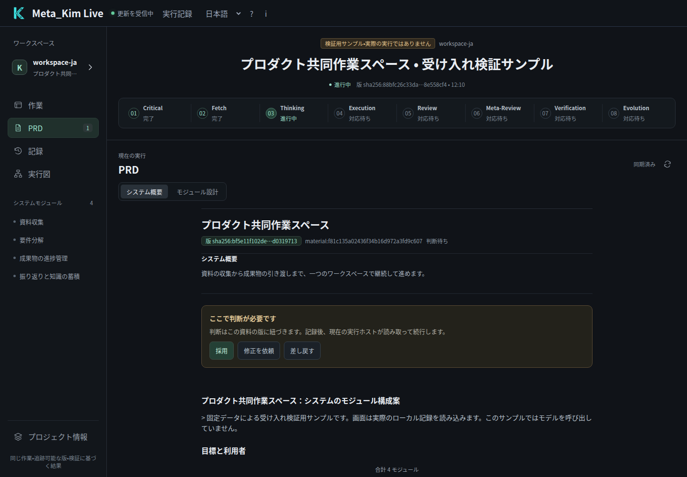
</p>

*一回目の内容は Live の「PRD → システム概要」に表示されます。実際の資料を読んだうえで、現在の版に対する判断を記録します。画面には同じ受入テスト用サンプルを使っています。*

## 二回目の PRD：各モジュールを着手できる設計にする

方向が定まったら、AI は各モジュールの詳細を設計し、同じ PRD にまとめます。モジュール同士は、すでに定めた用語、状態、インターフェースを共有します。


**一つのモジュールが具体化する過程を見ます。** 前のシステム基準を引き継ぎ、「予約作成」の操作、状態、ルール、連携と受け入れ条件を補い、下の画面・API・検証タスクへ渡します。

「予約を作成する」モジュールなら、次のような実務上の問いに答えます。

- **利用者はどう完了するか。** 時間を選び、入力し、確定して結果を見る。修正やキャンセル後にどこから続けるかも定めます。
- **各状態で何を表示するか。** 読み込み中、空き枠なし、送信失敗と再試行、成功を設計します。スマートフォン表示、キーボード操作、アクセシビリティも含めます。
- **業務ルールは何か。** 時間枠の定員、二度押し、送信中に満席になった場合、キャンセル時の空き枠回復を扱います。
- **他の部分とどうつながるか。** 入力項目、返す結果、状態の管理者、権限を整理します。トランザクション、再試行、データ移行は実際のプロジェクトに応じて具体化します。
- **どう正しさを確かめるか。** 各受け入れ基準にタスクと確認方法を対応させ、正常な流れと必要な失敗・復旧の場面をカバーします。

詳細設計では、要求を実装と確認にも結び付けます。予約アプリのタスク例は次のとおりです。

| 要求 | 設計と実装タスク | 確認方法 |
| --- | --- | --- |
| 二度押しても予約は一件 | 画面は送信中の状態を扱い、API は同じ送信を識別して同じ予約結果を返す | 連続操作と同じリクエストの再送を行い、予約の追加が一件か調べる |
| 最後の空き枠を超えて予約できない | データと API が空き枠更新の整合性を保ち、画面は満席を表示する | 二つのリクエストを同時に送り、成功数が空き枠を超えないか調べる |
| キャンセルで空き枠が戻る | 取消 API が予約状態と空き枠を更新し、画面が結果を示す | 取消後に再取得し、予約状態と空き枠が一致するか調べる |

各実行者には、**現在のシステム基準、自分が担当するモジュールの完全な設計、関連する決定と接続条件、成果物、受け入れ基準**を渡します。フロントエンドとバックエンドは共通の項目と状態を合わせてから、それぞれの範囲で作業します。

後からキャンセル時の空き枠回復ルールを変えれば、関連する決定、モジュール、依存関係から影響するタスクを特定します。有効な成果は残し、必要な範囲を変更します。

<p align="center">
  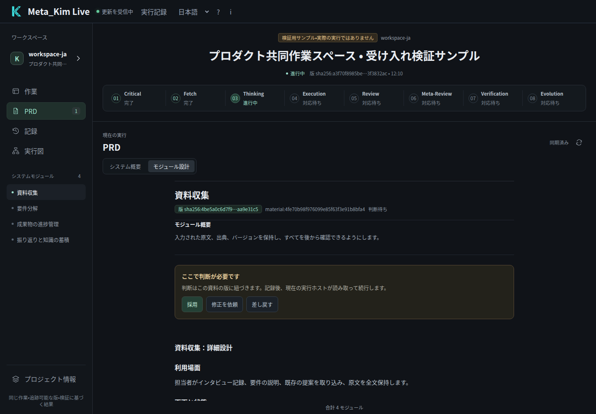
</p>

*二回目の内容は「PRD → モジュール詳細」に表示されます。概要の採用と現在のホストによる実ファイルの報告後に撮影しました。モジュールを採用すると次のモジュールに進めます。本文は受入テスト用サンプルです。*

## 八つの段階：何を残し、次へ何を渡すか


**01 から 08 へ、強調表示を追います。** 各カードには、その段階が残す成果が書かれています。次の段階はそれを受け取り、問題があれば解決できる段階へ戻ります。

| 段階 | 受け取るものと行うこと | 次へ渡すもの |
| --- | --- | --- |
| **01 Critical · 重要点の確認** | 依頼と現状を読み、利用者、目標、範囲、重要な制約を明らかにする | 目標、成功条件、判断に関わる未解決の問い |
| **02 Fetch · 調査と能力の発見** | 問いに沿ってコード、参考資料、利用可能な専門能力を調べる | 出典のある発見、方法の候補、足りない事実 |
| **03 Thinking · 判断と計画** | 目標と根拠から案を比較し、PRD の二つの視点と依存関係をまとめる | 設計基準、担当、方法、入力・成果物・受け入れ条件 |
| **04 Execution · 実行** | 現在の設計に従い、範囲を定めた作業を実行する | 実際に確認できる成果、実行記録、段階の統合結果 |
| **05 Review · 審査** | 成果を目標と照合し、前の理解、調査、設計も点検する | 具体的な問題、修正要求、審査結論 |
| **06 Meta-Review · 審査の再点検** | 審査基準、見落とし、結論を支える根拠を確認する | 審査判断の再点検結果と、追加確認が必要な問題 |
| **07 Verification · 実際の検証** | 現在の成果をテスト・操作・照合する。予約なら成功、重複送信、失敗からの復旧を確認する | 現在の版で得た根拠、結果、残る問題 |
| **08 Evolution · 経験からの改善** | 実際の成果から再利用できる発見を選び、候補を評価する | 審査を経た方法の更新、または今回は更新不要とする理由 |

これが実行の基本構造です。**段階は定めた順でつながり、同じ段階の独立した作業は並行し、統合してから次へ進みます。** 目標の誤解は確認へ、事実不足は調査へ、設計の問題は計画へ、検証の失敗は影響する作業へ戻します。準備は仕事に必要な深さで行い、審査と再点検はリスクに合わせます。再利用する発見がなければ、今回は方法の更新が不要と記録します。

## 動的な編成：依存関係と現在の状態で、今始める仕事を決める

**動的な編成とは、どのタスクが今進められるかを実行中も判断し続けることです。** 前提となる成果、変更するファイルの範囲、リソース、権限、クライアントが現在使える並行実行数を確認します。


**上部の共通仕様から、左右の分岐を同時に見ます。** 左の画面が選択待ちでも、右の API は進みます。画面が再開した後、両方の成果を下部で統合します。この着手条件の変化を扱うのが動的な編成です。

予約アプリは、たとえば次のように進みます。

1. **共通の接続条件を先に決める。** 送信項目と成功・失敗時の応答を、フロントエンドとバックエンドの共通入力にします。
2. **独立した仕事を同時に始める。** 画面と予約 API の担当範囲が分かれ、クライアントに実行能力があれば並行できます。同じファイルを変更する仕事は順序を調整します。
3. **前提が揃った仕事から解放する。** 画面と実際の API を接続する作業は両方の成果を待ちます。新たに準備できたタスクを補充し、同じ段階の結果を統合担当へ渡します。
4. **一部の待機中も、独立した仕事を進める。** 画面案に利用者の選択が必要なら、その画面タスクは待機します。共通の項目と接続仕様が決まっているバックエンドは進められます。
5. **問題を関係するタスクへ戻す。** 一つの分岐が失敗しても、独立して成功した成果を保ちます。原因を調べ、根拠のある修正を定めてから該当作業を再開します。

同じ根拠で効果のない試行が続くと、該当タスクを一時停止し、方法や事実を見直します。何が待機中か、その理由、再開に必要な条件が分かります。

## 余白とリズム：今必要な判断に、注意を向ける時間をつくる

**意図的な余白は、現在の判断と利用者の注意のための時間です。** いつ情報を出すか、短く伝えるか、待つかを調整します。PRD の未決事項は情報や決定の不足を示すもので、別々に記録します。


**上部の新しい情報から読みます。** 決定済みか、事実が足りないか、利用者が選べる状態か、緊急かを判断し、次のカードを選びます。Pause は理解する時間をつくり、再開条件を記録します。

システム案を読み、サービスを比較し、大きな変更を判断した直後なら、次のメッセージは「何が決まり、どの判断が残っているか」を伝えます。新たな重い質問は後に回し、長い資料はファイルに残せます。標準のリズムルールは、注意の負荷が高いカードが三回続くと Pause を入れます。再開時には現在の状態と次の行動を改めて確かめます。

一時停止には理由、未完了の仕事、再開条件を残します。その画面の選択だけが対象なら、判断に依存しない許可済みの仕事は進められます。利用者がプロジェクト全体の停止を求めた場合は、その指示に従います。

### 十枚のアクションカードで変化に対応する

「カードを配る」とは、現在の状況に合う行動を選ぶことです。八段階の基本構造の中で使い、**発動条件に合うカードを選び、済んだものは省略します。**

| アクションカード | 現れる条件 | 予約の例 |
| --- | --- | --- |
| **Clarify · 確認** | 未知の答えが方針を変える | スタッフが顧客の代わりに取り消せるか確認する |
| **Shrink scope · 範囲の縮小** | 範囲が大きく今回の交付に影響する | 主要な予約フローを仕上げ、拡張を次の回へ置く |
| **Options · 選択肢** | 体験、費用、保守が異なる実現可能な案がある | 外部サービスと既存アプリ内の実装を比較する |
| **Execute · 実行** | 設計、入力、実行条件が揃う | 予約画面と API を実装する |
| **Verify · 検証** | 確認できる成果がある | 予約、重複送信、取消を実際に確かめる |
| **Fix · 修正** | 検査で具体的な問題を発見する | 取消後に空き枠が戻らない問題を修正する |
| **Rollback · 復帰** | 影響が広がり、安定状態へ戻す必要がある | 復旧計画に沿って該当する変更を戻す |
| **Risk · リスク対応** | 権限、共有データなどに重要なリスクがある | 他店舗の予約にアクセスできてしまう問題を優先する |
| **Nudge · 軽い後押し** | 低リスクの次の一歩で少し停滞する | まず成功する予約の一例を確認するよう提案する |
| **Pause · 余白** | 重い判断や情報の提示が続く | 短い状況と再開点を残し、理解する時間を取る |

同じカードでも、今必要なら実行、済んでいれば省略、介入の価値が小さければ表示を控え、前提待ちなら後回し、緊急時は先に挿入、責任者の判断が必要なら引き上げます。**答えた内容は記録に残ります。内部の Agent 配置はシステムが扱い、利用者は製品の結果を変える選択に集中できます。**

## 全体を管理する九つの役割と、専門の実行能力が連携する

協働の入口は **meta-warden** です。九つの役割には、それぞれ担当があります。

- **meta-warden**：方向の統括、意見の衝突の調整、最終結論の取りまとめ。
- **meta-conductor**：段階、依存関係、直列・並列の作業、対話のリズム。
- **meta-genesis**：必要な Agent の役割、責務、プロンプト構造の設計。
- **meta-artisan**：タスクに合う Skill、MCP、ツールの組み合わせ。
- **meta-sentinel**：権限、リスク、Hook、復旧範囲。
- **meta-librarian**：記憶、文脈、中断後の継続。
- **meta-prism**：品質審査、方向のずれの発見、具体的な修正要求。
- **meta-scout**：外部能力と参考資料の探索・評価。
- **meta-chrysalis**：改善の兆候の集約と、承認された反映の調整。

役割はタスクに応じて参加します。**行う仕事を定め、合う能力を探し、担当・方法・ツール・受け入れ条件を一つの作業指示にまとめます。** 予約アプリでは、各部品が次のように連携します。

| 部品 | 定めること | 予約の例 |
| --- | --- | --- |
| **Agent · 実行者** | 誰が、どの範囲で成果を作るか | 画面と API の担当に変更範囲と成果物を渡す |
| **Skill · 作業方法** | 手順と品質基準 | 画面設計でスマートフォンの配置、状態表示、使いやすさを扱う |
| **専門資料と事例** | この仕事で必要な知識 | 該当する状態設計や API の事例をタスクへ渡す |
| **ツールと MCP** | プロジェクトやサービスをどう操作するか | コードを読み、ファイルを変更し、画面と結果を確認する |
| **Command · 再利用できる入口** | 繰り返す操作をどう呼び出すか | 既存の検査手順をタスクから呼べるコマンドにする |
| **Hook · 所定の時点での検査** | どの重要条件を、いつ確認するか | 操作の要求時に、関係する能力、作業範囲、権限の境界を確認する |

まずプロジェクトとクライアントの能力を探し、次に接続済みの Kim Service などを検討します。合う能力は再利用し、必要ならプロジェクト向けに調整し、繰り返し使える不足が残る場合に作成します。現在の設計、選んだ資料、受け入れ条件を作業指示と一緒に渡し、統合担当が結果を取りまとめます。

## 中断した仕事を続け、次の仕事をより良くする


**今回の作業 → 記録の保存 → 次回の再開を追います。** 下の二つの分岐は実際の成果を使い、残作業を続けることと、残す価値のある経験の評価を行います。

Meta_Kim は、計画、発見、進捗、決定、成果物、検査結果をプロジェクトに保存します。次の会話では現在のファイルと照合し、完了したこと、判断待ちのこと、結果確認が必要な操作を整理して、有効な再開点から続けます。

たとえば、こう伝えられます。

> 「予約アプリの続きを進めて。完成済みの予約フローは残し、前回の残作業を読んで、キャンセル後の案内と空き枠の復元を仕上げ、一緒に受け入れ確認をしてほしい。」

前回の操作結果が不明なら、現在の結果を確認してから再実行するか判断します。プロジェクトの関係図は関連モジュールを見つける助けになり、記憶と実行記録は過去の判断を説明します。現在のソースと成果物も合わせて確認します。

経験を再利用するときは、実際の問題と改善案を記録し、成果が良くなるか、他の場面に影響しないかを評価してから、必要な審査を経て方法や部品を更新します。**具体例、比較、復旧の手段があるからこそ、次の仕事で検証された経験を活用できます。**

## 会社の一つの案件を、複数の実行につなぐ


**長期の案件（Work）は会社の業務システムが保持し、Meta_Kim は各実行をその案件に結びます。** 一人の会社でも、今後メンバーが増えても同じ任意のインターフェースを使えます。ホストが会社、案件、コンテキストの版、アクセス範囲、情報源の参照を渡し、現在の作業指示と結果を結びます。コンテキストが変われば新しい実行に進み、以前の記録も追跡できます。

結果の記録では、四つの状態を分けます。

| 記録 | 内容 |
| --- | --- |
| **成果 produced** | 実際の実行から返った成果。計画や受領通知は成果に含めません |
| **検証 verified** | 既存の独立した結果レビューと証拠。未検証は不明のままです |
| **採用 adopted** | ホストが記録した採用版、元の決定の参照、理由。理由がなければ不明です |
| **効果 effect** | その後の業務上の観測と情報源。検証成功だけでは効果を断定しません |

今回 v2 を作っても、会社が以前承認した v1 を使い続けることはできます。両方を区別して残し、v1 の再承認は求めません。実行後にホストが採用、効果、知識の再利用を追記しても、元の実行ファイルは変わらず、worker は再実行されません。知識はそのまま再利用、調整して再利用、適用不可を記録できます。検証失敗、不採用、採用のフィードバックは、既存のレビュー付き知識ライフサイクルへの候補に留めます。

通常 API の任意の `workContext`、または CLI `--work-context-input` で接続します。後続の観測には `workOutcome` / `--work-outcome-input` を使い、元の `runId` と現在の案件コンテキストを結びます。項目と使い方は[既存のガバナンス参考](canonical/skills/meta-theory/references/dev-governance.md#optional-company-work-context)にあります。指定しなければ従来の流れを維持します。業務記録と権限はホストが管理し、参照だけでアクセス権を与えたり会社の知識を自動公開したりすることはありません。

<a id="installation"></a>

## 自分のプロジェクトで始める

**Node.js 22.13.0+**、Git、モデルへの接続を設定した AI クライアントが必要です。現在の公開版は **[v3.12.1](https://github.com/KimYx0207/Meta_Kim/releases/tag/v3.12.1)** です。

### 1. Meta_Kim をインストールする

```bash
git clone https://github.com/KimYx0207/Meta_Kim.git
cd Meta_Kim
npm install
node setup.mjs
```

利用するクライアントと導入範囲を選びます。**グローバル導入**ではアカウント内で再利用できる能力を、**プロジェクト導入**では指定したプロジェクト向けの設定を用意します。更新に使うため、Meta_Kim のチェックアウトは残してください。作業するプロジェクトは、別のディレクトリでも構いません。

たとえば、一つのプロジェクトへ Codex 対応を直接インストールする場合は、次を実行します。

```bash
node setup.mjs --targets codex --scope project --project-dir "/path/to/your-project"
```

引用符内をプロジェクトの絶対パスに置き換えてください。アカウント全体に導入する場合は、`--project-dir` を付けずに `--scope global` を使います。`--targets codex,claude` のように、カンマ区切りで複数のクライアントも選べます。

チェックアウトを残さずに導入する場合は、`npx --yes github:KimYx0207/Meta_Kim` を使えます。後から更新するには `npx --yes github:KimYx0207/Meta_Kim update` を実行します。この方法でも同じ setup オプションを指定できます。以降の CLI コマンドでは、`node bin/meta-kim.mjs` をこの `npx` の接頭部分に置き換えてください。

### 2. プロジェクトを開き、欲しい結果を伝える

設定したクライアントで作業対象のプロジェクトを開き、自分の言葉で目標を伝えます。誰が成果を使うのか、何を変えたいのか、手元の資料と守るべき制約を添えてください。例えば、次のように依頼します。

> 「このプロジェクトの会員登録フローを確認してください。今のデータ項目を保ちながらスマートフォンで使いやすくし、変更後の流れと検査結果を見せてください。」

既存のプロジェクトと、大切な制約を伝えます。提示された重要な選択肢を確認し、計画に沿って進めてもらいます。何を、なぜ変更するのか、どう確かめるのかを途中で尋ねても構いません。起動用の特別なコマンドを覚える必要はありません。

### 3. Live で作業を見る

Meta_Kim のチェックアウトで実行します。

```bash
node bin/meta-kim.mjs live --project-root "/path/to/your-project"
```

コマンドが表示したローカル URL を開きます。Live は、そのプロジェクトに保存されたタスクと実行の記録を読みます。まだ記録がない段階で画面を試す場合は、URL に `?demo=states` を付けると、本ページと同じ内蔵デモを開けます。

最初に「仕事」で八段階と次の操作を確認し、「PRD」でシステム概要やモジュール詳細を読みます。タスクの依存関係や検査結果は「実行マップ」でタスクを選び、「証拠」を開いて確認できます。

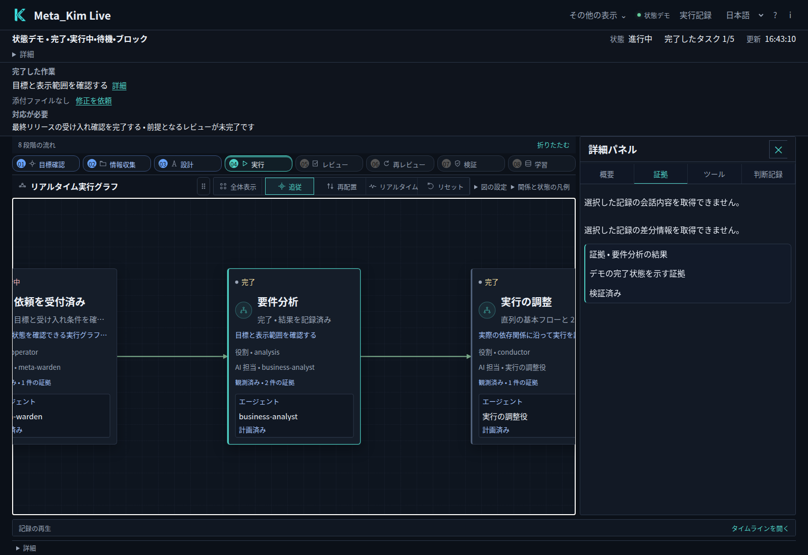

*内蔵デモでタスクを選び、証拠を開いた画面です。記録を通して、そのタスクの状態を理解できます。*

言語セレクターで中国語、英語、日本語、韓国語を選べます。Live は画面の言語を記憶し、タスクやフィードバックの原文を保持します。登録済みの大綱やモジュールを Live で直接レビューし、修正依頼を保存できます。現在の AI ホストが永続的な作業依頼から処理を引き継ぎます。

<a id="clients"></a>

## いつものクライアントで使う

対話型インストーラーは、次の六つの対象名に対応しています。セットアップ中に選ぶか、`--targets` に名前を指定してください。

| クライアント | 対象名 | セットアップで用意するもの |
| --- | --- | --- |
| Claude Code | `claude` | Agent、Skill、コマンド、Hook |
| Codex | `codex` | Agent、共有 Skill、設定、Hook |
| Cursor | `cursor` | Agent、Skill、プロジェクトルール、Hook |
| OpenClaw | `openclaw` | Agent のワークスペース、Skill、設定テンプレート |
| Gemini CLI | `gemini` | Agent、共有 Skill、設定、Hook |
| ZCode | `zcode` | Agent、Skill、MCP 設定、任意のユーザー単位 Hook |

導入後は、作業プロジェクトでクライアントを開き直して設定を読み込みます。ツールの利用権限とモデルの権限は、引き続きクライアントが管理します。Meta_Kim のグローバル Hook を有効にする場合は、セットアップのコマンドに `--with-global-hooks` を追加してください。ZCode はユーザー単位の Hook を読みます。

**OpenClaw はテンプレートの接続も必要です。** セットアップでは Agent のワークスペースと `openclaw.template.json` を生成します。通常、グローバル導入では `~/.openclaw/`、プロジェクト導入ではそのプロジェクト内の `openclaw/` に配置します。テンプレートの `agents.list` と `skills.load.extraDirs` を既存の OpenClaw 設定にマージし、他の Agent、ディレクトリ、設定を保持してください。gateway を再起動し、入口の Agent として `meta-warden` を選びます。

**Qoder と Trae** には、実験的な連携に使う Beta アダプター素材を同梱しています。明示的に設定するまでは有効にならず、追加の `--targets` 選択肢ではありません。DeepSeek Harness は次の専用手順で導入します。依存プロジェクトの対応クライアントは各上流プロジェクトが管理します。

### クライアントとモデルを別々に設定する


**専門の方法、実行クライアント、モデルは別々の選択です。** 同じ PRD、八段階、引き継ぎ、検証の方法を複数のクライアントで使えます。Claude Code、Codex、Gemini CLI、ZCode などは利用する入口であり、モデルは接続設定と今回の要求で決まります。Claude Code で MiniMax モデルを使っても、クライアントは Claude Code として、モデルは別項目として記録します。

| 変更するもの | 既存の設定入口 | 動作 |
| --- | --- | --- |
| 今回のクライアント | API `runtime` / CLI `--runtime` | 明示指定を優先。自動選択は接続済み連携、設定、ホスト情報を使い、出所も記録 |
| ホスト情報がない場合の互換既定値 | `config/contracts/runtime-priority-and-compatibility-contract.json` の `selectionPolicy.defaultPlanningRuntime` | 出所のある計画用の値。実行成功や権限の証拠にはしない |
| 今回の worker モデル | API `stageRunner.model` / CLI `--stage-runner-model` | 実装済みのコマンド連携が実際の仕様で渡す。注入型連携はモデル選択対応を明示する必要がある |
| アカウント、接続、モデル利用可否 | 現在のクライアントまたはホスト設定 | 実環境が提供。方法パッケージがモデル利用権や道具の権限を付与することはない |

モデル省略時は実行プロセスの既定動作として記録し、親セッションのモデル継承は推測しません。実行報告では **requested（要求）、applied（連携に渡した値）、observed（実測）** を分け、観測のない値は不明のまま残します。明示要求が未対応なら不足を示し、別モデルへ黙って置換しません。実行設定を変える場合は新しい実行根拠が必要ですが、完了済みの案件記録は引き続き参照できます。

導入用の生成物、ホスト上での続行、ネイティブなコマンド連携の対応範囲は別です。上の六つの導入先は `config/sync.json` が正本です。組み込みの読み取り専用段階 worker は現在 Codex と Claude Code のコマンド仕様を実装しています。Gemini や ZCode での続行には実際の連携と能力の証拠が必要です。MiniMax Code などの新しいクライアントも共通の方法を読めますが、ネイティブ実行には対応する連携の実装と検証が必要です。

新しいクライアント・OS・モデルの紐付けを持たない旧実行は、過去の根拠として残します。続きの実行には新しい `runId` と現在の能力・文脈の確認を使い、過去のモデルを推測しません。新形式の実行を再開すると元のモデル引数記録を保持し、採用や業務効果の観測追加だけで worker を再実行しません。

## 専門的な方法が必要な仕事に Kim Service を接続する

Meta_Kim は仕事の進め方を組み立てます。**Kim Service は、設計、分析、コンテンツ制作などに使う専門的な方法と資料を提供します。** 接続すると、タスクの方法を選ぶ際にそれらも候補にできます。実際の作業には、利用中のクライアントのツールを使います。

インストーラーが管理対象の Service ソースを登録済みで、導入記録の検証にも通る場合は、その登録を利用できます。自分でダウンロードしたコピーを使う場合は、次の手順でディレクトリを明示的に接続します。

Kim Service をローカルのディレクトリにクローンします。

```bash
git clone https://github.com/KimYx0207/Kim_Service.git
```

**作業対象プロジェクトのルート**に `.meta-kim/local.overrides.json` を作成し、チェックアウトの絶対パスを指定します。

```json
{
  "dependencyRoots": {
    "kim-service": "/absolute/path/to/Kim_Service"
  }
}
```

ファイルがすでにある場合は、既存の `dependencyRoots` に `kim-service` を追加し、他の設定を残してください。使うのは Meta_Kim のインストーラーディレクトリではなく、AI クライアントで開いているプロジェクトのルートです。Windows の JSON パスには `C:/Projects/Kim_Service` のようにスラッシュを使えます。

環境変数で管理する場合は、`META_KIM_KIM_SERVICE_ROOT` で同じ接続先を指定でき、ローカルファイルより優先されます。AI クライアントを起動する環境に設定してください。二つのリポジトリを隣に置くだけでは接続されません。設定後は、利用できる Kim Service の能力を確認し、今回のタスクに合う方法を使うようアシスタントに依頼します。

<a id="dsh"></a>

## DeepSeek Harness の導入

DSH には、ネイティブの profile、Skill、MCP 設定を使う独立した Beta 連携があります。**DSH 0.2.2-rc.1** と **Node.js 24.9.0+** が導入済みなら、Meta_Kim のチェックアウトで次を実行します。

```bash
node bin/meta-kim.mjs dsh install
node bin/meta-kim.mjs dsh check
dsh --profile meta-kim
```

一つのプロジェクトに導入する場合は、install コマンドへ `--scope project --project-root "/path/to/your-project"` を加え、インストーラーが表示した起動コマンドを使います。同じプロジェクトの設定を確認するには、次を実行します。

```bash
node bin/meta-kim.mjs dsh check --scope project --project-root "/path/to/your-project"
```

Kim Service のネイティブ DSH Skill も使う場合は、[Kim Service のリリース](https://github.com/KimYx0207/Kim_Service/releases/latest)から DSH パッケージをダウンロードして展開し、インストールまたは更新時に `--service-package "/path/to/unpacked-service-package"` を指定してください。

連携の更新には `node bin/meta-kim.mjs dsh update` を使います。既存の Service 内容は保持されます。それらの Skill も更新する場合は、新しく展開した Service パッケージを渡してください。連携を削除するには `node bin/meta-kim.mjs dsh uninstall` を実行します。プロジェクト単位の更新・削除には、導入時と同じ `--scope project --project-root` の値を指定してください。

<a id="continue-work"></a>

## 作業を続け、改善し、導入環境を更新する

会話が中断したら、**同じ作業プロジェクト**を開き直します。続ける前に、保存した計画、調査結果、進捗、実行記録を読むようアシスタントに依頼してください。

> 「会員登録の改善を続けてください。保存した決定と完了済みの作業を今のプロジェクトと照合し、中断した操作の結果を確かめてから、次の未完了タスクへ進んでください。」

次の改善では、維持したいことと変更したいことを伝えます。たとえば「モバイルのレイアウトと今の項目は保ち、完了メッセージを改善して」と伝えれば、受け入れた成果を土台にできます。任意の Memory サービスを追加すると、選んだ情報をセッション間で保持する助けになります。現在の仕事を続ける基盤は、プロジェクトのタスク記録にもあります。

ソースから導入した環境を更新する場合は、Meta_Kim のチェックアウトで実行します。

```bash
git pull --ff-only
node setup.mjs --update
node setup.mjs --check
```

インストールやクライアントの読み込みに問題がある場合は、`node bin/meta-kim.mjs doctor` で環境を確認し、次の対応を調べられます。更新時も作業プロジェクトの記録を残し、次のセッションから続けられるようにしてください。

## ソースと生成ファイル


**事実の種類ごとに正本を一つに保ち、アプリ・データ・表示を接続します。** 以下は現在の実装の配置です。

| 責任 | 正本または実装 | 変更時の境界 |
| --- | --- | --- |
| 共通の方法と段階の契約 | `canonical/`、`config/contracts/` | 方法、八段階、管理ルールそれぞれの正本を維持 |
| クライアントと連携の事実 | `config/sync.json`、`config/runtime-compatibility-catalog.json`、`scripts/runtime-tool-profiles.mjs` | 生成先、形式、能力の証拠を分離。導入の検出は実行の証拠ではない |
| アプリと領域ルール | `src/application/`、`src/domain/`、`scripts/governed-execution/` | 依頼、依存関係、再開、結果判断。主入口は引き続き `scripts/run-meta-theory-governed-execution.mjs` |
| データとホスト連携 | `src/data/repositories/`、`src/infrastructure/` | 実行・知識の記録を保存し、既存の契約で実ホストへ接続 |
| 表示 | `src/presentation/live/`、`src/presentation/run-surfaces/` | 状態、証拠、次の作業を表示。別のモデル選択方針を持たない |

拡張先は責任で決めます。新しい方法は canonical、新しいホストは設定と検証済み連携、新しい画面は既存の状態を利用します。案件の主記録、組織権限、外部通知、定期的な知識整理は接続先ホストが担当します。README のアニメーション SVG は `scripts/build-readme-animations.mjs` と各言語の文案から生成し、`--check` で整合性を確認できます。見出し、入口、結びを中央に配置し、動きを減らしても全体の関係が分かります。

共通の Agent、Skill、実行環境の素材は `canonical/` で管理し、機械可読の設定は `config/` に置きます。`.claude/`、`.codex/`、`.cursor/` などのクライアント別ディレクトリは `npm run meta:sync` でローカルに生成します。生成物は `.gitignore` で GitHub のソースから除外し、ローカルに保持します。配布パッケージには元の共通ソースを含めます。

## 連絡先


GitHub <a href="https://github.com/KimYx0207">KimYx0207</a> |
X <a href="https://x.com/KimYx0207">@KimYx0207</a> |
公式サイト <a href="https://www.aiking.dev/">aiking.dev</a> |
WeChat 公式アカウント：**ラオジンとAIを楽しむ**

Feishu ナレッジベース：
<a href="https://my.feishu.cn/wiki/OhQ8wqntFihcI1kWVDlcNdpznFf">継続更新の入口</a>

### 方法の根拠

Meta_Kim の方法論は、本プロジェクトのメンテナ（KimYx0207）による「元に基づく意図拡張（intent amplification）」の研究に依拠しています。

- 論文: <https://zenodo.org/records/18957649>
- DOI: `10.5281/zenodo.18957649`

---

## License

[Apache License 2.0](LICENSE). Commercial use is permitted. Retain [LICENSE](LICENSE) and [NOTICE](NOTICE) when redistributing the project or substantial portions. Third-party components retain their own licenses; attribution does not imply endorsement.

**Meta_Kim by KimYx0207 — https://github.com/KimYx0207/Meta_Kim**
