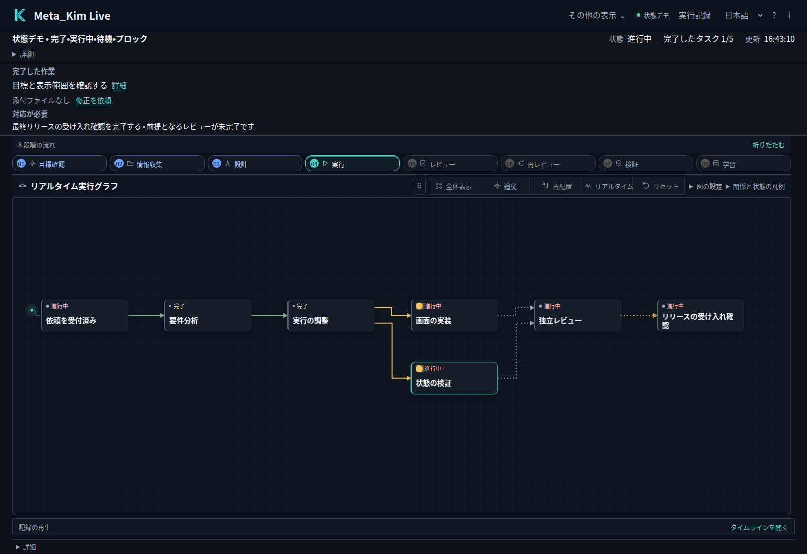
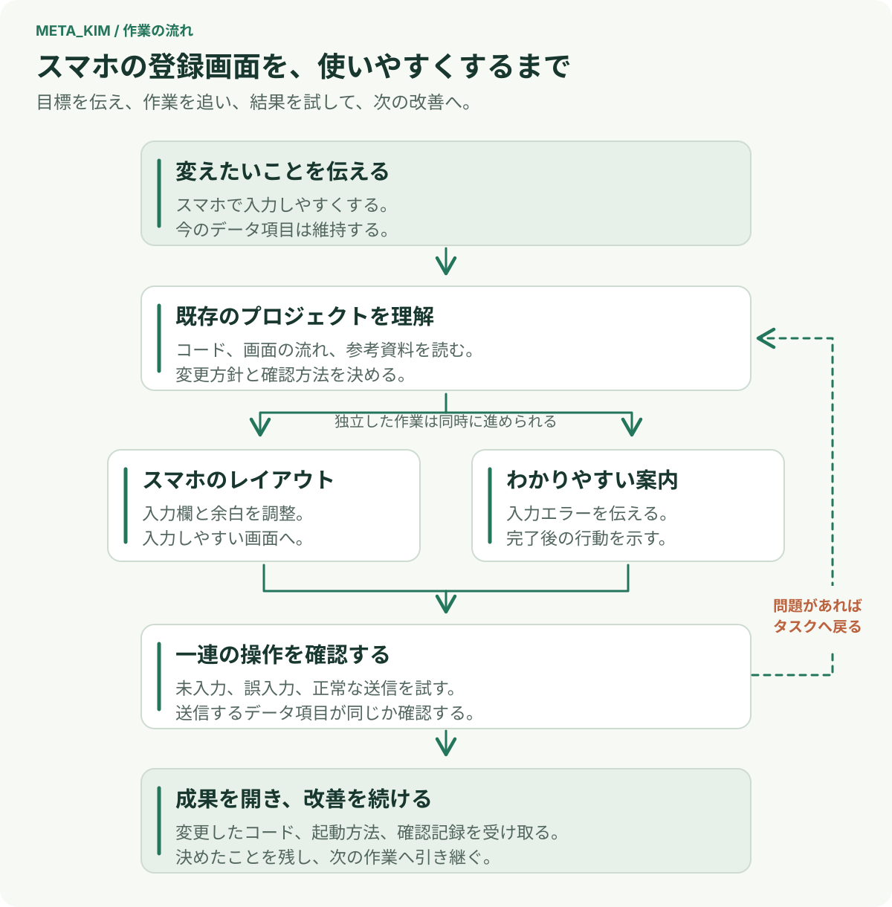
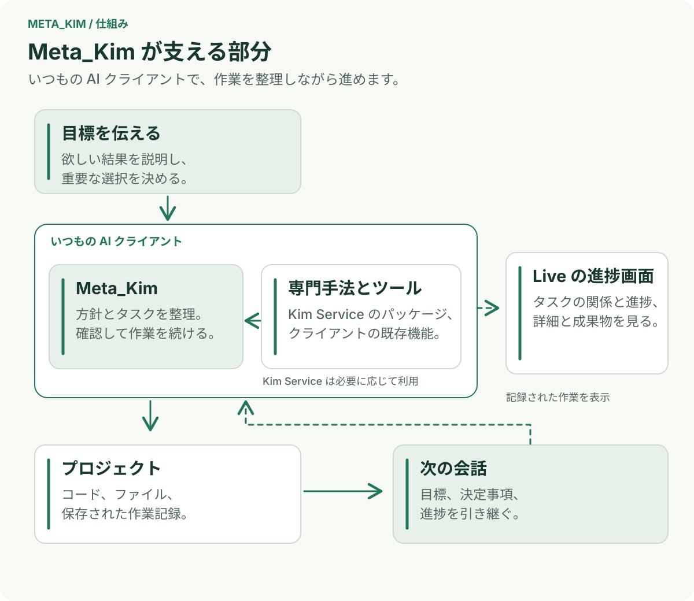

<div align="center">

# 元 · Meta_Kim

**やりたいことを AI に伝える。考えるところから、作って確かめ、次の改善へ。**

[English](README.md) · [简体中文](README.zh-CN.md) · [日本語](README.ja-JP.md) · [한국어](README.ko-KR.md)

[](https://github.com/KimYx0207/Meta_Kim/stargazers)
[](LICENSE)

</div>

## 一つの仕事を、AI と最後まで進める

**Meta_Kim は、AI が作業を組み立て、適した手法を使い、成果を確かめ、前回の続きに取りかかれるよう支えます。** 普段の AI クライアントをそのまま使いながら、目的、決定事項、進捗をプロジェクトに残していけます。



*内蔵デモを表示した Live の実画面です。まずタスクマップで全体のつながりを見て、気になるタスクをクリックすると詳細を確認できます。*

## 例えば、スマートフォンで使いやすい会員登録にする

すでに動いている Web サイトがあるものの、スマートフォンでは登録フォームに入力しづらい。集めるデータ項目は変えずに、使い勝手をよくしたいとします。

欲しい結果を、普段の言葉で伝えてください。**まずは困っていることから。** 入力欄が窮屈、エラーが分かりにくい、直した画面を自分で試したい。Meta_Kim は、AI が既存のプロジェクトを調べ、具体的な進め方を考えるのを支えます。

**方針を決めたら、作業を見ながら進めます。** この例なら、モバイル向けの配置を整え、入力エラーを分かりやすくし、送信するデータが変わらないことを確認します。各タスクに必要なファイル、手法、完了条件を整理します。Live を開けば、タスク同士の関係と現在の進捗を確認できます。

**成果を試し、次の改善につなげます。** 変更したソース、起動方法、実施した確認を見せてもらいましょう。画面をスマートフォンの幅にして、未入力、誤入力、正常な登録を試します。そのうえで「今の配置はそのままに、登録完了のメッセージをもっと分かりやすくして」と続けられます。決定事項や作業記録が残るので、次の会話でも続きを進めやすくなります。



初めて試すときは、このくらいの小さな仕事から。新機能の開発、不具合の修正、複数のセッションにまたがる製品づくりにも、同じ進め方を使えます。

## 仕事のつながりをどう支えるのか



目的を伝え、製品の方向を左右する選択をするのは利用者です。**Meta_Kim は AI クライアントの中で作業を整理します。** 最初に何を調べるか、どの仕事から始められるか、各タスクに何が必要か、どう成果を確かめるかをつなぎます。

**[Kim Service](https://github.com/KimYx0207/Kim_Service) は、設計、開発、分析などに使う専門的な手法を提供します。** Meta_Kim は、こうした手法とクライアントにあるツールやスキルを組み合わせて使えます。計画と成果、確認結果を記録に残すことで、次のセッションにも具体的な続きを引き継げます。

## 自分のプロジェクトで試す

**Node.js 22.13.0 以降**と、設定済みの AI クライアントが必要です。現在のバージョン：**[v3.10.2](https://github.com/KimYx0207/Meta_Kim/releases/tag/v3.10.2)**。

### 1. Meta_Kim をインストールする

```bash
git clone https://github.com/KimYx0207/Meta_Kim.git
cd Meta_Kim
npm install
node setup.mjs
```

案内に従って、利用するクライアントを選びます。一つのプロジェクトだけに導入することも、複数のプロジェクトで共通の設定を使うこともできます。導入範囲や任意サービスの設定は、[インストールの選択肢](docs/technical-notes.ja-JP.md#導入オプション)を参照してください。

### 2. プロジェクトを開き、欲しい結果を伝える

設定したクライアントで対象のプロジェクトを開きます。会員登録の例なら、いつものチャットで次のように依頼します。

> 「このプロジェクトの会員登録を見直して、スマートフォンで入力しやすくしてほしい。今のデータ項目は残し、変更後の操作と確認結果を見せてください。」

AI は現在のプロジェクトから調べ始めます。項目を残す、既存のデザインに合わせるといった条件を伝え、成果を左右する点を一緒に決めてください。作業中も提案を確認し、必要に応じて希望を追加できます。

### 3. Live を開き、タスクの中身を見る

Meta_Kim のディレクトリで実行します。

```bash
node bin/meta-kim.mjs live --project-root "/path/to/your-project"
```

引用符内を対象プロジェクトの絶対パスに置き換え、表示されたローカル URL を開いてください。Live は、プロジェクトに保存されたタスクと実行記録を表示します。先に画面を試したい場合は、同じ URL に `?demo=states` を付けると内蔵デモを開けます。

**まず、このページ冒頭のタスクマップを見ます。** タスクを結ぶ線から、進行中の仕事と、ほかの仕事の完了を待っている箇所をたどれます。**次にタスクのノードをクリックします。** 詳細パネルで概要を読み、**証拠**を選ぶと、記録された成果と確認内容を調べられます。


*同じ内蔵デモでタスクを選択したところです。一つの仕事の中身を確認してから、全体のマップに戻れます。*

実際の成果を変更したいときは、AI クライアントに戻って要望を伝えます。この例なら、会員登録を自分で試したあと、次に直したい点を相談します。

### インストール済みの環境を更新する

Meta_Kim のディレクトリで実行します。

```bash
git pull --ff-only
node setup.mjs --update
node setup.mjs --check
```

## 利用するクライアントを選ぶ

普段の作業に合うクライアントを選べます。連携はそれぞれのクライアントの設定・拡張形式を使います。

| クライアント | 連携内容と入口 |
| --- | --- |
| **Codex · Claude Code** | Agent、Skill、指示、Hook。セットアップ時に選択 |
| **Cursor** | Agent、Skill、プロジェクトルール、Hook。セットアップ時に Cursor を選択 |
| **OpenClaw** | Skill、Agent ワークスペース、設定テンプレート。セットアップ時に OpenClaw を選択 |
| **Gemini CLI** | Agent、共有 Skill、設定、Hook。[クライアントガイド](canonical/skills/meta-theory/references/runtime-gemini.md) |
| **ZCode** | Agent、Skill、MCP、ユーザー単位の Hook。[クライアントガイド](canonical/skills/meta-theory/references/runtime-zcode.md) |
| **DeepSeek Harness（DSH）** | Beta 連携：ネイティブ Skill、専用設定・プロジェクト導入、MCP。[クライアントガイド](docs/technical-notes.ja-JP.md#deepseek-harness) |
| **Qoder · Trae** | Beta 互換アダプター。[連携の詳細](config/runtime-compatibility-catalog.json) |

[互換性カタログ](config/runtime-compatibility-catalog.json) · [導入と技術上の補足](docs/technical-notes.ja-JP.md)。依存プロジェクトの対応クライアントは各上流プロジェクトが管理します。

## 必要に応じて詳しく読む

導入範囲、Hook、任意サービスの設定は[導入と技術上の補足](docs/technical-notes.ja-JP.md)にまとめています。目的から具体的な作業へつなぐ仕組みは、[意図から成果へ](canonical/skills/meta-theory/references/intent-to-delivery.md)で説明しています。

開発や機能拡張には、[構成](docs/harness-architecture.md)、[Live SDK](docs/live-sdk.md)、[開発ガイド](AGENTS.md)を参照してください。バージョンごとの変更は[変更履歴](CHANGELOG.ja-JP.md)で確認できます。

## 連絡先


GitHub <a href="https://github.com/KimYx0207">KimYx0207</a> |
X <a href="https://x.com/KimYx0207">@KimYx0207</a> |
公式サイト <a href="https://www.aiking.dev/">aiking.dev</a> |
WeChat 公式アカウント：**ラオジンとAIを楽しむ**

Feishu ナレッジベース：
<a href="https://my.feishu.cn/wiki/OhQ8wqntFihcI1kWVDlcNdpznFf">継続更新の入口</a>

### コーヒーを一杯

Meta_Kim が役に立ったなら、継続メンテの支援としてコーヒーをご馳走いただけるとうれしいです。

<table align="center">
<tr><th>WeChat Pay</th><th>Alipay</th></tr>
<tr>
<td align="center"></td>
<td align="center"></td>
</tr>
</table>

### 方法の根拠

Meta_Kim の方法論は、本プロジェクトのメンテナ（KimYx0207）による「元に基づく意図拡張（intent amplification）」の研究に依拠しています。

- 論文: <https://zenodo.org/records/18957649>
- DOI: `10.5281/zenodo.18957649`

---

## License

[Apache License 2.0](LICENSE). Commercial use is permitted. Retain [LICENSE](LICENSE) and [NOTICE](NOTICE) when redistributing the project or substantial portions. Third-party components retain their own licenses; attribution does not imply endorsement.

**Meta_Kim by KimYx0207 — https://github.com/KimYx0207/Meta_Kim**
