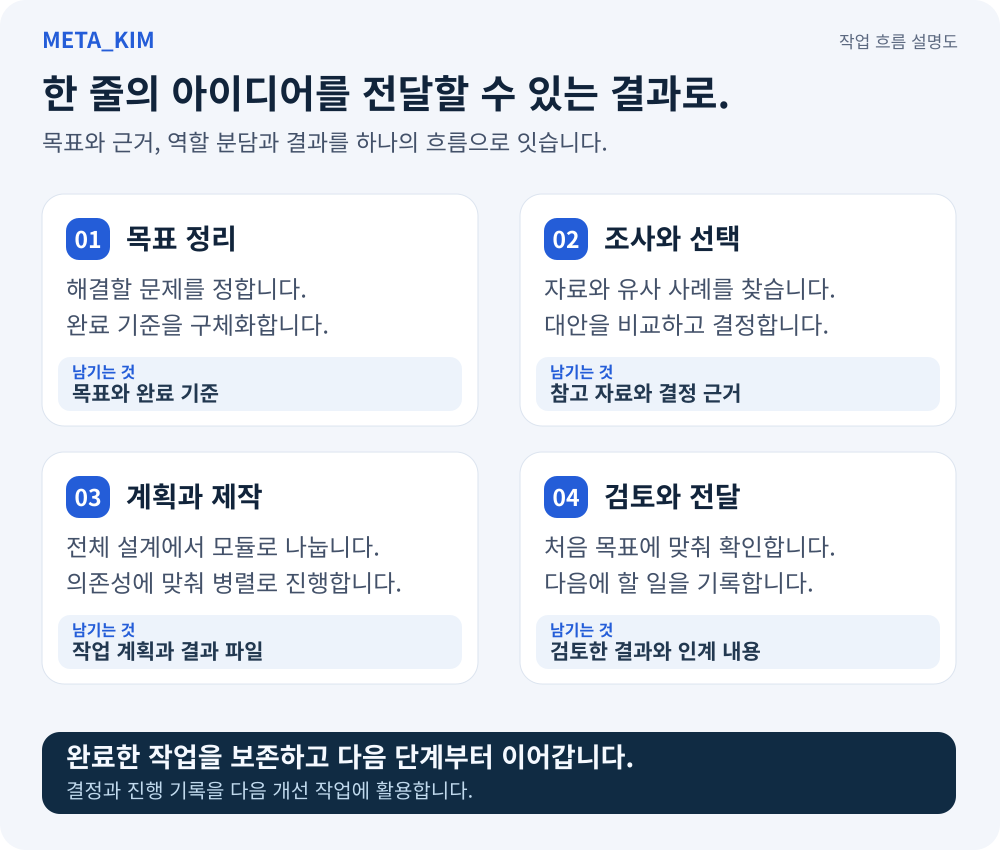

<div align="center">

# 元 · Meta_Kim

**하나의 목표에서 구체적인 계획, 전문적인 협업, 사용할 수 있는 결과까지.**

[English](README.md) · [简体中文](README.zh-CN.md) · [日本語](README.ja-JP.md) · [한국어](README.ko-KR.md)

[](https://github.com/KimYx0207/Meta_Kim/stargazers)
[](LICENSE)

</div>

## 하나의 일을 AI와 끝까지 이어 가기

**Meta_Kim은 평소 쓰는 AI 클라이언트 안에서 목표, 프로젝트 자료, 전문 방법과 작업 기록을 연결합니다.** 어시스턴트가 요청을 이해하고, 방식을 선택하고, 작업을 나누어 결과를 확인하도록 돕습니다. 결정 사항과 완료한 작업은 프로젝트에 남아 다음 세션에도 이어집니다.

### 이럴 때 유용합니다

| 하려는 일 | 작업을 진행하는 방식 |
| --- | --- |
| 새로운 도구나 기능을 만들고 싶다 | 구현 방안을 비교하고 사용자 흐름을 정한 뒤 계획과 구현 작업으로 구체화 |
| 사용 중인 제품을 개선하고 싶다 | 현재 프로젝트를 읽고 관련 사용자 흐름과 코드를 찾아 필요한 부분을 수정하고 확인 |
| 여러 전문 분야가 필요하거나 여러 번에 나누어 작업해야 한다 | 각 작업에 맞는 방법과 자료를 전달하고 의존 관계를 정리해 저장된 결과부터 재개 |

원하는 결과를 평소 쓰는 말로 설명하면 Meta_Kim이 그에 맞춰 작업을 구성합니다. **[Kim Service](https://github.com/KimYx0207/Kim_Service)는 구체적인 실행에 필요한 전문 방법을 제공합니다.** 클라이언트에 이미 있는 다른 기능이나 도구와 함께 사용할 수 있습니다.

## 어떤 결과물을 받게 되나요

행사 신청 도구를 만든다면 다음과 같이 시작할 수 있습니다.

> “휴대폰에서 쓸 수 있는 행사 신청 도구를 만들어 줘. 먼저 방식을 함께 정하고, 신청과 참가자 목록 내보내기를 구현한 뒤 사용 방법을 직접 보여 줘.”

범위를 정하면 요청을 구체적인 결과물로 연결합니다. 이 예에서는 다음과 같이 구성할 수 있습니다.

| 진행할 일 | 확인할 결과물 |
| --- | --- |
| 방식 선택 | 추천 방안, 사용자 흐름, 관련 자료와 선택 이유 |
| 제품 계획 | 하나의 요구 사항 문서: 시스템·기술 선택부터 모듈·인터페이스·인수 기준까지 |
| 사용 흐름 구현 | 신청, 참가자 관리와 내보내기 작업 및 관련 소스와 자료 |
| 결과 확인 | 신청과 내보내기 시연, 검사 기록, 수정이 필요한 구체적인 항목 |
| 다음 작업으로 연결 | 완료한 결과물, 결정 사항, 남은 작업과 다음 행동 |

작은 수정부터 새로운 제품 개발까지, 실제로 필요한 작업에 맞춰 계획을 세웁니다.

## 작업이 진행되는 과정



1. **원하는 결과를 파악합니다.** 기존 프로젝트를 읽고 무엇을 만들지에 영향을 주는 핵심 질문을 확인합니다.
2. **적합한 방식을 찾습니다.** 중요한 미확인 사항을 조사하고 유효한 방안을 비교해 추천 이유를 설명합니다.
3. **바로 시작할 수 있는 계획을 만듭니다.** 작업별 입력, 담당자, 의존 관계와 완료 기준을 정합니다.
4. **작업을 나누고 조율합니다.** 각 작업에 필요한 방법과 자료를 전달하고 준비된 독립 작업을 함께 진행합니다.
5. **검토하고 사용해 보며 개선합니다.** 목표에 맞춰 결과를 확인하고 피드백을 반영한 뒤 유용한 결정과 결과를 다음 개선에 남깁니다.

**Live 작업 보드**는 작업, 담당자, 의존 관계, 결과물과 검사 결과를 한곳에서 보여 줍니다. 중단한 뒤에는 저장된 기록에서 이어 갈 수 있습니다. 한 작업의 방식을 바꿔야 할 때도 다음 행동을 기록하고 독립 작업은 계속 진행합니다.

<details>
<summary>Live 데모 화면 보기(중국어)</summary>


*중국어 인터페이스에 데모용 작업 데이터를 표시한 화면입니다.*

</details>

## 첫 프로젝트 시작하기

**Node.js 22.13.0+**와 설정된 AI 클라이언트가 필요합니다. 현재 버전: **[v3.10.1](https://github.com/KimYx0207/Meta_Kim/releases/tag/v3.10.1)**.

### 1. Meta_Kim 설치

```bash
git clone https://github.com/KimYx0207/Meta_Kim.git
cd Meta_Kim
npm install
node setup.mjs
```

안내에 따라 클라이언트와 설치 범위를 선택합니다. 전역 설치는 여러 프로젝트에서 기능을 재사용할 때, 프로젝트 설치는 전용 설정이 필요할 때 적합합니다. 기존 사용자 설정은 병합됩니다. [설치 옵션](docs/technical-notes.ko-KR.md#설치-옵션).

### 2. 프로젝트를 열고 원하는 결과 설명

설정한 클라이언트에서 대상 프로젝트를 열고 구체적으로 요청합니다.

> “이 프로젝트의 회원가입 흐름을 확인하고 휴대폰에서 입력하기 편하게 바꿔 줘. 현재 데이터 필드는 유지하고, 변경한 흐름과 검사 결과를 보여 줘.”

어시스턴트는 기존 프로젝트 자료부터 확인합니다. 제품의 방향에 큰 영향을 주는 선택은 사용자가 결정하고, 일상적인 구현 판단은 작업 팀이 처리합니다.

### 3. 진행 상황을 확인하고 결과물 사용

현재 작업의 Live 링크를 엽니다. Meta_Kim을 내려받은 디렉터리에서 대상 프로젝트의 Live를 시작할 수도 있습니다.

```bash
node bin/meta-kim.mjs live --project-root "/path/to/your-project"
```

예시 경로를 자신의 프로젝트 디렉터리로 바꿔 주세요. 결과물과 검사 기록을 확인한 뒤 다음에 바꿀 부분을 알려 줍니다.

### 기존 설치 업데이트

Meta_Kim을 내려받은 디렉터리에서 실행합니다.

```bash
git pull --ff-only
node setup.mjs --update
node setup.mjs --check
```

## 사용할 클라이언트 선택

평소 작업하는 클라이언트를 선택하세요. 각 연동은 해당 클라이언트의 설정과 확장 형식을 사용합니다.

| 클라이언트 | 연동 내용과 시작 위치 |
| --- | --- |
| **Codex · Claude Code** | Agent, Skill, 지침과 Hook. 설치할 때 해당 클라이언트 선택 |
| **Cursor** | Agent, Skill, 프로젝트 규칙과 Hook. 설치할 때 Cursor 선택 |
| **OpenClaw** | Skill, Agent 작업 공간과 설정 템플릿. 설치할 때 OpenClaw 선택 |
| **Gemini CLI** | Agent, 공유 Skill, 설정과 Hook. [클라이언트 안내](canonical/skills/meta-theory/references/runtime-gemini.md) |
| **ZCode** | Agent, Skill, MCP와 사용자 수준 Hook. [클라이언트 안내](canonical/skills/meta-theory/references/runtime-zcode.md) |
| **DeepSeek Harness(DSH)** | Beta 연동: 네이티브 Skill, 전용 설정 또는 프로젝트 설치, MCP. [클라이언트 안내](docs/technical-notes.ko-KR.md#deepseek-harness) |
| **Qoder · Trae** | Beta 호환 어댑터. [연동 상세](config/runtime-compatibility-catalog.json) |

[호환성 목록](config/runtime-compatibility-catalog.json) · [설치 및 기술 안내](docs/technical-notes.ko-KR.md). 의존 프로젝트의 지원 클라이언트는 해당 상위 프로젝트가 관리합니다.

## 다음에 필요한 문서 찾기

| 알아보고 싶은 내용 | 문서 |
| --- | --- |
| 설치 범위, Hook 활성화와 선택형 서비스 설정 | [설치 및 기술 안내](docs/technical-notes.ko-KR.md) |
| 조사와 요구 사항을 실제 작업으로 전달하는 과정 | [의도에서 결과까지](canonical/skills/meta-theory/references/intent-to-delivery.md) |
| Live 사용과 화면 확장 | [Live SDK](docs/live-sdk.md) |
| 프로젝트 구조와 개발 참여 | [구조](docs/harness-architecture.md) · [개발 안내](AGENTS.md) |
| 버전별 변경 내용 | [변경 기록](CHANGELOG.ko-KR.md) |

## 연락처


GitHub <a href="https://github.com/KimYx0207">KimYx0207</a> |
X <a href="https://x.com/KimYx0207">@KimYx0207</a> |
공식 사이트 <a href="https://www.aiking.dev/">aiking.dev</a> |
위챗 공식 계정: **라오진과 함께하는 AI**

Feishu 지식 베이스:
<a href="https://my.feishu.cn/wiki/OhQ8wqntFihcI1kWVDlcNdpznFf">지속 업데이트 입구</a>

### 커피 한 잔

Meta_Kim이 도움이 되었다면 후원으로 응원해 주세요.

<table align="center">
<tr><th>위챗 결제</th><th>알리페이</th></tr>
<tr>
<td align="center"></td>
<td align="center"></td>
</tr>
</table>

### 방법론 근거

Meta_Kim의 방법론은 본 프로젝트 메인테이너(KimYx0207)가 작성한 "메타 기반 의도 증폭(intent amplification)" 연구에 기반합니다:

- 논문: <https://zenodo.org/records/18957649>
- DOI: `10.5281/zenodo.18957649`

---

## License

[Apache License 2.0](LICENSE). Commercial use is permitted. Retain [LICENSE](LICENSE) and [NOTICE](NOTICE) when redistributing the project or substantial portions. Third-party components retain their own licenses; attribution does not imply endorsement.

**Meta_Kim by KimYx0207 — https://github.com/KimYx0207/Meta_Kim**
