<div align="center">

# 元 · Meta_Kim

**원하는 결과를 말하세요. 조사와 설계, 협업, 검수, 다음 개선까지 이어 갑니다.**

[English](README.md) · [简体中文](README.zh-CN.md) · [日本語](README.ja-JP.md) · [한국어](README.ko-KR.md)

</div>

<p align="center">
  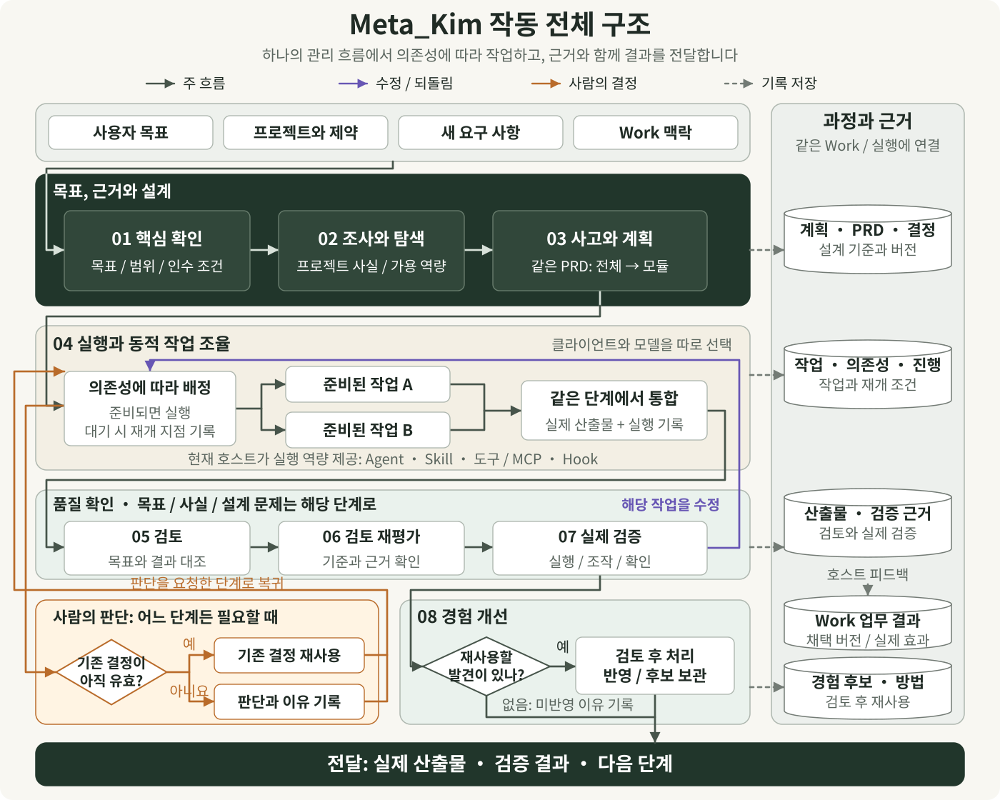
</p>

01–08을 위에서 아래로 읽습니다. 짙은 초록 영역에서 목표와 근거를 정리하고 하나의 PRD에서 시스템과 모듈을 설계합니다. 실행 영역은 현재 호스트가 제공하는 역량을 사용하며, 품질 확인 단계에서 실제 결과를 검증합니다. 주황색은 필요할 때 사람의 판단을 요청하는 경로이며 유효한 기존 결정은 재사용합니다. 보라색은 실행 문제를 해당 작업으로 되돌립니다. 목표·사실·설계 문제는 각각의 담당 단계로 돌아갑니다. 점선은 기록 저장을 뜻하며 Work의 채택과 효과는 호스트가 전달합니다. 경험은 검토 후 방법에 반영하거나 후보로 보관하고, 반영할 필요가 없으면 이유를 남긴 뒤 전달을 마칩니다.

[확대 가능한 원본 그림 열기](docs/images/system-panorama.ko-KR.svg)

## 한 문장으로 요청한 뒤에는 어떤 일이 일어날까요?

> “작은 예약 앱을 만들고 싶어요. 손님은 휴대폰으로 시간을 고르고, 직원은 예약을 관리하게 해 주세요. 두 번 눌러도 예약은 한 건만 생겨야 해요.”

**Meta_Kim은 AI가 이 요청을 실행하고 확인하며 계속 개선할 수 있는 작업으로 바꾸도록 돕습니다.** 평소 쓰는 AI 클라이언트 안에서 문제 이해, 기존 프로젝트와 참고 자료 조사, 경험을 바꾸는 선택지 비교, 시스템 개요, 모듈 상세 설계, 작업 협업과 결과 확인을 연결합니다.

받아야 할 결과는 구체적입니다. 이 예라면 작동하는 예약 화면, 관리 화면, 관련 소스, 실행 방법, 정상 예약과 중복 제출, 마감된 시간대의 검사 결과입니다. 아래에서는 예약 앱을 하나의 사례로 삼아 각 단계가 어떻게 이어지는지 설명합니다.

AI 클라이언트에서 프로젝트를 열고 요청, 기존 자료와 제약을 전달하세요. **Live는 계속되는 프로젝트 작업의 통합 작업 공간입니다.** 여덟 단계, 시스템 PRD, 모듈 상세, 채택한 버전, 수정 의견과 처리 기록을 한곳에서 확인합니다. 실제 실행은 현재 AI 호스트가 이어갑니다.

<p align="center">
  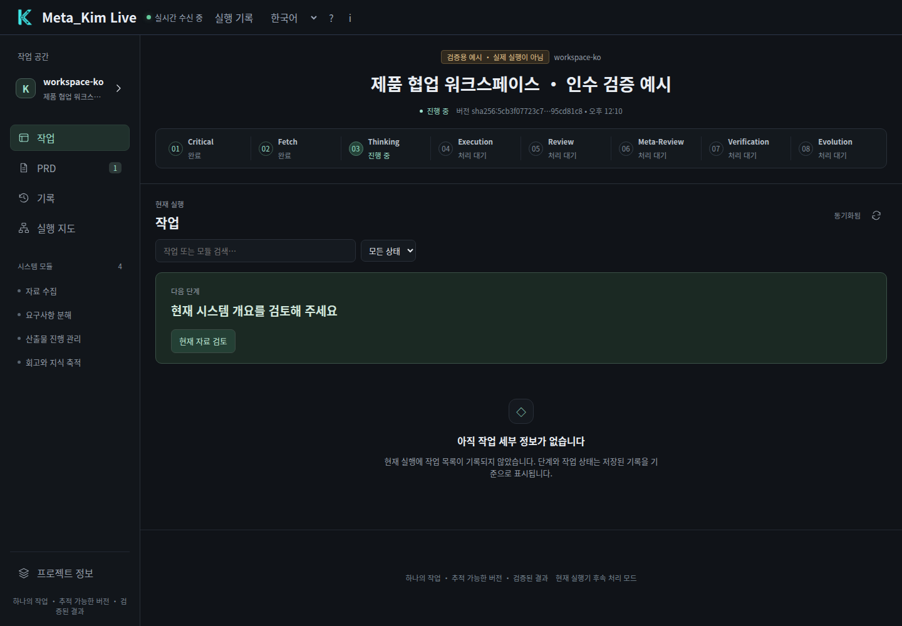
</p>

*인수 테스트용 예시라고 명시된 실제 Live 작업 공간입니다. 브라우저는 실제 Hub, 검토 조작과 현재 호스트 CLI를 사용하며 모델을 호출하지 않았습니다. PRD에서 시스템 개요와 각 모듈의 상세 설계를 읽을 수 있습니다.*

## Live에서 읽고 검토하고 다음으로 이어가기

작업 화면에서 현재 단계와 다음 행동을 확인하고, PRD에서 시스템 개요와 모듈 상세를 전환합니다. 현재 파일 버전에 대해 채택, 수정 요청 또는 반려를 기록할 수 있습니다. 모듈을 채택하면 호스트가 다음 작업을 받을 수 있습니다. 기록과 실행 지도에서는 결과와 근거를 확인합니다.

요청 저장, 호스트 접수, 파일 보고, 결과 검증은 각각 다른 상태입니다. 호스트가 실행되지 않으면 대기 상태를 유지합니다. 긴 자료는 원문을 온전히 보관하고 필요한 페이지만 읽습니다. 절차와 실행 범위는 [통합 작업 공간과 호스트 연결](docs/live-workspace.md)을 참고하세요.

## 마인드맵으로 전체 구조부터 보기


**사용자 목표에서 네 갈래를 따라갑니다.** 목표 이해, 설계, 작업과 전달이 목표와 어떻게 연결되는지, 역할은 어떻게 나뉘는지 봅니다. Meta_Kim이 전체를 구성하고 전문 역량이 실제 작업을 맡습니다.

- **목표**: 누가 어떤 상황에서 사용하며 무엇을 얻으려는지, 어떤 조건을 지켜야 하는지 정합니다.
- **설계**: 근거를 조사하고 가능한 방법을 비교하며 중요한 결정을 하나의 요구사항 설계에 기록합니다.
- **작업**: 입력, 담당자, 결과물을 정하고 의존 관계에 따라 순차 작업과 병렬 작업을 구성합니다.
- **품질**: 결과를 검토하고 실제로 검사한 뒤, 문제를 해당 작업으로 돌려보냅니다.
- **연속성과 개선**: 결정, 진행 상황, 결과를 저장해 유효한 성과에서 재개하고 검증된 방법을 다음에 활용합니다.

이 연결에서 가치가 나옵니다. 모듈의 인터페이스가 바뀌면 관련 작업도 함께 검토합니다. 한 갈래가 사용자의 판단을 기다려도 독립적인 작업은 진행할 수 있습니다. 효과가 없었던 방법을 다시 시도하려면 새로운 근거가 필요합니다.

## 첫 번째 PRD: 아이디어를 시스템 구조와 모듈 개요로 만들기

**PRD는 제품 요구사항 문서입니다. 무엇을 만들고, 왜 만들며, 어떤 결과를 잘된 것으로 볼지 설명합니다.** Meta_Kim의 시스템 개요와 모듈 상세는 같은 PRD를 두 차례 구체화한 것입니다. 앞서 내린 결정이 다음 설계로 이어집니다.


**한 번의 생성 과정을 따라가 보세요.** 한 문장의 요청이 현황 확인과 조사, 방안 비교를 거쳐 같은 PRD의 사용자 흐름, 기술과 범위, 모듈 개요, 공통 약속으로 정리됩니다.

### 사용자 흐름을 먼저 살펴보고 시스템을 구성합니다

1. **요청을 관찰 가능한 결과로 바꿉니다.** 누가 예약하고 누가 관리하나요? 시간을 고르면 무엇이 보여야 하나요? 중복 제출은 어떻게 처리하나요? 사용자, 주요 흐름, 제약과 검수 기준을 정합니다.
2. **이미 있는 것을 확인합니다.** 프로젝트 구조, 실제 코드, 기술과 버전, 기존 데이터, 작업 중인 변경을 읽습니다. 잘 작동하는 선택은 이어 갑니다.
3. **결정에 영향을 주는 미지의 부분을 조사합니다.** 기능 구현 가능성은 공식 문서로 확인하고, 예약 경험은 전체 사용자 흐름과 관련 소스로 살펴봅니다. GitHub 프로젝트의 상태 처리, 인터페이스, 복구 방법도 설계 근거가 됩니다.
4. **실질적으로 다른 방법을 비교합니다.** 외부 예약 서비스 이용, 기존 앱 확장, 별도 서비스 개발은 경험, 작업량, 유지 관리와 데이터 소유 방식이 다릅니다. 사용자가 정할 제품 방향에는 이유와 추천을 함께 제시합니다.
5. **선택한 방향을 시스템 개요로 정리합니다.** 기술과 버전, 구조, 모듈별 책임, 인터페이스와 공유 상태, 주요 검수 기준, 추가 근거나 사용자 선택이 필요한 질문을 기록합니다.

예약 앱의 개요에는 이런 내용이 들어갈 수 있습니다.

- **사용자 경로**: 예약 가능한 시간을 확인하고 정보를 입력해 예약을 확정합니다. 직원은 예약을 확인하고 변경합니다.
- **시스템 구조**: 화면 계층은 페이지와 상태를 표시하고, 애플리케이션 계층은 예약 규칙을 처리하며, 데이터 계층은 시간대와 예약을 저장합니다.
- **모듈 목록**: 시간대 조회, 예약 생성, 직원 관리 화면의 목적과 담당 범위를 먼저 정합니다.
- **공통 약속**: 잔여 정원을 누가 관리하는지, 예약 상태에는 무엇이 있는지, 제출과 취소 인터페이스가 어떻게 이어지는지 정합니다.
- **이번 검수와 미결정**: 휴대폰에서 예약을 완료하고 중복 제출 결과가 일치해야 합니다. 문자 알림을 첫 배포에 포함할지는 명확한 제품 선택으로 남깁니다.

예를 들어 ‘두 번 눌러도 예약은 한 건’이라는 요청은 검수 기준이 되어 ‘예약 생성’ 모듈에 연결됩니다. 같은 제출을 누가 식별하고 잔여 정원을 누가 관리하는지는 인터페이스와 공유 데이터의 약속으로 정합니다. 사용자 흐름과 이 책임 구분에서 모듈 경계가 나옵니다.

**전체 구성이 성립하는지 확인한 뒤 구현 상세로 들어갑니다.** 탐색 중에는 미결정을 남길 수 있습니다. 모듈을 실행하기 전에는 필요한 결정과 인터페이스를 확정합니다. 작은 수정은 합의한 설계를 재사용하고 영향받는 부분만 구체화합니다.

<p align="center">
  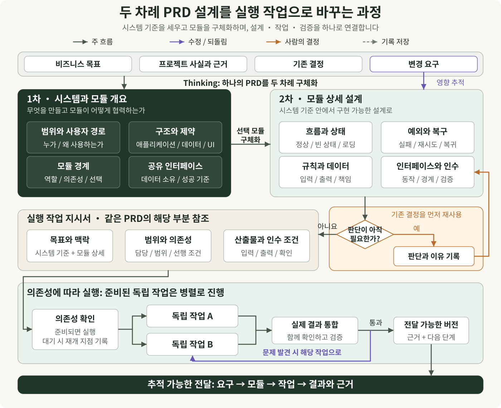
</p>

두 차례 설계를 왼쪽에서 오른쪽으로 읽은 뒤 화살표를 따라 아래의 작업 지시서와 실행으로 이동합니다. 1차는 범위, 구조, 모듈 경계와 공유 인터페이스를 정합니다. 2차는 같은 시스템 기준 안에서 흐름, 상태, 예외, 데이터와 인수 조건을 구체화합니다. 작업 지시서는 해당 PRD를 참조하며 맥락, 범위, 의존성과 산출물 요구 사항을 전달합니다. 판단 분기는 한 모듈의 사례입니다. 기존 결정을 먼저 재사용하고 필요한 사람의 판단과 이유를 기록한 뒤 해당 설계로 돌아갑니다. 영향을 받는 의존성만 기다리고, 다른 준비된 독립 작업은 호스트 역량에 따라 병렬 실행할 수 있습니다. 요구 변경은 영향을 받는 모듈과 설계 기준을 찾아 연결된 작업을 갱신하며, 검증 실패는 해당 작업으로 돌아갑니다.

[확대 가능한 원본 그림 열기](docs/images/prd-to-tasks.ko-KR.svg)

<p align="center">
  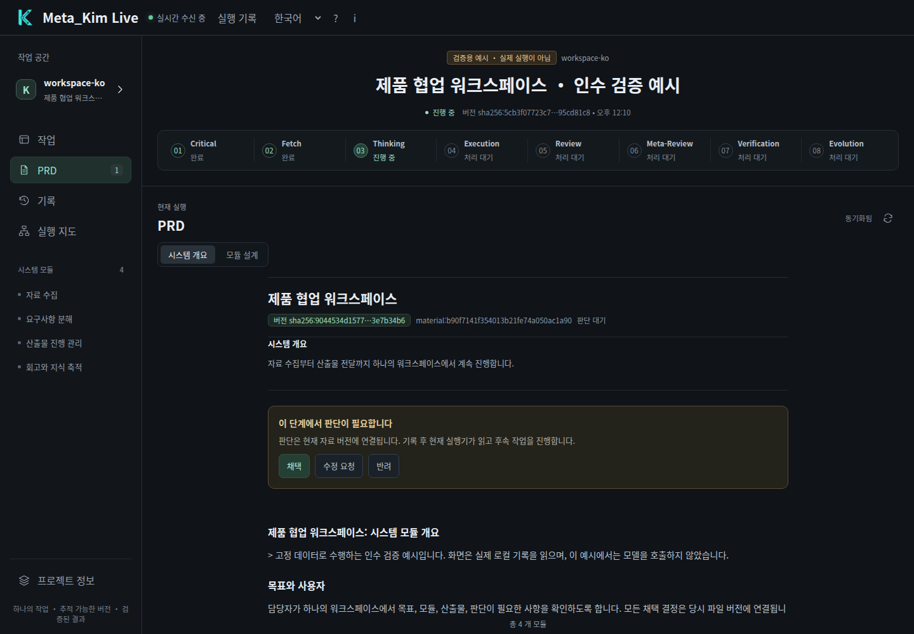
</p>

*첫 번째 내용은 Live의 「PRD → 시스템 개요」에 표시됩니다. 실제 자료를 읽고 현재 버전에 대한 판단을 기록합니다. 위와 동일하게 인수 테스트용으로 표시한 예시입니다.*

## 두 번째 PRD: 각 모듈을 구현 가능한 수준으로 펼치기

방향이 정해지면 AI는 각 모듈의 상세 설계를 보완하고 같은 PRD에 통합합니다. 모듈은 앞서 정한 개념, 상태와 인터페이스를 계속 공유합니다.


**한 모듈이 구체화되는 과정을 봅니다.** 앞선 시스템 기준을 유지하고 ‘예약 생성’의 행동, 상태, 규칙, 연동과 검수 내용을 채운 뒤 아래 화면·API·검증 작업에 전달합니다.

‘예약 생성’ 모듈이라면 다음과 같은 실제 질문에 답합니다.

- **사용자가 어떻게 완료하나요?** 시간을 고르고 정보를 입력해 확정한 다음 결과를 봅니다. 수정이나 취소 후 어디에서 이어 가는지도 정합니다.
- **각 상태에는 무엇을 보여 주나요?** 로딩 안내, 예약 가능한 시간 없음, 제출 오류와 재시도, 성공 상태를 설계합니다. 휴대폰 화면, 키보드 조작과 접근성도 포함합니다.
- **업무 규칙은 무엇인가요?** 시간대별 정원, 반복 클릭, 제출하는 사이 정원이 찬 경우, 취소 후 잔여 정원 회복을 다룹니다.
- **다른 모듈과 어떻게 연결되나요?** 입력 필드, 반환 결과, 상태 관리 담당자와 권한을 정합니다. 트랜잭션, 재시도, 데이터 이전은 실제 프로젝트에 맞게 구체화합니다.
- **어떻게 올바른지 확인하나요?** 각 검수 기준에 작업과 검사 방법을 대응시켜 정상 경로와 필요한 실패·복구 상황을 확인합니다.

상세 설계는 각 요구사항을 구현과 검사에도 연결합니다. 예약 앱의 작업 예시는 다음과 같습니다.

| 요구사항 | 설계와 구현 작업 | 검사 방법 |
| --- | --- | --- |
| 반복해서 눌러도 예약은 한 건 | 화면은 제출 중 상태를 처리하고 API는 같은 제출을 식별해 같은 예약 결과를 반환 | 연속 클릭과 같은 요청 재전송 후 예약 기록이 한 건만 늘었는지 확인 |
| 마지막 자리를 초과해 예약하지 않음 | 데이터와 API가 정원 갱신의 일관성을 유지하고 화면은 마감 결과를 표시 | 두 요청을 동시에 보내 성공 건수가 잔여 정원을 넘지 않는지 확인 |
| 취소하면 잔여 정원 복구 | 취소 API가 예약 상태와 정원을 갱신하고 화면은 결과를 표시 | 취소 후 시간대를 다시 조회해 예약 상태와 잔여 정원이 일치하는지 확인 |

각 실행자에게는 **현재 시스템 기준, 자신이 맡은 모듈의 완전한 설계, 관련 결정과 인터페이스, 결과물과 검수 기준**을 전달합니다. 프런트엔드와 백엔드는 공통 필드와 상태를 맞춘 뒤 각자 범위에서 작업합니다.

나중에 취소 시 정원을 돌려주는 규칙이 바뀌면 관련 결정, 모듈과 의존 관계를 따라 영향받는 작업을 찾습니다. 유효한 결과는 보존하고 실제로 영향을 받는 부분을 변경합니다.

<p align="center">
  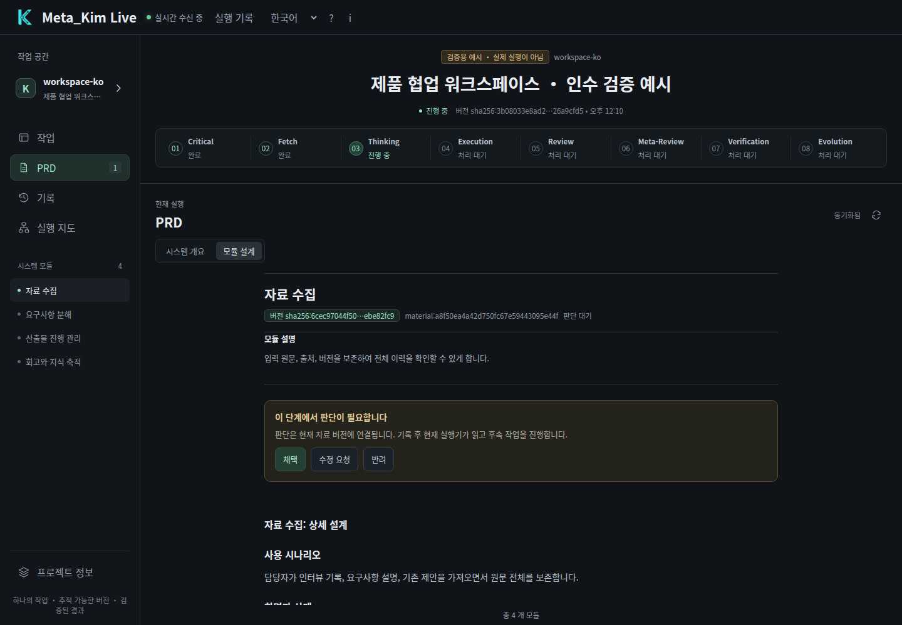
</p>

*두 번째 내용은 「PRD → 모듈 상세」에 표시됩니다. 실제 개요 채택과 현재 호스트의 파일 보고 후에 촬영했습니다. 모듈을 채택하면 호스트가 다음 모듈을 이어갈 수 있습니다. 본문은 인수 테스트용 예시입니다.*

## 여덟 단계: 무엇을 남기고 다음 단계에 무엇을 넘기나요?


**01에서 08까지 강조 표시를 따라갑니다.** 각 카드 아래에는 해당 단계가 남길 결과가 있습니다. 다음 단계는 그 결과를 받아 사용하고, 문제가 생기면 해결할 수 있는 단계로 돌아갑니다.

| 단계 | 받는 내용과 하는 일 | 다음에 전달할 내용 |
| --- | --- | --- |
| **01 Critical · 핵심 확인** | 요청과 프로젝트 현황에서 사용자, 목표, 범위, 중요한 제약을 확인 | 명확한 목표, 성공 기준, 판단에 필요한 미해결 질문 |
| **02 Fetch · 조사와 역량 탐색** | 질문에 맞춰 코드, 참고 자료와 사용 가능한 전문 역량을 조사 | 출처가 있는 발견, 후보 방법, 부족한 사실 |
| **03 Thinking · 판단과 계획** | 목표와 근거로 경로를 비교하고 두 PRD 관점과 작업 의존 관계를 구성 | 설계 기준, 담당자, 방법, 입력·결과물·검수 계획 |
| **04 Execution · 실행** | 현재 설계에 따라 범위가 정해진 작업을 수행 | 확인 가능한 실제 결과물, 실행 기록, 해당 단계의 통합 결과 |
| **05 Review · 검토** | 결과를 목표와 비교하고 앞선 이해, 조사와 설계도 점검 | 구체적인 문제, 수정 요구, 검토 결론 |
| **06 Meta-Review · 검토 재점검** | 검토 기준, 누락, 결론을 뒷받침하는 근거를 확인 | 검토 판단의 재점검 결과와 추가 확인할 문제 |
| **07 Verification · 실제 검증** | 현재 결과를 테스트·조작·대조. 예약 사례는 성공, 중복 제출, 실패 복구를 확인 | 현재 버전의 근거, 결과와 남은 문제 |
| **08 Evolution · 경험 개선** | 실제 결과에서 재사용할 발견을 고르고 개선 후보를 평가 | 검토를 거친 방법의 업데이트 또는 반영이 필요 없는 이유 |

이것이 실행의 기본 뼈대입니다. **단계는 정해진 순서로 이어지고, 같은 단계의 독립적인 작업은 병렬로 진행한 뒤 통합해 다음 단계로 넘어갑니다.** 목표를 잘못 이해했으면 핵심 확인으로, 사실이 부족하면 조사로, 설계가 맞지 않으면 계획으로, 검증이 실패하면 관련 작업으로 돌아갑니다. 준비는 실제 작업에 필요한 깊이로 하고 검토와 재점검은 위험에 맞춥니다. 재사용할 발견이 없으면 이번에는 방법을 갱신할 필요가 없다고 기록합니다.

## 동적 작업 편성: 의존 관계와 현재 상태로 지금 시작할 일을 고르기

**동적 편성은 어떤 작업이 지금 진행 가능한지 실행 중에도 계속 판단하는 것입니다.** 선행 결과, 파일 범위, 자원, 권한과 현재 클라이언트가 제공하는 병렬 실행 능력을 함께 봅니다.


**위쪽 공통 규약에서 시작해 양쪽 갈래를 함께 봅니다.** 왼쪽 화면 작업이 선택을 기다리는 동안 오른쪽 API 작업은 계속됩니다. 화면 작업이 재개되면 두 결과를 아래에서 통합합니다. 동적 편성은 이런 준비 상태의 변화를 처리합니다.

예약 앱은 다음과 같이 진행할 수 있습니다.

1. **공통 인터페이스를 먼저 정합니다.** 제출 필드, 성공·실패 응답을 프런트엔드와 백엔드의 공통 입력으로 삼습니다.
2. **독립적인 작업을 함께 시작합니다.** 화면과 예약 인터페이스의 작업 범위가 분리되고 클라이언트에 실행 능력이 있으면 동시에 진행할 수 있습니다. 같은 파일을 바꾸는 작업은 순서를 조정합니다.
3. **선행 결과가 끝나면 다음 작업을 시작합니다.** 화면을 실제 인터페이스와 연결하려면 양쪽 결과가 준비되어야 합니다. 새로 준비된 작업을 계속 채우고 같은 단계의 결과를 통합 담당자에게 넘깁니다.
4. **한 갈래가 기다려도 독립적인 작업은 이어 갑니다.** 화면 방안에 사용자의 선택이 필요하면 해당 화면 작업은 기다립니다. 공통 필드와 인터페이스가 확정된 백엔드 작업은 계속할 수 있습니다.
5. **문제를 관련 작업으로 돌려보냅니다.** 한 갈래가 실패해도 독립적으로 성공한 결과는 유지합니다. 원인을 살피고 근거가 있는 수정을 정한 뒤 해당 작업을 재개합니다.

같은 근거로 효과 없는 시도가 반복되면 해당 작업을 잠시 멈추고 방법이나 사실을 보완합니다. 무엇이 기다리는지, 이유가 무엇인지, 어떤 조건이 갖춰져야 재개할 수 있는지 알 수 있습니다.

## 여백과 리듬: 지금 필요한 판단에 집중할 시간을 만들기

**의도적인 여백은 현재 결정과 사용자의 주의를 위한 공간입니다.** 정보를 언제 보여 주고, 짧게 말하고, 기다릴지 조절합니다. PRD의 미결정은 정보나 결정이 아직 부족하다는 뜻으로, 별도로 기록합니다.


**위쪽의 새 정보부터 봅니다.** 이미 결정됐는지, 사실이 부족한지, 사용자가 선택할 준비가 됐는지, 긴급한지를 판단해 다음 카드를 고릅니다. Pause는 이해할 시간을 남기고 재개 조건을 기록합니다.

시스템 계획을 읽고 서비스 제공자를 비교한 다음 중요한 변경까지 판단했다면, 다음 메시지는 ‘무엇을 정했고 어떤 결정이 남았는지’를 먼저 알려 줘야 합니다. 새로 주의를 많이 쓰는 질문은 미루고 긴 자료는 파일에 남길 수 있습니다. 기본 리듬 규칙은 주의 부담이 큰 카드가 세 번 연속되면 Pause를 배치합니다. 재개할 때는 현재 상태와 다음 행동을 다시 확인합니다.

일시 정지에는 이유, 미완료 작업과 재개 조건을 남깁니다. 해당 화면 선택에만 관련된 경우라면 그 판단에 의존하지 않는 승인된 작업은 이어 갈 수 있습니다. 사용자가 프로젝트 전체를 멈추라고 요청하면 그 지시에 따릅니다.

### 열 가지 행동 카드로 상황 변화에 대응하기

‘카드를 낸다’는 말은 현재 상황에 맞는 행동을 고른다는 뜻입니다. 여덟 단계의 기본 흐름 안에서 **발동 조건에 맞는 카드를 고르고 이미 충족한 카드는 건너뜁니다.**

| 행동 카드 | 나타나는 조건 | 예약 사례 |
| --- | --- | --- |
| **Clarify · 확인** | 모르는 답이 방향을 바꾸는 경우 | 직원이 고객 대신 취소할 수 있는지 확인 |
| **Shrink scope · 범위 축소** | 넓은 범위가 이번 전달을 어렵게 하는 경우 | 기본 예약 흐름을 완성하고 확장은 다음 반복에 배치 |
| **Options · 선택지** | 경험, 비용, 유지 관리가 다른 실행 가능한 방안이 있는 경우 | 외부 서비스 이용과 기존 앱 내 구현을 비교 |
| **Execute · 실행** | 설계, 입력, 실행 조건이 준비된 경우 | 예약 화면과 API 구현 |
| **Verify · 검증** | 확인할 결과물이 있는 경우 | 예약, 중복 제출, 취소를 실제로 검사 |
| **Fix · 수정** | 검사에서 구체적인 문제가 발견된 경우 | 취소 후 잔여 정원이 돌아오지 않는 문제 수정 |
| **Rollback · 복구** | 영향이 확산돼 안정된 상태로 돌아가야 하는 경우 | 복구 계획에 따라 해당 변경을 되돌림 |
| **Risk · 위험 대응** | 권한, 공유 데이터 등에 중요한 위험이 생긴 경우 | 직원이 다른 매장 예약에 접근하는 문제를 우선 처리 |
| **Nudge · 가벼운 제안** | 위험이 낮은 다음 단계에서 잠깐 멈춘 경우 | 성공하는 예약 사례 하나부터 확인하자고 제안 |
| **Pause · 여백** | 부담이 큰 판단이나 정보가 연속되는 경우 | 짧은 상태와 재개 지점을 남기고 이해할 시간을 마련 |

같은 카드라도 처리가 달라집니다. 지금 필요하면 실행하고, 이미 충족했으면 건너뛰며, 개입할 가치가 작으면 알림을 줄이고, 선행 조건이 부족하면 미룹니다. 긴급한 문제는 먼저 삽입하고 더 높은 판단이 필요하면 담당자에게 올립니다. **이미 답한 내용은 기록합니다. 내부 Agent 배분은 시스템이 처리하고, 사용자는 제품 결과를 바꾸는 선택에 집중합니다.**

## 전체를 관리하는 아홉 역할과 실제 작업의 전문 역량

협업의 진입점은 **meta-warden**입니다. 아홉 역할에는 각각 분명한 책임이 있습니다.

- **meta-warden**: 방향을 조율하고 충돌을 해결하며 최종 결론을 모읍니다.
- **meta-conductor**: 단계, 작업 의존 관계, 순차·병렬 실행과 대화 리듬을 구성합니다.
- **meta-genesis**: 필요한 Agent의 정체성, 책임과 프롬프트 구조를 설계합니다.
- **meta-artisan**: 작업에 맞는 Skill, MCP와 도구를 조합합니다.
- **meta-sentinel**: 권한, 위험, Hook과 복구 범위를 다룹니다.
- **meta-librarian**: 기억, 문맥과 중단 후 연속성을 관리합니다.
- **meta-prism**: 품질을 검토하고 방향 이탈을 찾아 구체적인 수정을 요청합니다.
- **meta-scout**: 외부 역량과 참고 자료를 찾고 평가합니다.
- **meta-chrysalis**: 개선 신호를 모으고 승인된 경험 반영을 조율합니다.

각 역할은 작업에 맞게 참여합니다. **해야 할 일을 정하고 적절한 역량을 찾은 뒤 담당자, 방법, 도구와 검수 기준을 하나의 작업 지시로 묶습니다.** 예약 앱에서는 다음과 같이 연결됩니다.

| 구성 요소 | 정하는 내용 | 예약 사례 |
| --- | --- | --- |
| **Agent · 실행자** | 누가 어떤 범위에서 결과를 만드는지 | 화면과 API 담당자에게 수정 범위와 결과물을 지정 |
| **Skill · 작업 방법** | 절차와 품질 기준 | 화면 설계에서 휴대폰 배치, 상태 피드백, 사용성을 다룸 |
| **전문 자료와 예시** | 이번 작업에 필요한 지식 | 해당하는 상태 설계나 API 예시를 각 작업에 전달 |
| **도구와 MCP** | 프로젝트나 서비스를 조작하는 방법 | 코드를 읽고 파일을 수정하며 화면과 실제 결과를 확인 |
| **Command · 재사용할 실행 입구** | 반복 작업을 호출하는 방법 | 기존 검사 절차를 작업에서 호출할 명령으로 제공 |
| **Hook · 정해진 시점의 검사** | 언제 어떤 핵심 조건을 확인하는지 | 조작 요청 시 관련 역량, 작업 범위와 권한 경계를 확인 |

먼저 프로젝트와 클라이언트의 기존 역량을 찾고 연결된 Kim Service 같은 출처를 검토합니다. 적합한 역량은 재사용하고 필요한 부분은 프로젝트에 맞게 조정하며, 반복해서 쓸 부족분이 남으면 새로 만듭니다. 현재 설계, 선택한 자료, 검수 기준을 작업 지시와 함께 전달하고 통합 담당자가 결과를 모읍니다.

## 중단한 작업을 이어서 하고 다음 작업도 개선하기


**이번 작업 → 기록 저장 → 다음 대화의 재개를 따라갑니다.** 아래 두 갈래는 실제 결과를 근거로 남은 일을 계속하고, 어떤 경험을 남길 가치가 있는지 평가합니다.

Meta_Kim은 계획, 발견, 진행 상황, 결정, 결과물과 검사 기록을 프로젝트에 저장합니다. 다음 대화에서는 현재 파일과 기록을 비교해 완료된 일, 기다리는 선택, 결과 확인이 필요한 조작을 정리하고 유효한 지점에서 다시 시작합니다.

이렇게 말할 수 있습니다.

> “예약 앱을 계속해 줘. 완성된 예약 흐름은 유지하고 지난번 남은 작업을 읽어서, 취소 안내와 잔여 정원 복구를 마무리한 뒤 함께 검수해 줘.”

이전 조작의 성공 여부가 불분명하면 현재 결과를 확인한 뒤 다시 실행할지 결정합니다. 프로젝트 관계도는 관련 모듈을 찾는 데 도움을 주고 기억과 실행 기록은 이전 결정을 설명합니다. 실제 소스와 현재 결과물도 함께 확인합니다.

경험을 재사용할 때는 관찰한 문제와 개선안을 기록하고 결과가 나아지는지, 다른 상황에 영향을 주는지 평가한 뒤 필요한 검토를 거쳐 방법이나 구성 요소를 업데이트합니다. **구체적인 사례와 비교, 복구 경로가 있어야 다음 작업에서 검증한 경험을 활용할 수 있습니다.**

## 회사의 한 업무를 여러 실행에 연결하기


**장기간 이어지는 업무(Work)는 회사의 업무 시스템이 보관하고, Meta_Kim은 각 실행을 그 업무에 연결합니다.** 지금은 1인 회사여도, 나중에 구성원이 늘어나도 같은 선택적 인터페이스를 사용합니다. 호스트가 회사, 업무, 맥락 버전, 접근 범위, 출처 참조를 제공하면 현재 작업 지시와 결과에 연결됩니다. 맥락이 바뀌면 새 실행을 시작하며 이전 기록도 추적할 수 있습니다.

결과 기록은 네 가지 상태를 구분합니다.

| 기록 | 담는 내용 |
| --- | --- |
| **산출 produced** | 실제 실행이 반환한 결과. 계획이나 수신 확인은 산출로 계산하지 않습니다 |
| **검증 verified** | 기존의 독립적인 결과 검토와 증거. 검증하지 않았으면 미확인 상태입니다 |
| **채택 adopted** | 호스트가 기록한 정확한 채택 버전, 원래 결정의 참조, 이유. 이유가 없으면 미확인으로 남깁니다 |
| **효과 effect** | 이후 업무 효과에 대한 관찰과 출처. 검증 통과만으로 효과를 단정하지 않습니다 |

이번 실행에서 v2를 만들더라도 회사는 이전에 승인한 v1을 계속 사용할 수 있습니다. 두 버전을 구분하여 기록하고 v1의 재승인을 요구하지 않습니다. 실행 후 호스트가 채택, 효과, 지식 재사용 관찰을 추가해도 원래 실행 파일은 유지되고 worker를 다시 실행하지 않습니다. 지식은 그대로 재사용, 수정 후 재사용, 적용 불가로 기록합니다. 검증 실패, 미채택, 채택 피드백은 기존의 검토 절차를 갖춘 지식 수명 주기에 전달할 후보로 남습니다.

일반 API의 선택 항목 `workContext` 또는 CLI `--work-context-input`으로 연결합니다. 이후 관찰은 `workOutcome` / `--work-outcome-input`을 사용하며 원래 `runId`와 현재 업무 맥락에 연결합니다. 필드와 사용법은 [기존 거버넌스 참고](canonical/skills/meta-theory/references/dev-governance.md#optional-company-work-context)에 있습니다. 입력하지 않으면 기존 흐름을 유지합니다. 업무 기록과 권한은 호스트가 관리하며, 참조 자체가 접근 권한을 부여하거나 회사 지식을 자동 공개하지 않습니다.

<a id="installation"></a>

## 내 프로젝트에서 시작하기

**Node.js 22.13.0+**, Git, 모델 연결을 설정한 AI 클라이언트가 필요합니다. 현재 공개 버전은 **[v3.12.1](https://github.com/KimYx0207/Meta_Kim/releases/tag/v3.12.1)** 입니다.

### 1. Meta_Kim 설치하기

```bash
git clone https://github.com/KimYx0207/Meta_Kim.git
cd Meta_Kim
npm install
node setup.mjs
```

사용할 클라이언트와 설치 범위를 선택하세요. **전역 설치**는 계정에서 재사용할 기능을 설치하고, **프로젝트 설치**는 선택한 프로젝트 디렉터리에 맞춰 설치합니다. 업데이트에 사용할 수 있도록 Meta_Kim 체크아웃을 보관하세요. 실제 작업 프로젝트는 다른 디렉터리에 있어도 됩니다.

예를 들어 한 프로젝트에 Codex 지원을 바로 설치하려면 다음을 실행합니다.

```bash
node setup.mjs --targets codex --scope project --project-dir "/path/to/your-project"
```

따옴표 안을 프로젝트의 절대 경로로 바꾸세요. 계정 전체에 설치할 때는 `--project-dir` 없이 `--scope global`을 사용합니다. `--targets codex,claude`처럼 쉼표로 여러 클라이언트를 선택할 수도 있습니다.

체크아웃을 보관하지 않고 설치하려면 `npx --yes github:KimYx0207/Meta_Kim`을 사용하세요. 나중에 업데이트할 때는 `npx --yes github:KimYx0207/Meta_Kim update`를 실행합니다. 이 방법에도 같은 setup 옵션을 지정할 수 있습니다. 아래 CLI 명령에서는 `node bin/meta-kim.mjs`를 이 `npx` 명령 접두어로 바꾸면 됩니다.

### 2. 프로젝트를 열고 원하는 결과 말하기

설정한 클라이언트에서 작업 프로젝트를 열고 자신의 말로 목표를 설명하세요. 누가 결과를 사용할지, 무엇을 바꾸고 싶은지, 이미 있는 자료와 지켜야 할 제약을 함께 알려 주세요. 예를 들면 다음과 같습니다.

> “이 프로젝트의 회원가입 흐름을 검토해 줘. 기존 데이터 항목은 유지하면서 휴대폰에서 더 편하게 사용할 수 있도록 바꾸고, 변경된 흐름과 검사 결과를 보여 줘.”

기존 프로젝트와 중요한 제약을 전달하세요. 어시스턴트가 제시하는 주요 선택을 검토한 뒤 계획에 따라 진행하게 합니다. 무엇을 왜 바꾸는지, 어떻게 확인할지 도중에 물어봐도 됩니다. 별도의 활성화 명령을 외울 필요는 없습니다.

### 3. Live에서 작업 살펴보기

Meta_Kim 체크아웃에서 실행하세요.

```bash
node bin/meta-kim.mjs live --project-root "/path/to/your-project"
```

명령이 출력한 로컬 URL을 여세요. Live는 해당 프로젝트에 저장된 작업과 실행 기록을 읽습니다. 프로젝트 기록이 생기기 전에 화면을 먼저 둘러보려면 URL에 `?demo=states`를 추가해 이 페이지에 나온 내장 데모를 여세요.

먼저 작업 화면에서 여덟 단계와 다음 행동을 확인하고, PRD에서 시스템 개요와 모듈 상세를 읽으세요. 작업 의존성과 검사 결과는 실행 지도에서 작업을 선택하고 근거를 열어 확인할 수 있습니다.

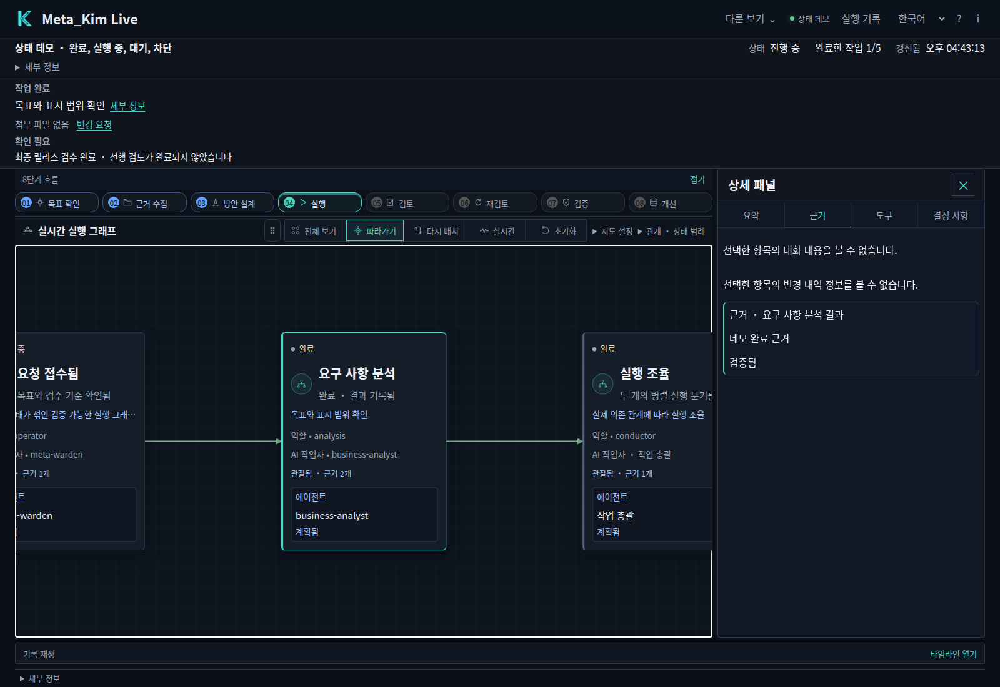

*내장 데모에서 작업을 선택하고 근거를 연 화면입니다. 기록을 통해 해당 작업의 상태를 이해할 수 있습니다.*

언어 선택기에서 중국어, 영어, 일본어와 한국어를 선택할 수 있습니다. Live는 화면 언어를 기억하고 작업과 피드백 원문을 보존합니다. 등록된 시스템 개요와 모듈을 Live에서 직접 검토하고 수정 의견을 남기면 현재 AI 호스트가 저장된 작업 요청을 통해 이어갑니다.

<a id="clients"></a>

## 평소 사용하는 클라이언트에서 쓰기

대화형 설치 프로그램은 다음 여섯 대상 이름을 지원합니다. 설정 과정에서 선택하거나 `--targets`에 이름을 지정하세요.

| 클라이언트 | 대상 이름 | 설치로 제공하는 것 |
| --- | --- | --- |
| Claude Code | `claude` | Agent, Skill, 명령과 Hook |
| Codex | `codex` | Agent, 공유 Skill, 설정과 Hook |
| Cursor | `cursor` | Agent, Skill, 프로젝트 규칙과 Hook |
| OpenClaw | `openclaw` | Agent 워크스페이스, Skill과 설정 템플릿 |
| Gemini CLI | `gemini` | Agent, 공유 Skill, 설정과 Hook |
| ZCode | `zcode` | Agent, Skill, MCP 설정과 선택형 사용자 단위 Hook |

설치 후 작업 프로젝트에서 클라이언트를 다시 열어 설정을 불러오세요. 도구 접근과 모델 권한은 계속 해당 클라이언트가 관리합니다. Meta_Kim의 전역 Hook을 활성화하려면 setup 명령에 `--with-global-hooks`를 추가하세요. ZCode는 사용자 단위 Hook을 읽습니다.

**OpenClaw는 템플릿 연결도 필요합니다.** 설치 과정에서 Agent 워크스페이스와 `openclaw.template.json`을 생성합니다. 기본 위치는 전역 설치의 경우 `~/.openclaw/`, 프로젝트 설치의 경우 해당 프로젝트의 `openclaw/`입니다. 템플릿의 `agents.list`와 `skills.load.extraDirs`를 기존 OpenClaw 설정에 병합하고, 다른 Agent와 디렉터리 및 설정은 보존하세요. gateway를 다시 시작한 뒤 진입 Agent로 `meta-warden`을 선택합니다.

**Qoder와 Trae**에는 실험적 연동을 위한 Beta 어댑터 리소스가 포함되어 있습니다. 명시적으로 설정하기 전에는 비활성 상태이며, 추가 `--targets` 선택지가 아닙니다. DeepSeek Harness는 아래의 별도 절차를 사용합니다. 의존 프로젝트의 지원 클라이언트는 해당 상위 프로젝트가 관리합니다.

### 클라이언트와 모델을 따로 설정하기


**전문 방법, 실행 클라이언트, 모델은 각각 선택합니다.** 같은 PRD, 여덟 단계, 인계와 검증 방법을 여러 클라이언트에서 사용할 수 있습니다. Claude Code, Codex, Gemini CLI, ZCode 등은 사용 환경이며 모델은 연결 설정과 이번 요청으로 결정합니다. Claude Code에서 MiniMax 모델을 사용해도 클라이언트는 Claude Code로, 모델은 별도 항목으로 기록합니다.

| 바꿀 항목 | 기존 설정 입구 | 동작 |
| --- | --- | --- |
| 이번 실행의 클라이언트 | API `runtime` / CLI `--runtime` | 명시적 선택 우선. 자동 모드는 연결된 어댑터, 설정, 호스트 신호를 사용하고 출처를 기록 |
| 호스트 정보가 없을 때의 호환 기본값 | `config/contracts/runtime-priority-and-compatibility-contract.json`의 `selectionPolicy.defaultPlanningRuntime` | 출처가 있는 계획 기본값이며 실행 성공이나 권한의 증거가 아님 |
| 이번 worker 모델 | API `stageRunner.model` / CLI `--stage-runner-model` | 구현된 명령 어댑터가 실제 규약으로 전달. 주입형 어댑터는 모델 선택 지원을 명시해야 함 |
| 계정, 연결, 모델 이용 가능 여부 | 현재 클라이언트 또는 호스트 설정 | 실제 환경에서 제공하며 방법 패키지가 모델 접근이나 도구 권한을 추가하지 않음 |

모델을 생략하면 실행 프로세스의 기본 동작으로 기록하고 부모 세션의 모델을 상속했다고 추측하지 않습니다. 결과에는 **requested(요청), applied(어댑터에 전달), observed(실제 관측)** 를 구분하며 관측 증거가 없으면 미확인으로 둡니다. 명시한 요청을 지원하지 않으면 부족한 기능을 알리고 다른 모델로 몰래 바꾸지 않습니다. 실행 설정을 바꿀 때는 새 실행 근거가 필요하며 이미 완료한 업무 기록은 계속 참조할 수 있습니다.

설치용 생성물, 호스트에서 이어가기, 네이티브 명령 어댑터의 지원 범위는 각각 다릅니다. 위의 여섯 설치 대상은 `config/sync.json`을 기준으로 합니다. 내장 읽기 전용 단계 worker는 현재 Codex와 Claude Code의 명령 규약을 구현합니다. Gemini와 ZCode 등의 호스트에서 이어가려면 실제 어댑터와 기능 증거가 필요합니다. MiniMax Code 같은 새 클라이언트도 공통 방법을 읽을 수 있지만 네이티브 실행은 해당 어댑터 구현과 검증이 필요합니다.

새 클라이언트·운영체제·모델 연결 정보가 없는 이전 실행은 과거 근거로 보관합니다. 추가 실행에는 새 `runId`와 현재 기능·맥락 확인을 사용하며 이전 모델을 추측하지 않습니다. 새 형식의 실행을 재개하면 원래 모델 인수 기록을 유지하고, 채택이나 업무 효과 관측만 추가할 때 worker를 다시 실행하지 않습니다.

## 전문적인 방법이 필요할 때 Kim Service 연결하기

Meta_Kim은 작업을 조직합니다. **Kim Service는 설계, 분석, 콘텐츠 제작 같은 일에 재사용할 전문적인 방법과 자료를 제공합니다.** 연결하면 작업 방법을 고를 때 이 자료들도 검토할 수 있습니다. 실제 작업은 현재 클라이언트에서 사용할 수 있는 도구로 진행합니다.

설치 프로그램이 관리 대상 Service 소스를 이미 등록했고 설치 기록의 검증도 통과한다면, Meta_Kim은 그 등록을 사용할 수 있습니다. 직접 내려받은 사본은 아래와 같이 디렉터리를 명시적으로 연결하세요.

Kim Service를 로컬 디렉터리에 복제합니다.

```bash
git clone https://github.com/KimYx0207/Kim_Service.git
```

**실제 작업 프로젝트의 루트**에 `.meta-kim/local.overrides.json`을 만들고, 체크아웃의 절대 경로를 지정합니다.

```json
{
  "dependencyRoots": {
    "kim-service": "/absolute/path/to/Kim_Service"
  }
}
```

파일이 이미 있으면 기존 `dependencyRoots` 객체에 `kim-service` 항목을 병합하고 다른 설정을 보존하세요. Meta_Kim 설치 디렉터리가 아니라 AI 클라이언트에서 연 프로젝트의 루트를 사용합니다. Windows에서도 `C:/Projects/Kim_Service`처럼 JSON 경로에 슬래시를 쓸 수 있습니다.

환경 변수로 관리한다면 `META_KIM_KIM_SERVICE_ROOT`로 같은 연결을 지정할 수 있으며, 로컬 파일보다 우선합니다. AI 클라이언트를 시작하는 환경에 설정하세요. 두 저장소를 나란히 놓기만 해서는 연결되지 않습니다. 설정한 뒤에는 사용할 수 있는 Kim Service 기능을 확인하고, 이번 작업에 맞는 방법을 사용하도록 어시스턴트에게 요청하세요.

<a id="dsh"></a>

## DeepSeek Harness 설치

DSH는 네이티브 profile, Skill과 MCP 설정을 사용하는 별도의 Beta 연동을 제공합니다. **DSH 0.2.2-rc.1**과 **Node.js 24.9.0+** 가 설치되어 있다면 Meta_Kim 체크아웃에서 다음을 실행하세요.

```bash
node bin/meta-kim.mjs dsh install
node bin/meta-kim.mjs dsh check
dsh --profile meta-kim
```

한 프로젝트에 설치할 때는 install 명령에 `--scope project --project-root "/path/to/your-project"`를 추가하고, 설치 프로그램이 출력한 시작 명령을 사용합니다. 같은 프로젝트의 설정을 확인하려면 다음을 실행하세요.

```bash
node bin/meta-kim.mjs dsh check --scope project --project-root "/path/to/your-project"
```

Kim Service의 네이티브 DSH Skill도 포함하려면 [Kim Service 릴리스](https://github.com/KimYx0207/Kim_Service/releases/latest)에서 DSH 패키지를 내려받아 압축을 풀고, 설치 또는 업데이트할 때 `--service-package "/path/to/unpacked-service-package"`를 추가하세요.

이 연동을 갱신하려면 `node bin/meta-kim.mjs dsh update`를 사용합니다. 업데이트는 기존 Service 구성을 유지합니다. 해당 Skill도 갱신하려면 새로 압축을 푼 Service 패키지를 전달하세요. 연동을 제거하려면 `node bin/meta-kim.mjs dsh uninstall`을 실행합니다. 프로젝트 업데이트나 제거에는 설치할 때 사용한 것과 같은 `--scope project --project-root` 값을 지정하세요.

<a id="continue-work"></a>

## 작업을 이어서 개선하고 설치 환경을 최신으로 유지하기

대화가 중단되면 **같은 작업 프로젝트**를 다시 여세요. 계속하기 전에 저장된 계획, 조사 결과, 진행 상황과 실행 기록을 읽도록 어시스턴트에게 요청합니다.

> “회원가입 개선을 이어서 해 줘. 저장된 결정과 완료한 작업을 현재 프로젝트와 대조하고, 중단된 작업의 결과를 확인한 다음 아직 끝내지 않은 다음 작업부터 진행해 줘.”

다음 개선에서는 유지할 것과 바꿀 것을 함께 말하세요. 예를 들어 “모바일 배치와 기존 항목은 유지하고, 완료 메시지를 더 명확하게 해 줘”라고 요청하면 받아들인 결과를 바탕으로 새 작업을 진행할 수 있습니다. 선택형 Memory 서비스를 추가하면 일부 정보를 세션 간에 유지하는 데 도움이 됩니다. 현재 작업을 이어 가는 기반은 프로젝트의 작업 기록에도 담겨 있습니다.

소스에서 설치한 환경을 업데이트하려면 Meta_Kim 체크아웃에서 실행하세요.

```bash
git pull --ff-only
node setup.mjs --update
node setup.mjs --check
```

설치나 클라이언트 로딩을 살펴봐야 한다면 `node bin/meta-kim.mjs doctor`로 환경을 확인하고 다음 조치를 안내받을 수 있습니다. 업데이트할 때도 작업 프로젝트의 기록을 보존해, 다음 세션에서 이어 갈 수 있도록 하세요.

## 소스와 생성 파일


**각 정보에 하나의 기준 원본을 두고 앱, 데이터, 화면을 연결합니다.** 다음은 현재 구현의 실제 위치입니다.

| 책임 | 원본 또는 구현 | 변경 경계 |
| --- | --- | --- |
| 공통 방법과 단계 계약 | `canonical/`, `config/contracts/` | 방법, 여덟 단계, 관리 규칙이 각각 자기 원본을 유지 |
| 클라이언트와 어댑터 정보 | `config/sync.json`, `config/runtime-compatibility-catalog.json`, `scripts/runtime-tool-profiles.mjs` | 생성 대상, 형식, 기능 증거를 구분. 설치 발견은 실행 증거가 아님 |
| 앱과 도메인 규칙 | `src/application/`, `src/domain/`, `scripts/governed-execution/` | 작업, 의존 관계, 재개, 결과 판단. 주 진입점은 `scripts/run-meta-theory-governed-execution.mjs` 유지 |
| 데이터와 호스트 어댑터 | `src/data/repositories/`, `src/infrastructure/` | 실행·지식 기록을 저장하고 기존 계약으로 실제 호스트에 연결 |
| 표현 | `src/presentation/live/`, `src/presentation/run-surfaces/` | 상태, 증거, 다음 작업을 표시하며 모델 선택 정책을 중복하지 않음 |

확장은 책임에 맞춰 수행합니다. 새 방법은 canonical, 새 호스트는 설정과 검증된 어댑터, 새 화면은 기존 상태를 사용합니다. 업무의 주 기록, 조직 권한, 외부 알림, 정기 지식 정리는 연결된 업무 호스트가 담당합니다. README의 동적 SVG는 `scripts/build-readme-animations.mjs`와 언어별 문안에서 생성하며 `--check`로 일치를 확인합니다. 제목, 시작 카드와 끝을 가운데 배치하고 동작을 줄여도 전체 관계가 보이게 합니다.

공통 Agent, Skill과 실행 리소스는 `canonical/`에서, 기계가 읽는 설정은 `config/`에서 관리합니다. `.claude/`, `.codex/`, `.cursor/` 같은 클라이언트별 디렉터리는 `npm run meta:sync`로 로컬에 생성합니다. 생성물은 `.gitignore`로 GitHub 소스에서 제외하고 로컬에 유지하며, 배포 패키지에는 공통 원본 소스를 포함합니다.

## 연락처


GitHub <a href="https://github.com/KimYx0207">KimYx0207</a> |
X <a href="https://x.com/KimYx0207">@KimYx0207</a> |
공식 사이트 <a href="https://www.aiking.dev/">aiking.dev</a> |
위챗 공식 계정: **라오진과 함께하는 AI**

Feishu 지식 베이스:
<a href="https://my.feishu.cn/wiki/OhQ8wqntFihcI1kWVDlcNdpznFf">지속 업데이트 입구</a>

### 방법론 근거

Meta_Kim의 방법론은 본 프로젝트 메인테이너(KimYx0207)가 작성한 "메타 기반 의도 증폭(intent amplification)" 연구에 기반합니다:

- 논문: <https://zenodo.org/records/18957649>
- DOI: `10.5281/zenodo.18957649`

---

## License

[Apache License 2.0](LICENSE). Commercial use is permitted. Retain [LICENSE](LICENSE) and [NOTICE](NOTICE) when redistributing the project or substantial portions. Third-party components retain their own licenses; attribution does not imply endorsement.

**Meta_Kim by KimYx0207 — https://github.com/KimYx0207/Meta_Kim**
