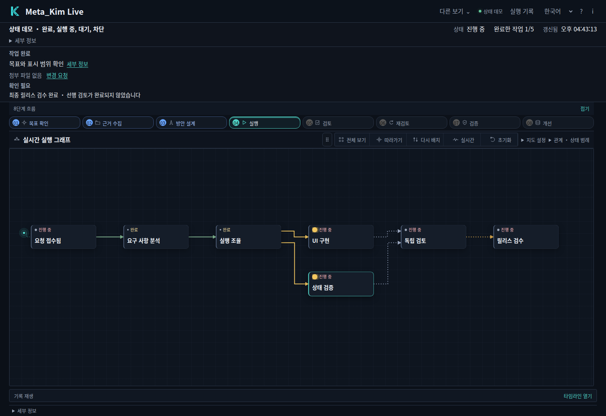
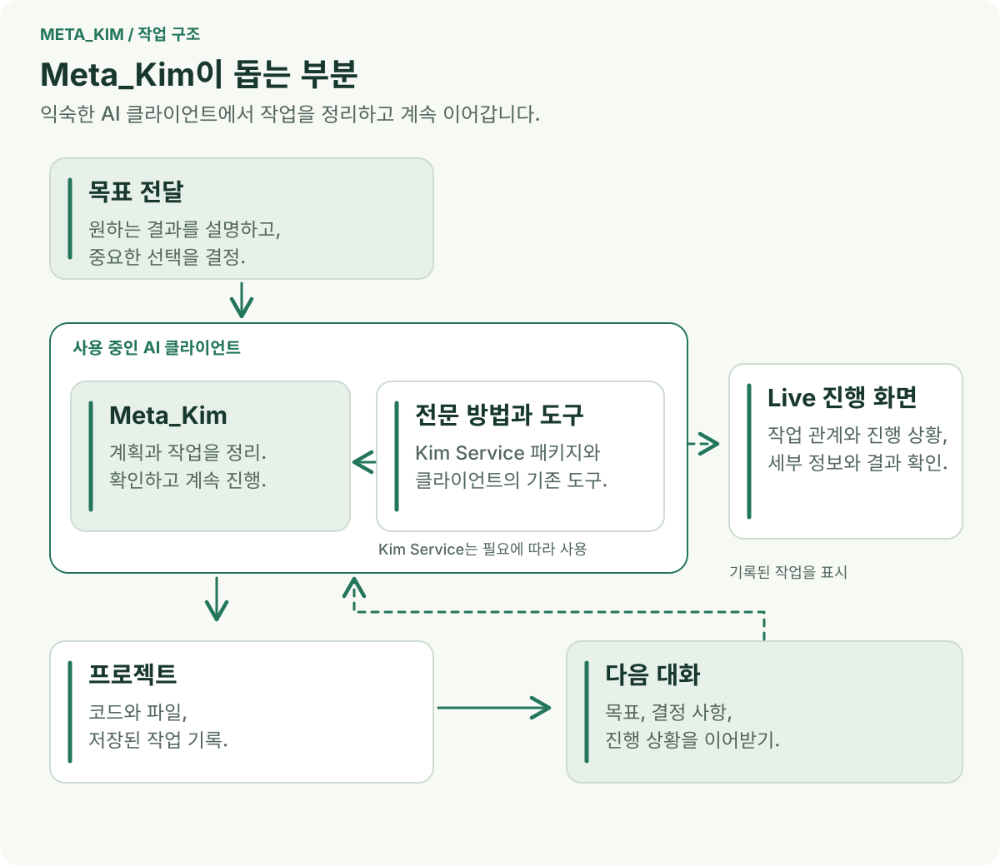

<div align="center">

# 元 · Meta_Kim

**AI에 목표를 전하세요. 계획과 작업, 다음 단계를 이어 가세요.**

[English](README.md) · [简体中文](README.zh-CN.md) · [日本語](README.ja-JP.md) · [한국어](README.ko-KR.md)

</div>

## 아이디어를 진행 상황이 보이고 직접 쓸 수 있는 결과로

**Meta_Kim은 “이 부분을 더 좋게 만들고 싶다”는 요청을 직접 확인하고 사용하며 개선할 수 있는 결과까지 이어 가도록 AI 어시스턴트를 돕습니다.** 평소 쓰던 AI 클라이언트 안에서 목표를 구체화하고, 방법을 고르고, 작업을 나누고, 필요한 전문 지식을 연결하며 실제 결과를 확인합니다.

한 번의 지시로 끝나지 않는 일에서는 이런 연결이 중요합니다. 설계 결정은 구현에 영향을 주고, 한 작업에는 다른 작업의 결과가 필요합니다. 다음 대화에서는 어디까지 끝났는지도 알아야 합니다. Meta_Kim은 이 관계를 프로젝트에 남겨, 이미 한 일을 바탕으로 다음 단계에 나아가도록 합니다.



*실제로 실행한 Live의 내장 데모입니다. 연결된 작업과 상태를 살펴보고, 작업을 선택해 해당 기록을 확인할 수 있습니다.*

## 첫 요청부터 다음 개선까지, 하나의 프로젝트로 이어 가기

웹사이트에 이미 회원가입 양식이 있다고 가정해 보세요. 작동은 하지만 휴대폰에서는 입력칸이 좁고 오류를 알아보기 어렵습니다. 기존 데이터 항목을 유지하면서 더 편하게 만들고 싶습니다.

**원하는 결과를 자신의 말로 설명하세요.** 어시스턴트는 기존 흐름을 읽고 서버로 보내는 데이터, 필수 항목, 제품의 스타일처럼 유지해야 할 내용을 확인합니다. 페이지를 바꾸기 전에 관련 자료를 살펴보고 여러 방법을 비교할 수 있습니다. “양식을 한 화면에 유지해야 하나요?”처럼 실제 선택에 도움이 되는 질문을 다룹니다.

**방향을 서로 연결된 계획으로 만듭니다.** 프로젝트 전체에서는 페이지, 입력 검증, 서버 인터페이스의 관계를 정리합니다. 개별 작업에서는 모바일 배치 변경, 더 명확한 오류 안내, 같은 데이터가 애플리케이션에 전달되는지 확인할 검사로 나눕니다. 각 작업에는 범위, 입력 자료, 예상 결과와 완료 판단 방법이 있습니다. 독립적인 작업은 함께 진행하고, 인터페이스 결정이 필요한 작업은 그 결정을 기다립니다.

**직접 시험할 수 있는 결과를 받습니다.** 이 예에서는 변경한 소스, 실행 방법과 검사 결과를 요청하세요. 화면을 휴대폰 너비로 줄여 빈칸, 잘못된 값, 정상 가입을 차례로 시험합니다. 결과를 합의한 기준과 비교합니다. 배치는 좋아졌지만 오류가 여전히 잘못된 위치에 나온다면, 다음 작업에서 그 문제를 고칩니다.

**다음 대화에서도 같은 프로젝트를 이어 갑니다.** “이 배치는 유지하고, 가입 완료 메시지만 더 명확하게 바꿔 줘”라고 말할 수 있습니다. 기록한 결정, 완료한 작업과 결과가 출발점이 됩니다. 어시스턴트는 이를 현재 프로젝트와 대조한 뒤 계속합니다.


작은 수정은 작은 작업으로 진행할 수 있습니다. 여러 모듈에 걸친 기능에는 더 자세한 계획을 세웁니다. 계획의 깊이는 일의 내용과 위험에 맞춥니다.

## 각각의 작업이 함께 움직이는 이유



### 명확한 결과가 이후 선택의 기준이 됩니다

첫 요청에는 겪고 있는 문제, 떠올린 해결책과 프로젝트에 대한 가정이 섞이기 쉽습니다. Meta_Kim은 무엇을 이루려는지, 무엇을 유지해야 하는지, 어떤 상태를 성공으로 볼지 정리합니다. 중요한 선택에 영향을 주는 조사와 참고 자료를 가져옵니다. 어시스턴트가 근거를 가지고 방법을 선택하고, 사용자도 본격적인 작업 전에 구체적인 안을 검토할 수 있습니다.

### 하나의 설계가 시스템 전체와 개별 작업을 연결합니다

소프트웨어 작업에서는 같은 설계를 두 관점으로 봅니다. **아키텍처 관점**은 전체 구조, 인터페이스와 제약을 설명합니다. **모듈 관점**은 이를 담당 범위와 완료 기준이 분명한 작업으로 구체화합니다. 각 모듈이 전체 결과에서 어떤 역할을 하는지 알 수 있습니다. 결정이 바뀌면 완료한 모든 일을 무효로 취급하는 대신, 영향을 받는 작업을 찾아낼 수 있습니다.

### 의존 관계를 보고 지금 진행할 일을 고릅니다

작업에 필요한 것과 작업이 만들어 내는 것을 정리합니다. 클라이언트에 필요한 도구가 있으면 독립적인 작업을 병렬로 맡길 수 있습니다. 같은 선행 조건이나 파일을 공유하는 작업은 조율합니다. 한 갈래가 사용자의 판단을 기다리는 동안에도, 관계없는 준비된 작업은 계속할 수 있습니다. 계획은 코딩을 시작하면 잊는 체크리스트가 아니라 실행 중에도 쓰는 기준이 됩니다.

### 각 작업에 필요한 전문 지식과 자료를 가져갑니다

Meta_Kim은 클라이언트에서 사용할 수 있는 기능과 명시적으로 연결한 Kim Service 같은 라이브러리에서 방법을 고릅니다. 전문적인 절차, 관련 참고 자료나 편집 가능한 예제를 입력 자료와 확인 항목에 묶어 작업에 전달할 수 있습니다. 읽어 들이는 것은 해당 일에 필요한 자료입니다. 담당자가 적절한 결과를 만들 만큼의 맥락을 제공하면서 관계없는 정보에 묻히지 않도록 합니다.

### 프로젝트 기록이 중단한 작업의 재개 지점이 됩니다

계획, 조사 결과, 진행 상황과 실행 결과 기록을 통해 의도한 작업과 실제로 일어난 일을 연결합니다. 이후 세션에서는 기록을 읽고 현재 파일과 비교해 다음 단계를 찾을 수 있습니다. 이전 작업의 결과가 불명확하면 같은 작업을 반복하기 전에 결과부터 확인합니다. 대화나 개별 작업이 중단되어도 유효한 완료 결과는 계속 활용할 수 있습니다.

### 검사 결과를 구체적인 수정으로 이어 갑니다

결과물이 기준을 충족하고 관련 검사로 뒷받침될 때 작업을 완료한 것으로 봅니다. 같은 근거와 같은 방법으로 실패를 반복한다면, 해당 작업에는 검토를 거친 수정이 필요합니다. 다른 방법을 선택하거나 가정을 바꾸고, 필요한 결정을 더 명확히 할 수 있습니다. 유용한 발견은 다음 개선에도 반영합니다. 무엇을 받았고, 왜 받아들였으며, 어떤 일이 남았는지 확인할 수 있습니다.

<a id="installation"></a>

## 내 프로젝트에서 시작하기

**Node.js 22.13.0+**, Git, 모델 연결을 설정한 AI 클라이언트가 필요합니다. 현재 공개 버전은 **[v3.10.2](https://github.com/KimYx0207/Meta_Kim/releases/tag/v3.10.2)**입니다.

### 1. Meta_Kim 설치하기

```bash
git clone https://github.com/KimYx0207/Meta_Kim.git
cd Meta_Kim
npm install
node setup.mjs
```

사용할 클라이언트와 설치 범위를 선택하세요. **전역 설치**는 계정에서 재사용할 기능을 설치하고, **프로젝트 설치**는 선택한 프로젝트 디렉터리에 맞춰 설치합니다. 업데이트에 사용할 수 있도록 Meta_Kim 체크아웃을 보관하세요. 실제 작업 프로젝트는 다른 디렉터리에 있어도 됩니다.

예를 들어 한 프로젝트에 Codex 지원을 바로 설치하려면 다음을 실행합니다.

```bash
node setup.mjs --targets codex --scope project --project-dir "/path/to/your-project"
```

따옴표 안을 프로젝트의 절대 경로로 바꾸세요. 계정 전체에 설치할 때는 `--project-dir` 없이 `--scope global`을 사용합니다. `--targets codex,claude`처럼 쉼표로 여러 클라이언트를 선택할 수도 있습니다.

체크아웃을 보관하지 않고 설치하려면 `npx --yes github:KimYx0207/Meta_Kim`을 사용하세요. 나중에 업데이트할 때는 `npx --yes github:KimYx0207/Meta_Kim update`를 실행합니다. 이 방법에도 같은 setup 옵션을 지정할 수 있습니다. 아래 CLI 명령에서는 `node bin/meta-kim.mjs`를 이 `npx` 명령 접두어로 바꾸면 됩니다.

### 2. 프로젝트를 열고 원하는 결과 말하기

설정한 클라이언트에서 작업 프로젝트를 열고 평소처럼 메시지를 보내세요.

> “이 프로젝트의 회원가입 흐름을 검토해 줘. 기존 데이터 항목은 유지하면서 휴대폰에서 더 편하게 사용할 수 있도록 바꾸고, 변경된 흐름과 검사 결과를 보여 줘.”

기존 프로젝트와 중요한 제약을 전달하세요. 어시스턴트가 제시하는 주요 선택을 검토한 뒤 계획에 따라 진행하게 합니다. 무엇을 왜 바꾸는지, 어떻게 확인할지 도중에 물어봐도 됩니다. 별도의 활성화 명령을 외울 필요는 없습니다.

### 3. Live에서 작업 살펴보기

Meta_Kim 체크아웃에서 실행하세요.

```bash
node bin/meta-kim.mjs live --project-root "/path/to/your-project"
```

명령이 출력한 로컬 URL을 여세요. Live는 해당 프로젝트에 저장된 작업과 실행 기록을 읽습니다. 프로젝트 기록이 생기기 전에 화면을 먼저 둘러보려면 URL에 `?demo=states`를 추가해 이 페이지에 나온 내장 데모를 여세요.

**먼저 페이지 위쪽의 작업 지도를 살펴보세요.** 연결선을 따라 무엇이 무엇에 의존하는지, 어떤 일이 진행 중인지 확인합니다. **작업을 클릭한 뒤 상세 패널에서 ‘근거’를 선택**하면 기록된 결과와 검사를 볼 수 있습니다.


*내장 데모에서 작업을 선택하고 근거를 연 화면입니다. 기록을 통해 해당 작업의 상태를 이해할 수 있습니다.*

언어 선택기에서 중국어, 영어, 일본어와 한국어를 선택할 수 있습니다. Live는 화면 언어를 기억하고 사용자가 작성한 작업의 원문은 그대로 표시합니다. 새 지시와 피드백은 AI 클라이언트에 전하고, Live에서는 기록된 작업을 따라가며 확인하세요.

<a id="clients"></a>

## 평소 사용하는 클라이언트에서 쓰기

대화형 설치 프로그램은 다음 여섯 대상 이름을 지원합니다. 설정 과정에서 선택하거나 `--targets`에 이름을 지정하세요.

| 클라이언트 | 대상 이름 | 설치로 제공하는 것 |
| --- | --- | --- |
| Claude Code | `claude` | Agent, Skill, 명령과 Hook |
| Codex | `codex` | Agent, 공유 Skill, 설정과 Hook |
| Cursor | `cursor` | Agent, Skill, 프로젝트 규칙과 Hook |
| OpenClaw | `openclaw` | Agent 워크스페이스, Skill과 설정 템플릿 |
| Gemini CLI | `gemini` | Agent, 공유 Skill, 설정과 Hook |
| ZCode | `zcode` | Agent, Skill, MCP 설정과 선택형 사용자 단위 Hook |

설치 후 작업 프로젝트에서 클라이언트를 다시 열어 설정을 불러오세요. 도구 접근과 모델 권한은 계속 해당 클라이언트가 관리합니다. Meta_Kim의 전역 Hook을 활성화하려면 setup 명령에 `--with-global-hooks`를 추가하세요. ZCode는 사용자 단위 Hook을 읽습니다.

**OpenClaw는 템플릿 연결도 필요합니다.** 설치 과정에서 Agent 워크스페이스와 `openclaw.template.json`을 생성합니다. 기본 위치는 전역 설치의 경우 `~/.openclaw/`, 프로젝트 설치의 경우 해당 프로젝트의 `openclaw/`입니다. 템플릿의 `agents.list`와 `skills.load.extraDirs`를 기존 OpenClaw 설정에 병합하고, 다른 Agent와 디렉터리 및 설정은 보존하세요. gateway를 다시 시작한 뒤 진입 Agent로 `meta-warden`을 선택합니다.

**Qoder와 Trae**에는 실험적 연동을 위한 Beta 어댑터 리소스가 포함되어 있습니다. 명시적으로 설정하기 전에는 비활성 상태이며, 추가 `--targets` 선택지가 아닙니다. DeepSeek Harness는 아래의 별도 절차를 사용합니다. 의존 프로젝트의 지원 클라이언트는 해당 상위 프로젝트가 관리합니다.

## 전문적인 방법이 필요할 때 Kim Service 연결하기

Meta_Kim은 작업을 조직합니다. **Kim Service는 설계, 분석, 콘텐츠 제작 같은 일에 재사용할 전문적인 방법과 자료를 제공합니다.** 연결하면 작업 방법을 고를 때 이 자료들도 검토할 수 있습니다. 실제 작업은 현재 클라이언트에서 사용할 수 있는 도구로 진행합니다.

설치 프로그램이 관리 대상 Service 소스를 이미 등록했고 설치 기록의 검증도 통과한다면, Meta_Kim은 그 등록을 사용할 수 있습니다. 직접 내려받은 사본은 아래와 같이 디렉터리를 명시적으로 연결하세요.

Kim Service를 로컬 디렉터리에 복제합니다.

```bash
git clone https://github.com/KimYx0207/Kim_Service.git
```

**실제 작업 프로젝트의 루트**에 `.meta-kim/local.overrides.json`을 만들고, 체크아웃의 절대 경로를 지정합니다.

```json
{
  "dependencyRoots": {
    "kim-service": "/absolute/path/to/Kim_Service"
  }
}
```

파일이 이미 있으면 기존 `dependencyRoots` 객체에 `kim-service` 항목을 병합하고 다른 설정을 보존하세요. Meta_Kim 설치 디렉터리가 아니라 AI 클라이언트에서 연 프로젝트의 루트를 사용합니다. Windows에서도 `C:/Projects/Kim_Service`처럼 JSON 경로에 슬래시를 쓸 수 있습니다.

환경 변수로 관리한다면 `META_KIM_KIM_SERVICE_ROOT`로 같은 연결을 지정할 수 있으며, 로컬 파일보다 우선합니다. AI 클라이언트를 시작하는 환경에 설정하세요. 두 저장소를 나란히 놓기만 해서는 연결되지 않습니다. 설정한 뒤에는 사용할 수 있는 Kim Service 기능을 확인하고, 이번 작업에 맞는 방법을 사용하도록 어시스턴트에게 요청하세요.

<a id="dsh"></a>

## DeepSeek Harness 설치

DSH는 네이티브 profile, Skill과 MCP 설정을 사용하는 별도의 Beta 연동을 제공합니다. **DSH 0.2.2-rc.1**과 **Node.js 24.9.0+**가 설치되어 있다면 Meta_Kim 체크아웃에서 다음을 실행하세요.

```bash
node bin/meta-kim.mjs dsh install
node bin/meta-kim.mjs dsh check
dsh --profile meta-kim
```

한 프로젝트에 설치할 때는 install 명령에 `--scope project --project-root "/path/to/your-project"`를 추가하고, 설치 프로그램이 출력한 시작 명령을 사용합니다. 같은 프로젝트의 설정을 확인하려면 다음을 실행하세요.

```bash
node bin/meta-kim.mjs dsh check --scope project --project-root "/path/to/your-project"
```

Kim Service의 네이티브 DSH Skill도 포함하려면 [Kim Service 릴리스](https://github.com/KimYx0207/Kim_Service/releases/latest)에서 DSH 패키지를 내려받아 압축을 풀고, 설치 또는 업데이트할 때 `--service-package "/path/to/unpacked-service-package"`를 추가하세요.

이 연동을 갱신하려면 `node bin/meta-kim.mjs dsh update`를 사용합니다. 업데이트는 기존 Service 구성을 유지합니다. 해당 Skill도 갱신하려면 새로 압축을 푼 Service 패키지를 전달하세요. 연동을 제거하려면 `node bin/meta-kim.mjs dsh uninstall`을 실행합니다. 프로젝트 업데이트나 제거에는 설치할 때 사용한 것과 같은 `--scope project --project-root` 값을 지정하세요.

<a id="continue-work"></a>

## 작업을 이어서 개선하고 설치 환경을 최신으로 유지하기

대화가 중단되면 **같은 작업 프로젝트**를 다시 여세요. 계속하기 전에 저장된 계획, 조사 결과, 진행 상황과 실행 기록을 읽도록 어시스턴트에게 요청합니다.

> “회원가입 개선을 이어서 해 줘. 저장된 결정과 완료한 작업을 현재 프로젝트와 대조하고, 중단된 작업의 결과를 확인한 다음 아직 끝내지 않은 다음 작업부터 진행해 줘.”

다음 개선에서는 유지할 것과 바꿀 것을 함께 말하세요. 예를 들어 “모바일 배치와 기존 항목은 유지하고, 완료 메시지를 더 명확하게 해 줘”라고 요청하면 받아들인 결과를 바탕으로 새 작업을 진행할 수 있습니다. 선택형 Memory 서비스를 추가하면 일부 정보를 세션 간에 유지하는 데 도움이 됩니다. 현재 작업을 이어 가는 기반은 프로젝트의 작업 기록에도 담겨 있습니다.

소스에서 설치한 환경을 업데이트하려면 Meta_Kim 체크아웃에서 실행하세요.

```bash
git pull --ff-only
node setup.mjs --update
node setup.mjs --check
```

설치나 클라이언트 로딩을 살펴봐야 한다면 `node bin/meta-kim.mjs doctor`로 환경을 확인하고 다음 조치를 안내받을 수 있습니다. 업데이트할 때도 작업 프로젝트의 기록을 보존해, 다음 세션에서 이어 갈 수 있도록 하세요.

## 소스와 생성 파일

공통 Agent, Skill과 실행 리소스는 `canonical/`에서, 기계가 읽는 설정은 `config/`에서 관리합니다. `.claude/`, `.codex/`, `.cursor/` 같은 클라이언트별 디렉터리는 `npm run meta:sync`로 로컬에 생성합니다. 생성물은 `.gitignore`로 GitHub 소스에서 제외하고 로컬에 유지하며, 배포 패키지에는 공통 원본 소스를 포함합니다.

## 연락처


GitHub <a href="https://github.com/KimYx0207">KimYx0207</a> |
X <a href="https://x.com/KimYx0207">@KimYx0207</a> |
공식 사이트 <a href="https://www.aiking.dev/">aiking.dev</a> |
위챗 공식 계정: **라오진과 함께하는 AI**

Feishu 지식 베이스:
<a href="https://my.feishu.cn/wiki/OhQ8wqntFihcI1kWVDlcNdpznFf">지속 업데이트 입구</a>

### 커피 한 잔

Meta_Kim이 도움이 되었다면 후원으로 응원해 주세요.

<table align="center">
<tr><th>위챗 결제</th><th>알리페이</th></tr>
<tr>
<td align="center"></td>
<td align="center"></td>
</tr>
</table>

### 방법론 근거

Meta_Kim의 방법론은 본 프로젝트 메인테이너(KimYx0207)가 작성한 "메타 기반 의도 증폭(intent amplification)" 연구에 기반합니다:

- 논문: <https://zenodo.org/records/18957649>
- DOI: `10.5281/zenodo.18957649`

---

## License

[Apache License 2.0](LICENSE). Commercial use is permitted. Retain [LICENSE](LICENSE) and [NOTICE](NOTICE) when redistributing the project or substantial portions. Third-party components retain their own licenses; attribution does not imply endorsement.

**Meta_Kim by KimYx0207 — https://github.com/KimYx0207/Meta_Kim**
