<div align="center">

# 元 · Meta_Kim

**Describe the result you want. Keep research, design, teamwork, acceptance and the next improvement connected.**

[English](README.md) · [简体中文](README.zh-CN.md) · [日本語](README.ja-JP.md) · [한국어](README.ko-KR.md)

</div>

<p align="center">
  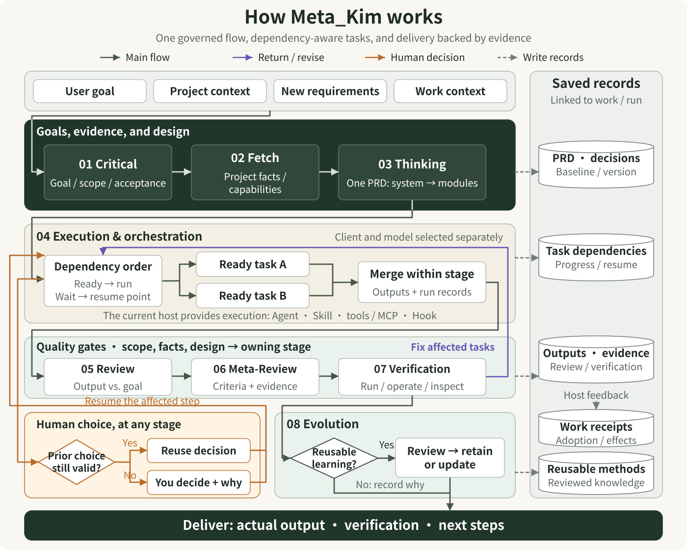
</p>

Read stages 01–08 from top to bottom. The dark section establishes the goal and evidence, then develops the system and its modules in one PRD. The execution section uses capabilities supplied by the current host; quality gates check actual results. Orange paths request a human decision when needed and reuse existing valid decisions. Purple paths return execution issues to affected tasks; scope, evidence, or design issues return to the responsible stage. Dashed paths write records. The host supplies Work adoption and effect feedback. Reusable learning is reviewed before updating methods or retaining a candidate; when no update is needed, the reason is recorded before delivery.

[Open the scalable diagram](docs/images/system-panorama.en.svg)

## You describe a goal. What happens next?

> “I want a small booking app. Customers should choose a time on their phones, staff should manage bookings, and tapping twice should produce just one booking.”

**Meta_Kim helps your AI turn that request into work it can carry out, check and continue improving.** Inside your existing AI client, it organizes the whole process: understand the problem, inspect the project and relevant sources, compare choices that affect the experience, outline the system, develop the modules, coordinate the work and check the result.

The outcome should be concrete: for this example, a working booking page, a management view, the relevant source, instructions for running it, and checks for normal bookings, repeated submissions and fully booked time slots. The booking app below is a running example of how the pieces connect.

Open your project in your AI client and describe the result, existing materials and constraints. **Live is the single visual workspace for continuing project work:** inspect all eight stages, read both PRD passes, accept the current version or submit module feedback. The current AI host performs the next step.

<p align="center">
  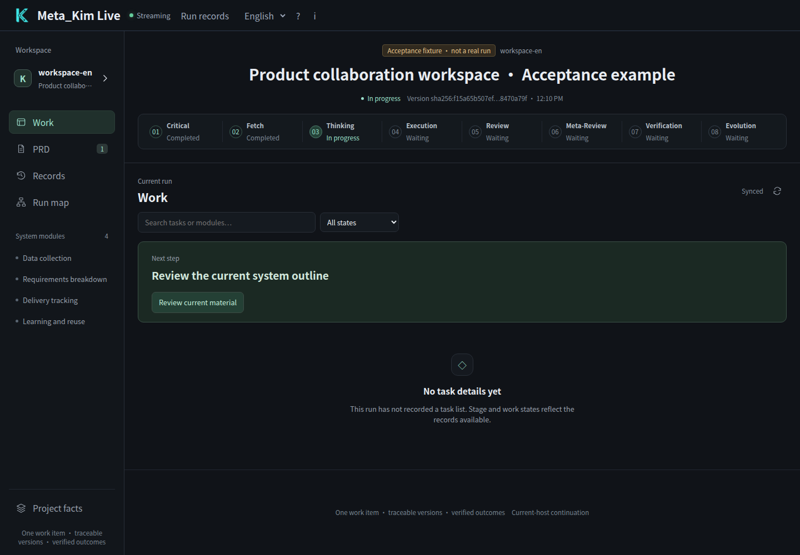
</p>

*Actual Live workspace with a clearly marked acceptance sample. The browser uses the real Hub, review controls and current-host CLI; the sample does not call a model. Open PRD to read the system outline and individual module designs.*

## Read, review and continue in Live

| Your task | Live entry | Durable result |
| --- | --- | --- |
| Understand the current step | Work and the eight-stage strip | Existing run state and next action |
| Review the first system decomposition | PRD → System overview | Acceptance, revision or return bound to the outline and design context |
| Review detailed module designs | PRD → Module detail and module navigation | Actual text, dependencies, version and per-module review |
| Correct a design | Feedback below the current artifact | Full feedback and a work order; affected old approvals become invalid |
| Check progress and evidence | Records, Run map and task details | Claims, file evidence and verification records |

Accepting the outline makes the next module available to the host; accepting a module advances to the next item. **Recorded, host claimed, file reported and verified are distinct states.** An absent host leaves the request waiting. See [the unified workspace and host protocol](docs/live-workspace.md) for registration, continuation, revision and bounded material loading.

## A mind map of the whole system


**Start at the user’s goal and follow the four branches.** See how understanding, design, tasks and delivery relate to that goal, together with their division of responsibility: Meta_Kim organizes the work and specialist capabilities carry it out.

- **Goal:** who is using the product, in what situation, for what result and under which constraints.
- **Design:** inspect evidence, compare feasible approaches and keep important decisions in one requirements design.
- **Tasks:** define inputs, owners and deliverables, then use dependencies to organize serial and parallel work.
- **Quality:** review the output, run the appropriate checks and return problems to the affected tasks.
- **Continuation and improvement:** save decisions, progress and results; resume from valid work and retain methods supported by evidence.

The value is in these connections. Changing a module interface updates the relevant work. A branch awaiting your decision can leave independent work moving. An ineffective method needs a new basis before another attempt.

## First PRD pass: turn an idea into a system and module outline

**A PRD, or product requirements document, explains what to build, why it matters and how to judge the result.** In Meta_Kim, the system outline and module details are two passes over the same PRD. Earlier decisions remain part of the later design.


**Follow one generation cycle:** the request leads to project inspection and research, then option comparison, then four parts of the same PRD: user journey, technology and scope, module outline, and shared agreements.

### Understand the user journey before fixing the system structure

1. **Translate the request into observable outcomes.** Who books and who manages bookings? What appears after selecting a time? How should repeated submissions behave? Identify the users, main journey, constraints and acceptance criteria.
2. **Inspect what already exists.** Read the project structure, actual code, technologies and versions, existing data and current changes. Preserve choices that already work well.
3. **Research the unknowns that affect a decision.** Use official documentation to establish whether a capability can work. Examine complete journeys and relevant source to design the booking experience. State handling, interfaces and recovery in GitHub projects can inform the approach.
4. **Compare genuinely different options.** A hosted booking service, an extension to the current app and a separate service can change the experience, effort, maintenance and data ownership. Explain the tradeoffs and a recommendation when a product direction needs your judgment.
5. **Record the chosen system outline.** Include the technology and version baseline, architecture, module responsibilities, interfaces and shared state, main acceptance criteria, and the questions that still need evidence or your choice.

For the booking app, that outline might contain:

- **User journey:** see available times, enter details and confirm; staff view and change bookings.
- **System structure:** a presentation layer displays pages and states, an application layer coordinates booking rules, and a data layer stores time slots and bookings.
- **Modules:** time-slot lookup, booking creation and staff management, each with an initial purpose and boundary.
- **Shared agreements:** who owns remaining capacity, which booking states exist, and how submission and cancellation interfaces connect.
- **Acceptance and open choices:** complete a booking on a phone and keep repeated submissions consistent; decide explicitly whether text-message reminders belong in the first delivery.

For example, “tapping twice should produce one booking” becomes an acceptance criterion assigned to booking creation. Responsibility for recognizing the same submission and maintaining capacity becomes part of the interface and shared-state agreements. The user journey and these responsibilities determine the module boundaries.

**You can assess the whole approach before implementation details grow.** Exploration can retain open questions. Before a module is ready for execution, its required decisions and interfaces must be settled. A small repair reuses its accepted design and expands only the affected part.

<p align="center">
  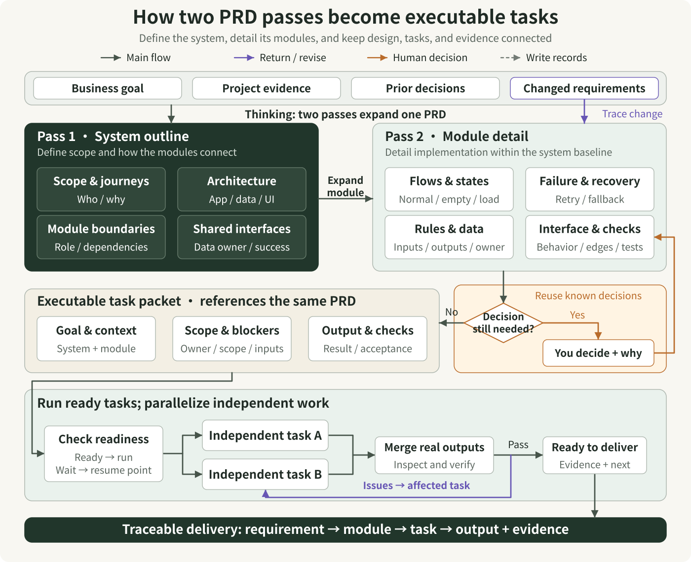
</p>

Read the two design passes from left to right, then follow the arrows down to task packets and execution. The first pass establishes scope, architecture, module boundaries, and shared interfaces. The second details module flows, states, failures, data, and acceptance within that same system baseline. Task packets reference the corresponding parts of this PRD and carry context, scope, dependencies, and output requirements. The decision branch illustrates one module: reuse valid decisions first, record a necessary human choice, and return to its design. Only affected dependencies wait; the host may execute other ready, independent tasks in parallel. Requirement changes identify the affected module and design baseline before updating linked tasks; failed verification returns to the relevant task.

[Open the scalable diagram](docs/images/prd-to-tasks.en.svg)

<p align="center">
  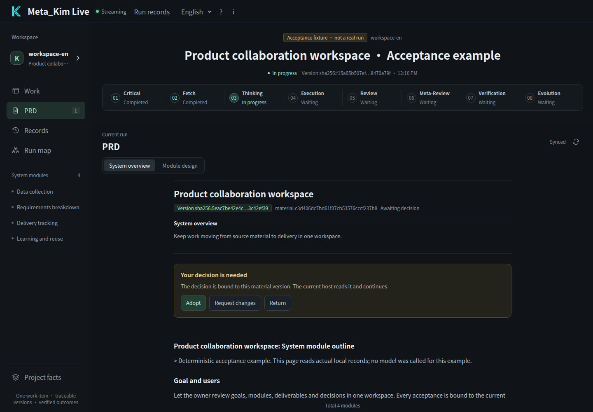
</p>

*In Live, the first pass appears under PRD → System overview. Read the actual material and record your judgment against its current version. This screenshot uses the same labeled acceptance sample.*

## Second PRD pass: make each module ready to implement

Once the direction is settled, the AI develops each module's detailed design and synthesizes it into the same PRD. Modules continue to share the concepts, state and interfaces established above.


**Follow one module being developed:** carry forward the system baseline, select booking creation, fill in actions, states, rules, contracts and acceptance, then hand those details to the UI, API and verification tasks below.

For the booking-creation module, the details answer practical questions:

- **How does the user complete the step?** Choose a time, enter details, confirm and receive the result; identify where editing and cancellation lead next.
- **What appears in each state?** Loading feedback, no available times, submission errors and retry, and success. Include phone layouts, keyboard use and accessibility.
- **Which business rules apply?** Capacity per time slot, repeated clicks, a slot becoming full during submission, and capacity restored after cancellation.
- **How does the module connect to the rest?** Input fields, returned results, state ownership and permissions; elaborate transactions, retries and migration where the project needs them.
- **How is correctness demonstrated?** Every acceptance criterion maps to a task and a check, covering the normal journey and relevant failure and recovery cases.

The detailed design also connects each requirement to implementation and a check. These are example tasks for the booking app:

| Requirement | Design and implementation work | Check |
| --- | --- | --- |
| Repeated taps create one booking | The UI handles the submitting state; the API recognizes the same submission and returns the same booking | Tap repeatedly and resend the same request; confirm that only one booking record is added |
| The last place cannot be overbooked | Data and API work keep capacity updates consistent; the UI shows a fully booked result | Send two concurrent requests; confirm successes do not exceed remaining capacity |
| Cancellation restores capacity | The cancellation API updates booking state and capacity; the UI shows the result | Query the slot after cancellation; confirm booking state and remaining capacity agree |

Each worker receives **the current system baseline, its complete relevant module design, settled decisions and interfaces, required outputs and acceptance criteria**. Frontend and backend work share agreed fields and states before proceeding within their own scopes.

If you later change the rule for releasing capacity after cancellation, related decisions, modules and dependencies identify the affected tasks. Valid completed work remains useful while changes focus on their actual impact.

<p align="center">
  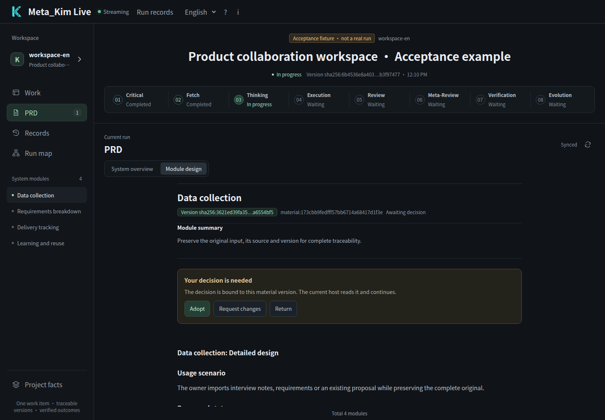
</p>

*The second pass appears under PRD → Module design. This capture follows a real outline approval and current-host file report; adopting a module makes the next one available. The text shown is an acceptance sample.*

## Eight stages: what each step produces for the next


**Follow the highlights from 01 to 08.** Each card names the result its stage leaves behind. The next stage uses that result; a problem returns to the stage equipped to resolve it.

| Stage | What it receives and does | What it passes on |
| --- | --- | --- |
| **01 Critical · Clarify the job** | Read the request and project context; establish users, outcome, scope and important constraints | A clear goal, success criteria and material open questions |
| **02 Fetch · Research and discover** | Investigate those questions through code, relevant sources and available professional capabilities | Sourced findings, candidate methods and specific missing facts |
| **03 Thinking · Choose and plan** | Combine goals and evidence, compare routes, develop both PRD views and arrange dependencies | The design baseline, owners, methods, inputs, outputs and acceptance plan |
| **04 Execution · Do the work** | Carry out the bounded tasks using the current design | Inspectable actual outputs, execution records and the stage’s merged result |
| **05 Review · Inspect the result** | Compare outputs with the goal; examine earlier understanding, research and design | Concrete findings, corrections and a review judgment |
| **06 Meta-Review · Examine the review** | Check standards, omissions and the evidence supporting the judgment | A review of that judgment and issues needing further inspection |
| **07 Verification · Check actual behavior** | Test or inspect the current result; the booking app needs success, repeated-submission and failure-recovery checks | Fresh evidence, results and remaining issues for the current version |
| **08 Evolution · Improve reusable methods** | Select useful lessons from actual outcomes and evaluate proposed changes | Reviewed method updates, or a reason that no writeback is needed |

This is the operating backbone. **Stages follow their defined order; independent work inside the active stage can run in parallel and is merged before the next stage.** A misunderstood goal returns to clarification, missing facts to research, an unsuitable design to planning, and a failed check to affected work. Preparation follows the task’s needs, and review depth follows its risk. When there is no reusable lesson, record that no method update is needed.

## Dynamic orchestration: use dependencies and current state to decide what runs now

**Dynamic orchestration keeps asking which tasks are ready to proceed.** It considers prerequisites, file scopes, resources, permissions and the current client's available execution capacity.


**Start with the shared contract, then watch both branches.** The UI branch waits for a choice while API work continues. Once the UI resumes, both outputs meet at the merge. That change in readiness is what dynamic orchestration handles.

The booking work can proceed like this:

1. **Settle the shared interface first.** Submission fields and success/error responses become shared inputs for frontend and backend work.
2. **Start independent work together.** Page implementation and booking-interface implementation can proceed together when their scopes are separate and the client provides execution capacity. Work touching the same files needs coordinated ordering.
3. **Release dependent work as inputs finish.** Connecting the page to the real interface waits for both outputs. The scheduler keeps filling newly ready work and hands the stage's outputs to one merge owner.
4. **Keep a local wait local.** If a page design needs your choice, its UI tasks wait while backend work using the agreed fields and interfaces can continue.
5. **Return problems to relevant tasks.** A failed branch preserves independently successful work. Diagnose the failure, establish an evidenced correction and then resume the affected work.

Repeated ineffective attempts on the same basis pause the affected task so its method or evidence can be corrected. You can see what is waiting, why, and what would make it ready again.

## Rhythm and intentional silence: make room for the decision that matters now

**Intentional silence leaves room for the current decision and your attention.** It governs when to show information, say less or wait. Open PRD items instead describe missing information or unsettled decisions; those are tracked separately.


**Start with the new information at the top:** is it settled, missing facts, ready for your choice, or urgent? Those conditions determine the next card. Pause leaves time to absorb the result and records how work can resume.

Suppose you have just reviewed the system plan, compared providers and handled a significant change. The next message should clarify what is settled and which decision remains. New demanding questions can wait while longer material stays in a file. The default rhythm rules place a Pause after three consecutive high-attention cards; resuming means checking the current state and next action again.

A pause records its reason, unfinished work and recovery condition. If it concerns only that page choice, authorized work independent of the judgment can continue. An explicit request to pause the whole project is respected.

### Ten action cards respond to changing conditions

“Dealing a card” means choosing an action for the current situation. The cards operate within the eight-stage backbone. **Select cards by their triggering conditions and skip those already satisfied.**

| Action card | When it appears | Booking example |
| --- | --- | --- |
| **Clarify** | An unknown answer would change the direction | Establish whether staff may cancel for a customer |
| **Shrink scope** | Scope puts the current delivery at risk | Finish the complete booking journey and schedule extensions for a later round |
| **Options** | Feasible approaches differ in experience, cost or maintenance | Compare a hosted service with implementation in the current app |
| **Execute** | Design, inputs and execution conditions are ready | Build the booking page and API |
| **Verify** | There is an output to check | Exercise bookings, repeated submissions and cancellation |
| **Fix** | A check finds a concrete issue | Correct capacity that fails to return after cancellation |
| **Rollback** | The impact is spreading and a stable state must be restored | Restore the affected change using its recovery plan |
| **Risk** | A permission, shared-data or other material risk appears | Address whether staff can access another branch’s bookings |
| **Nudge** | A low-risk next step is mildly stuck | Suggest first confirming one successful booking example |
| **Pause** | Demanding choices or information have become too dense | Leave a short status and recovery point, then allow time to absorb the result |

The same card can be handled differently: act now when it fits, skip it when already satisfied, suppress a low-value interruption, defer it until dependencies are ready, insert an urgent intervention, or escalate for an owner's judgment. **Settled answers stay recorded. The system handles internal Agent allocation; your attention goes to choices that change the product result.**

## Nine governance roles connect to the specialists who perform the work

**meta-warden** is the entry point to the collaboration. The nine roles have distinct responsibilities:

- **meta-warden** coordinates direction, arbitrates conflicts and synthesizes the final conclusion.
- **meta-conductor** arranges stages, task dependencies, parallel and serial work, and interaction rhythm.
- **meta-genesis** designs needed Agent identities, responsibilities and prompt structure.
- **meta-artisan** assembles suitable Skills, MCP capabilities and tools for a task.
- **meta-sentinel** handles permissions, risk, Hooks and recovery boundaries.
- **meta-librarian** manages memory, context and continuity after interruption.
- **meta-prism** reviews quality, detects drift and requests concrete corrections.
- **meta-scout** discovers and evaluates external capabilities and references.
- **meta-chrysalis** combines improvement signals and coordinates approved writeback.

These roles participate as the task requires. **Establish the work, find the capability that fits, then bind the owner, method, tools and acceptance in one work order.** For the booking app, the components work together as follows:

| Component | What it establishes | Booking example |
| --- | --- | --- |
| **Agent · Executor** | Who produces the result and within which scope | UI and API owners receive explicit file scopes and deliverables |
| **Skill · Working method** | The procedure and quality standard | A UI method covers mobile layout, feedback states and usability |
| **Professional material and examples** | Knowledge relevant to this task | Supply applicable state-design or API examples to their task |
| **Tools and MCP** | How the project or service can be operated | Read code, edit files, inspect pages and check actual results |
| **Command · Reusable entry point** | How to invoke a repeated operation | Make an existing check procedure available as a task command |
| **Hook · Triggered check** | Which key conditions to inspect at a defined moment | Check relevant capabilities, task scope and permission boundaries when an operation is requested |

Search the project and client’s existing capabilities first, then consider connected sources such as Kim Service. Reuse a suitable capability, adapt one for project needs, or create one when a reusable gap remains. The executor receives the work order with current design, selected materials and acceptance criteria; the merge owner combines the results.

## Resume interrupted work and improve the next round


**Follow current work → saved records → the next session.** The two lower branches use the actual results to continue unfinished work and evaluate which lessons are worth retaining.

Meta_Kim saves plans, findings, progress, decisions, outputs and checks in the project. A later conversation compares those records with the current files: what is done, which choice is pending, and which operation's result still needs confirmation. It then resumes from the valid continuation point.

You can say:

> “Continue the booking app. Keep the completed booking journey, read the remaining work from last time, finish the cancellation message and capacity restoration, then walk me through acceptance.”

If an earlier operation's result is uncertain, check the current outcome before deciding whether to repeat it. Project maps help locate related modules; memory and run records explain earlier decisions. Current source and outputs remain part of that check.

To retain a lesson, record the observed problem and proposed improvement, evaluate the result and its effect on other cases, then update a method or component through the relevant review. **Improvement has a concrete case, a comparison and a recovery path, so later work can benefit from tested experience.**

## One company Work can span many runs


**The company's business system owns the long-lived Work; Meta_Kim links each execution back to it.** The same optional interface supports a one-person company and a growing team. The host supplies organization, Work, context revision, scope and source references. These bind the current work orders and results. Changed context starts a new run while earlier records remain traceable.

The receipt answers four separate questions:

| Receipt | What it records |
| --- | --- |
| **produced** | Actual returned execution outputs; a plan or acknowledgement is not an output |
| **verified** | The existing independent outcome review and evidence; unchecked remains unknown |
| **adopted** | The host's exact adopted version, original decision reference and reason; missing reason remains unknown |
| **effect** | Subsequent business observations and sources; verification alone does not establish effectiveness |

A run may produce v2 while the company keeps the previously approved v1. Both remain visible without asking for v1's approval again. The host can append adoption, effect and knowledge-reuse observations after execution; original execution files stay unchanged and workers do not rerun. Reuse can be direct, adapted or not applicable. Failed verification, rejection and adoption feedback remain candidates for the existing reviewed knowledge lifecycle.

Use optional `workContext` in the ordinary API or CLI `--work-context-input`; append observations with `workOutcome` / `--work-outcome-input`, bound to the original `runId` and current Work context. See the [existing governance reference](canonical/skills/meta-theory/references/dev-governance.md#optional-company-work-context) for fields and usage. Omit these inputs to retain the existing flow. The host owns business records and authorization; references grant no access and do not publish company knowledge automatically.

<a id="installation"></a>

## Start with your own project

You need **Node.js 22.13.0+**, Git and an AI client with its model connection configured. Current release: **[v3.12.1](https://github.com/KimYx0207/Meta_Kim/releases/tag/v3.12.1)**.

### 1. Install Meta_Kim

```bash
git clone https://github.com/KimYx0207/Meta_Kim.git
cd Meta_Kim
npm install
node setup.mjs
```

Choose your client, then choose the installation scope. **Global** installs reusable capabilities for your account; **project** installs for a project directory you select. Keep the Meta_Kim checkout for updates. Your working project can be a different directory.

For example, to install Codex support for one project directly:

```bash
node setup.mjs --targets codex --scope project --project-dir "/path/to/your-project"
```

Replace the quoted path with your project's absolute directory. For account-wide setup, use `--scope global` without `--project-dir`. You can select several clients with a comma-separated value such as `--targets codex,claude`.

You can also install without keeping a checkout: `npx --yes github:KimYx0207/Meta_Kim`; update later with `npx --yes github:KimYx0207/Meta_Kim update`. This route accepts the same setup options. For the CLI commands below, use that `npx` prefix in place of `node bin/meta-kim.mjs`.

### 2. Open your project and describe the result

Open the working project in the client you configured. Describe your goal in your own words: who will use the result, what should change, the materials already available and any constraints. For example:

> “Review this project's sign-up flow. Make it easier to use on a phone, preserve the current data fields, and show me the changed flow with its checks.”

Give the assistant the existing project and any constraints that matter. Review the important choices it presents, then let it work through the plan. You can ask what is changing, why it is changing and how the result will be checked. You do not need to remember an activation command.

### 3. Open Live to inspect, review and continue

From the Meta_Kim checkout, run:

```bash
node bin/meta-kim.mjs live --project-root "/path/to/your-project"
```

Open the local URL printed by the command. Live reads that project's saved task and execution records. To explore the interface before you have project records, add `?demo=states` to the URL for the built-in demo shown here.

The default **Work** view shows the stages and next action. Use **PRD** for the system outline and module detail. To inspect dependencies and task evidence, open **Run map**, select a task, and choose **Evidence**. Only registered materials and existing run records appear in the workspace.

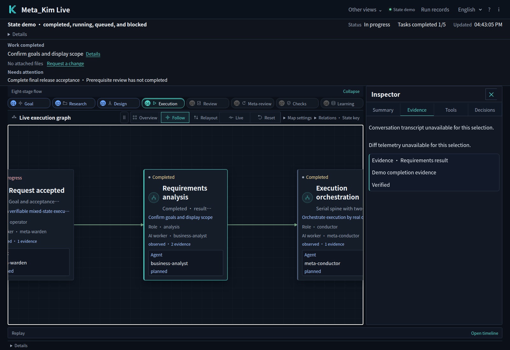

*The built-in demo after selecting a task and opening its evidence. The panel helps explain the task's state through its records.*

Use the language selector for Chinese, English, Japanese or Korean. Live remembers the interface language and preserves original task and feedback text. Review registered system/module files and submit feedback directly in Live; the current AI host continues through durable work orders. Other native-client decisions retain their existing surfaces.

<a id="clients"></a>

## Use the client you already work in

The interactive installer supports these six target names. Choose one during setup, or use its name with `--targets`.

| Client | Target | What setup provides |
| --- | --- | --- |
| Claude Code | `claude` | Agents, Skills, commands and Hooks |
| Codex | `codex` | Agents, shared Skills, configuration and Hooks |
| Cursor | `cursor` | Agents, Skills, project rules and Hooks |
| OpenClaw | `openclaw` | Agent workspaces, Skills and a configuration template |
| Gemini CLI | `gemini` | Agents, shared Skills, settings and Hooks |
| ZCode | `zcode` | Agents, Skills, MCP configuration and optional user-level Hooks |

After installation, reopen the client in your working project so it loads the configuration. Tool access and model permissions remain controlled by that client. To enable Meta_Kim's global Hooks, add `--with-global-hooks` to the setup command; ZCode reads Hooks at the user level.

**OpenClaw also needs its template connected.** Setup produces the agent workspaces and `openclaw.template.json`—normally under `~/.openclaw/` for global setup, or `openclaw/` within a project installation. Merge the template's `agents.list` and `skills.load.extraDirs` into your existing OpenClaw configuration, preserving other agents, directories and settings. Restart the gateway and select `meta-warden` as the entry agent.

**Qoder and Trae** Beta adapter resources are included for experimental integration. They are inactive until explicitly configured and are not additional `--targets` options. DeepSeek Harness uses the separate setup below. Dependency projects maintain their own client support.

### Configure the client and model separately


**A professional method, an execution client and a model are separate choices.** The same PRD, eight-stage workflow, handoff and verification methods can be used in different clients. Names such as Claude Code, Codex, Gemini CLI and ZCode describe the client; its connection settings and the current request determine the model. A Claude Code client connected to a MiniMax model remains a Claude Code client, with the model recorded separately.

| What to change | Existing configuration entry | Behavior |
| --- | --- | --- |
| Client for this run | API `runtime` / CLI `--runtime` | Explicit selection takes priority; auto uses bound adapters, configuration and host signals, retaining its source |
| Compatibility default without host evidence | `selectionPolicy.defaultPlanningRuntime` in `config/contracts/runtime-priority-and-compatibility-contract.json` | A traceable planning default, never proof of execution or permission |
| Worker model for this run | API `stageRunner.model` / CLI `--stage-runner-model` | Implemented command bridges pass it through their real protocol; injected adapters must declare model-selection support |
| Account, connection and model availability | Current client or host settings | Supplied by the actual environment; method packages do not grant model access or tool permissions |

Without an explicit model, the record identifies runtime-process defaults; it does not infer inheritance from the parent session. Receipts distinguish **requested**, **applied to the adapter**, and **observed** models. Missing observations remain unknown. An unsupported explicit request produces a capability gap instead of a silent substitution. Changing execution settings requires a new execution basis while completed Work records remain reusable.

Installation projections, host continuation and native command bridges have separate support boundaries. The six installer targets above come from `config/sync.json`. Built-in read-only stage workers currently implement native Codex and Claude Code protocols. Host continuation for Gemini, ZCode and other clients requires a real adapter and capability evidence. MiniMax Code or another new client can read portable methods; native execution requires an implemented and verified adapter, not just another name in a list.

Older runs without the new client, operating-system and model binding remain historical evidence. Further execution uses a new `runId` and fresh capability/context evidence, without guessing the historical model. Resuming a newly bound run preserves its original model-parameter record; appending business adoption or effect observations does not rerun workers.

## Add Kim Service when the job needs specialist methods

Meta_Kim organizes the work. **Kim Service supplies reusable specialist methods and materials** for tasks such as design, analysis and content delivery. Connecting it lets Meta_Kim consider those methods when selecting how a task should be done; the task still runs through the tools available in your client.

If the installer has already registered a managed Service source and its installation record still verifies, Meta_Kim can use that registration. For a copy you download yourself, bind its directory explicitly as follows.

Clone Kim Service into a local directory:

```bash
git clone https://github.com/KimYx0207/Kim_Service.git
```

In **the working project's root**, create `.meta-kim/local.overrides.json` and point it to the absolute directory of that checkout:

```json
{
  "dependencyRoots": {
    "kim-service": "/absolute/path/to/Kim_Service"
  }
}
```

If this file already exists, merge the `kim-service` entry into its existing `dependencyRoots` object and preserve all other settings. Use the root of the project opened in your AI client, rather than the Meta_Kim installer directory. On Windows, forward slashes are valid in the JSON path, for example `C:/Projects/Kim_Service`.

For environment-managed setups, `META_KIM_KIM_SERVICE_ROOT` provides the same binding and takes precedence over the local file; set it in the environment that launches the AI client. Simply placing the two repositories beside each other does not connect them. Once the binding is present, ask the assistant to check available Kim Service capabilities and use the relevant method for your task.

<a id="dsh"></a>

## DeepSeek Harness setup

DSH has a separate Beta integration using its native profile, Skills and MCP configuration. With **DSH 0.2.2-rc.1** and **Node.js 24.9.0+** already installed, run these commands from the Meta_Kim checkout:

```bash
node bin/meta-kim.mjs dsh install
node bin/meta-kim.mjs dsh check
dsh --profile meta-kim
```

For one project, add `--scope project --project-root "/path/to/your-project"` to the install command, then use the launch command printed by the installer. Check that same project with:

```bash
node bin/meta-kim.mjs dsh check --scope project --project-root "/path/to/your-project"
```

To include Kim Service's native DSH Skills, download and unpack its DSH package from the [Kim Service releases](https://github.com/KimYx0207/Kim_Service/releases/latest), then add `--service-package "/path/to/unpacked-service-package"` when installing or updating.

Use `node bin/meta-kim.mjs dsh update` to refresh this integration. An update retains an existing Service projection; pass a new unpacked Service package when you want to update those Skills too. To remove the integration, run `node bin/meta-kim.mjs dsh uninstall`. For project updates or removal, supply the same `--scope project --project-root` values used at installation.

<a id="continue-work"></a>

## Continue, improve and keep the installation current

When a conversation is interrupted, reopen the **same working project** and ask the assistant to read its saved plan, findings, progress and execution records before continuing. For example:

> “Continue the sign-up improvement. Check the saved decisions and completed work against the current project, confirm the outcome of any interrupted operation, and carry on from the next unfinished task.”

For another iteration, say what to preserve and what should change: “Keep the mobile layout and the existing fields; improve the confirmation message.” This makes the new work build on the accepted result. An optional Memory service can help retain selected information across sessions; project task records already provide the basis for continuing the current work.

To update a source installation, run these commands in the Meta_Kim checkout:

```bash
git pull --ff-only
node setup.mjs --update
node setup.mjs --check
```

If installation or client loading needs attention, `node bin/meta-kim.mjs doctor` checks the setup and suggests the next step. Keep your working project's records when updating so later sessions can continue from them.

## Source and generated files


**Each kind of fact has one authoritative source; application, data and views connect through those sources.** These paths describe the current implementation:

| Responsibility | Source or implementation | Change boundary |
| --- | --- | --- |
| Shared methods and stage contracts | `canonical/`, `config/contracts/` | Methods, eight stages and governance each retain their own source |
| Client and adapter facts | `config/sync.json`, `config/runtime-compatibility-catalog.json`, `scripts/runtime-tool-profiles.mjs` | Projection targets, formats and capability evidence stay distinct; installation is not execution proof |
| Application and domain rules | `src/application/`, `src/domain/`, `scripts/governed-execution/` | Tasks, dependencies, recovery and outcome rules; the main entry remains `scripts/run-meta-theory-governed-execution.mjs` |
| Data and host adapters | `src/data/repositories/`, `src/infrastructure/` | Persist run and knowledge records; connect actual hosts through existing adapter protocols |
| Presentation | `src/presentation/live/`, `src/presentation/run-surfaces/` | Show state, evidence and next actions without another model-selection policy |

Extend the responsible layer: methods in canonical, client configuration and verified adapters for a new host, existing state for a new view. The business host retains the Work master record, organization permissions, external notifications and scheduled knowledge processing. `scripts/build-readme-animations.mjs` and localized copy generate the README’s animated SVG diagrams; `--check` detects source drift. Titles, entry cards and endings are centered, and reduced motion retains the complete relationships.

Shared Agents, Skills and runtime assets are maintained in `canonical/`, with machine-readable configuration in `config/`. Client directories such as `.claude/`, `.codex/` and `.cursor/` are generated locally by `npm run meta:sync`. These runtime projections are excluded from GitHub source and kept local through `.gitignore`; the distribution package includes their shared sources.

## Contact


GitHub <a href="https://github.com/KimYx0207">KimYx0207</a> |
X <a href="https://x.com/KimYx0207">@KimYx0207</a> |
Website <a href="https://www.aiking.dev/">aiking.dev</a> |
WeChat Official Account: <strong>老金带你玩AI</strong>

Feishu knowledge base:
<a href="https://my.feishu.cn/wiki/OhQ8wqntFihcI1kWVDlcNdpznFf">long-term updates</a>

### Method basis

Meta_Kim’s methodological foundation comes from research on meta-based intent amplification, authored by this project’s maintainer (KimYx0207):

- Paper: <https://zenodo.org/records/18957649>
- DOI: `10.5281/zenodo.18957649`

---

## License

[Apache License 2.0](LICENSE). Commercial use is allowed. When redistributing Meta_Kim or substantial portions, retain [LICENSE](LICENSE) and [NOTICE](NOTICE). Third-party capabilities keep their own licenses. Attribution must not imply endorsement.

Recommended attribution: **Meta_Kim by KimYx0207 — https://github.com/KimYx0207/Meta_Kim**
