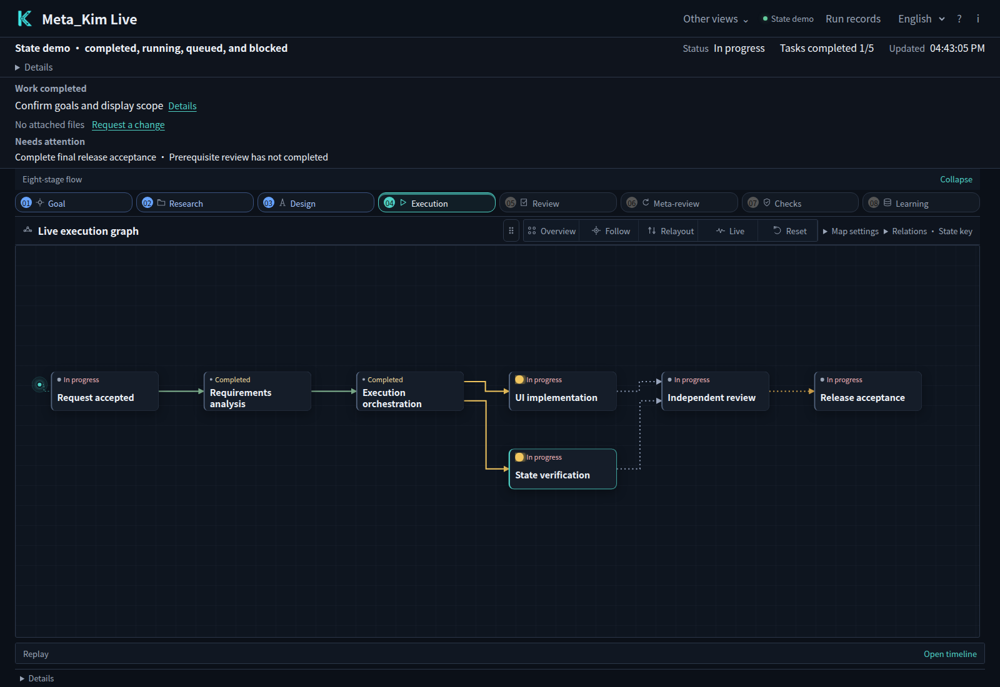
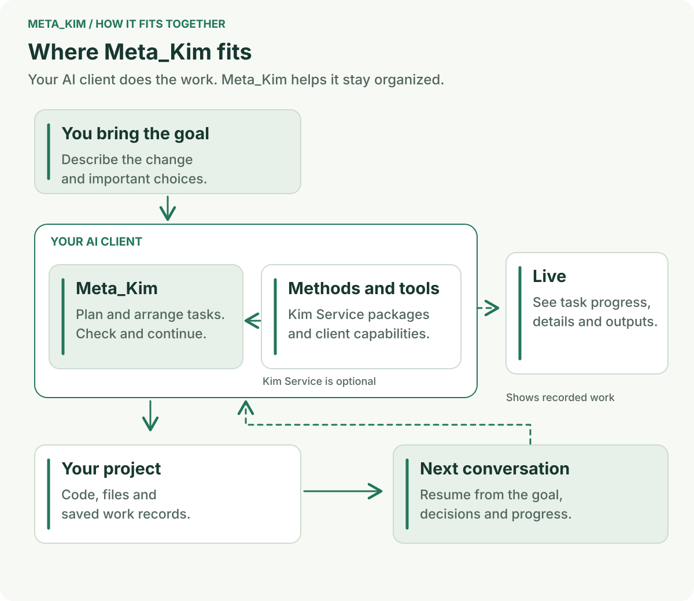

<div align="center">

# 元 · Meta_Kim

**Tell your AI what you want to finish. Keep the work moving from the first idea to the next improvement.**

[English](README.md) · [简体中文](README.zh-CN.md) · [日本語](README.ja-JP.md) · [한국어](README.ko-KR.md)

[](https://github.com/KimYx0207/Meta_Kim/stargazers)
[](LICENSE)

</div>

## Give your AI a job to carry through

**Meta_Kim helps your AI assistant plan the work, bring in the right skills, check the result and pick up where it left off.** You keep using your usual AI client. The project's goals, decisions and progress stay together as the work grows.



*The actual Live interface, running its built-in workflow demo. Start with the task map to see how the work connects; click a task to look inside it.*

## One example: make a sign-up page easier to use on a phone

You already have a working website. The sign-up form feels awkward on a phone, and you want to improve it without changing the data you collect.

You describe the outcome in your own words. **Start with the problem you see:** the fields feel cramped, errors are hard to spot, and you want to try the changed flow yourself. Meta_Kim helps the assistant read the existing project and turn that request into a workable approach.

**Agree on the change, then follow the work.** In this example, that could mean adjusting the mobile layout, making field errors clearer and checking that the same data still reaches the application. The work is divided into tasks with the relevant files, methods and completion criteria. Live shows how those tasks connect and what is happening now.

**Try the result, then keep improving it.** Ask for the changed source, how to run it and the checks that were performed. Walk through the form on a phone-sized screen: leave a field empty, enter an invalid value, then complete a normal sign-up. Your next request can build on that result—“Keep this layout, but make the confirmation message clearer.” Saved decisions and task records help the next session continue the same job.


This is a first-project example. The same way of working also fits a new feature, a repair or a larger product built over several sessions.

## How Meta_Kim helps the work stay together



You bring the goal and make the product choices that matter. **Meta_Kim organizes the work inside your AI client:** what to understand first, which tasks are ready, what each task needs and how to judge the result.

**[Kim Service](https://github.com/KimYx0207/Kim_Service) supplies specialist methods** for work such as product design, development and analysis. Meta_Kim can use them alongside the tools and skills already available in your client. The working records connect the plan to the outputs, so a later session has something concrete to continue from.

## Try it on your own project

You need **Node.js 22.13.0+** and a configured AI client. Current release: **[v3.10.2](https://github.com/KimYx0207/Meta_Kim/releases/tag/v3.10.2)**.

### 1. Install Meta_Kim

```bash
git clone https://github.com/KimYx0207/Meta_Kim.git
cd Meta_Kim
npm install
node setup.mjs
```

Choose the client you use and follow the setup prompts. You can install for one project or reuse the setup across projects. See [installation options](docs/technical-notes.md#installation-options) when you need to choose a scope or configure an optional service.

### 2. Open your project and describe the result

Open the project in the client you configured. For the sign-up example, send this as a normal chat message:

> “Review this project's sign-up flow. Make it easier to use on a phone, preserve the current data fields, and show me the changed flow with its checks.”

The assistant starts from the current project. Explain any real constraints—such as keeping existing fields or matching your product's style—and answer the questions that affect the result. You can follow the proposed approach and ask for changes as the work develops.

### 3. Open Live and inspect a task

From the Meta_Kim checkout, run:

```bash
node bin/meta-kim.mjs live --project-root "/path/to/your-project"
```

Replace the quoted path with your project's absolute directory, then open the local URL printed by the command. Live reads the project's saved task and execution records. If you want to explore the interface first, open the same URL with `?demo=states` to see the built-in demo.

**First, look at the task map** shown at the top of this page. Follow the links between tasks to understand what is in progress and what depends on another task. **Then click a task node.** Its detail panel lets you inspect the task summary; choose **Evidence** to read the recorded outputs and checks.


*The same built-in demo after selecting a task. Use the detail panel to understand one piece of work before returning to the whole map.*

Return to your AI client to give feedback on the actual deliverable. In our example, that means trying the sign-up flow and explaining the next change you want.

### Update an existing installation

Run these commands in your Meta_Kim checkout:

```bash
git pull --ff-only
node setup.mjs --update
node setup.mjs --check
```

## Choose your client

Choose the client you already work in. Each integration uses that client's own configuration and extension formats.

| Client | Integration and starting point |
| --- | --- |
| **Codex · Claude Code** | Agents, Skills, instructions and Hooks; choose them during setup |
| **Cursor** | Agents, Skills, project rules and Hooks; choose Cursor during setup |
| **OpenClaw** | Skills, agent workspaces and a configuration template; choose OpenClaw during setup |
| **Gemini CLI** | Agents, shared Skills, settings and Hooks; [client guide](canonical/skills/meta-theory/references/runtime-gemini.md) |
| **ZCode** | Agents, Skills, MCP and user-level Hooks; [client guide](canonical/skills/meta-theory/references/runtime-zcode.md) |
| **DeepSeek Harness (DSH)** | Beta integration with native Skills, profile/project setup and MCP; [client guide](docs/technical-notes.md#deepseek-harness) |
| **Qoder · Trae** | Beta compatibility adapters; [integration details](config/runtime-compatibility-catalog.json) |

[Compatibility catalog](config/runtime-compatibility-catalog.json) · [Installation and technical notes](docs/technical-notes.md). Dependency projects maintain their own client support.

## Go further when you need to

For setup choices, Hooks and optional services, read the [installation and technical notes](docs/technical-notes.md). To see how a goal becomes actionable work, read [intent to delivery](canonical/skills/meta-theory/references/intent-to-delivery.md).

If you are extending Meta_Kim, start with the [architecture](docs/harness-architecture.md), [Live SDK](docs/live-sdk.md) and [contributor guide](AGENTS.md). The [changelog](CHANGELOG.md) records each version's changes.

## Contact


GitHub <a href="https://github.com/KimYx0207">KimYx0207</a> |
X <a href="https://x.com/KimYx0207">@KimYx0207</a> |
Website <a href="https://www.aiking.dev/">aiking.dev</a> |
WeChat Official Account: <strong>老金带你玩AI</strong>

Feishu knowledge base:
<a href="https://my.feishu.cn/wiki/OhQ8wqntFihcI1kWVDlcNdpznFf">long-term updates</a>

### Buy me a coffee

If Meta_Kim has been useful, support the project with a coffee.

<table align="center">
<tr><th>WeChat Pay</th><th>Alipay</th></tr>
<tr>
<td align="center"></td>
<td align="center"></td>
</tr>
</table>

### Method basis

Meta_Kim’s methodological foundation comes from research on meta-based intent amplification, authored by this project’s maintainer (KimYx0207):

- Paper: <https://zenodo.org/records/18957649>
- DOI: `10.5281/zenodo.18957649`

---

## License

[Apache License 2.0](LICENSE). Commercial use is allowed. When redistributing Meta_Kim or substantial portions, retain [LICENSE](LICENSE) and [NOTICE](NOTICE). Third-party capabilities keep their own licenses. Attribution must not imply endorsement.

Recommended attribution: **Meta_Kim by KimYx0207 — https://github.com/KimYx0207/Meta_Kim**
