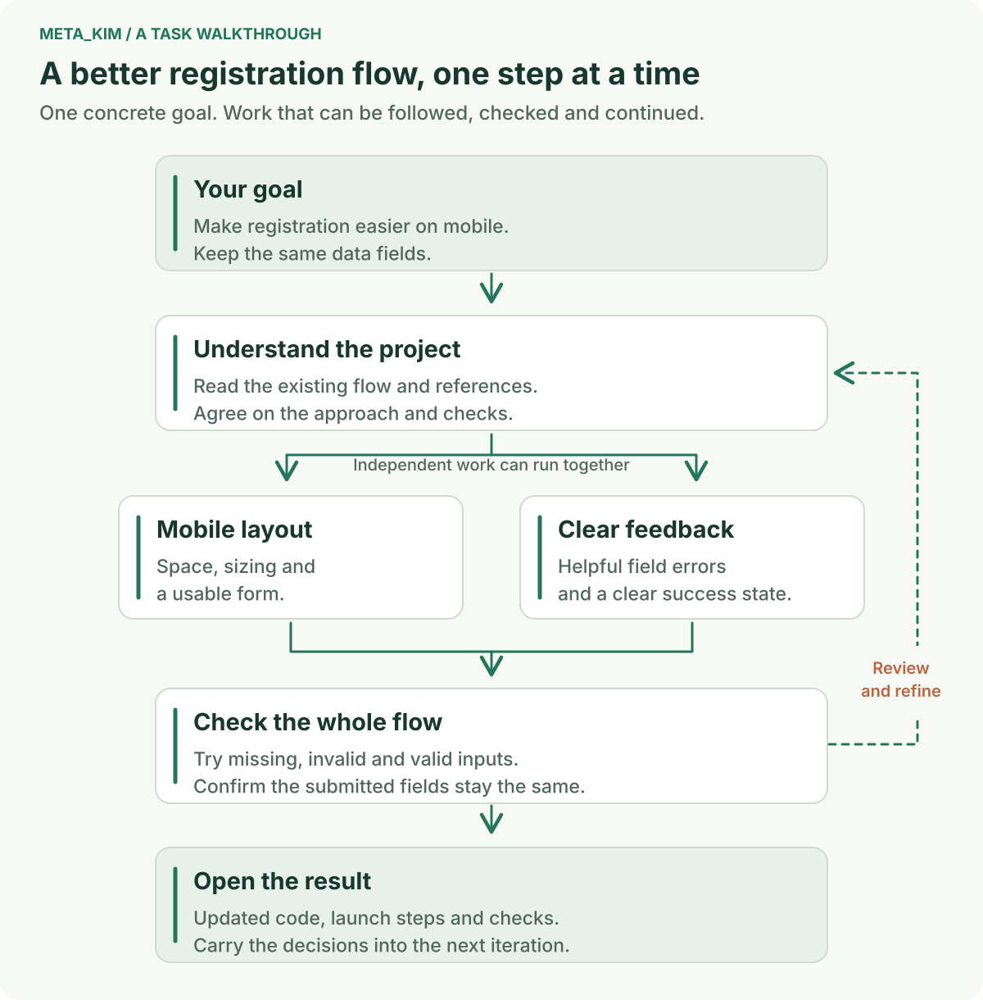
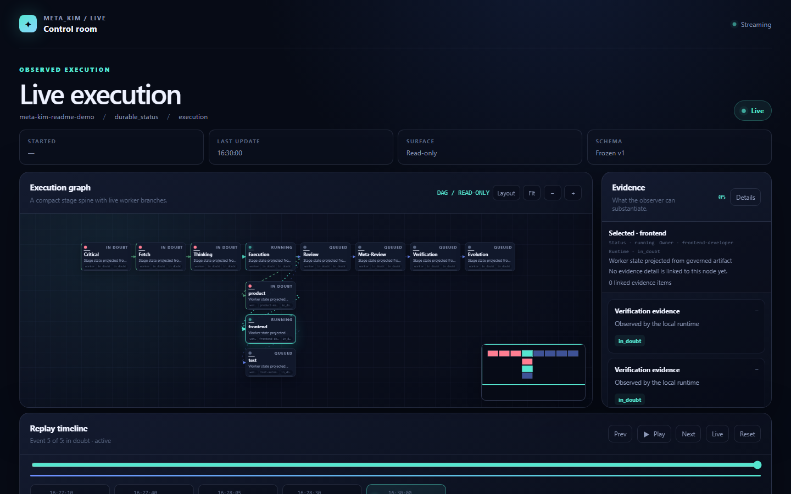

<div align="center">

# 元 · Meta_Kim

**From an idea to a clear plan, coordinated work and a result you can use.**

[English](README.md) · [简体中文](README.zh-CN.md) · [日本語](README.ja-JP.md) · [한국어](README.ko-KR.md)

[](https://github.com/KimYx0207/Meta_Kim/stargazers)
[](LICENSE)

</div>

## Give your AI assistant a whole job to carry through

**Meta_Kim connects your goal, project context, specialist methods and progress records inside your AI client.** It helps the assistant understand the job, choose an approach, coordinate the work and check the result. Decisions and completed work stay with the project, ready for the next session.

### Where it helps

| Your situation | How the work takes shape |
| --- | --- |
| You have an idea for a tool or a new feature | Compare practical approaches, settle the user journey, then turn it into a plan and implementation tasks |
| An existing product needs improvement | Read the current project, identify the affected experience and code, then make and check focused changes |
| A project spans several specialties or sessions | Give each task the right methods and materials, track dependencies, and resume from saved results |

You describe the outcome in your own words. Meta_Kim organizes the work around it. **[Kim Service](https://github.com/KimYx0207/Kim_Service) adds professional methods for the people and tools doing that work.** You can use it alongside other capability sources already available in your client.

## What a delivery can look like

For an event registration tool, a first request might be:

> “Build a mobile-friendly event registration tool. Help me choose an approach, create registration and attendee export, then walk me through how to use it.”

The agreed scope becomes a concrete handover. For this example:

| Part of the job | Deliverable to inspect |
| --- | --- |
| Choose an approach | A recommendation with the user flow, relevant references and reasons for the choice |
| Plan the product | One requirements document: system and technology choices, then modules, interfaces and acceptance criteria |
| Build the experience | Registration, attendee management and export work divided into clear tasks, with the relevant source files and materials |
| Check the result | A walkthrough of registration and export, recorded checks, and specific revisions where needed |
| Pick it up later | Completed outputs, decisions, remaining tasks and the next action in the project record |

The same process can support a small repair or a larger product. The plan grows with the work that needs doing.

## How the work moves forward



1. **Understand the outcome.** Read the project and clarify the few questions that change what should be built.
2. **Find a workable approach.** Investigate the important unknowns, compare useful options and explain a recommendation.
3. **Prepare the work.** Turn the chosen approach into tasks with inputs, owners, dependencies and clear completion criteria.
4. **Build and coordinate.** Give each task the methods and materials it needs. Independent ready work can progress together.
5. **Review, try and improve.** Check outputs against the goal, incorporate feedback and retain useful decisions and results for the next iteration.

The **Live task board** brings tasks, owners, dependencies, outputs and checks into one view. When work is interrupted, saved records help the next session continue from the current state. If one task needs a new approach, its next step stays visible while independent work continues.

<details>
<summary>Preview the Live demo (Chinese interface)</summary>



*This preview shows the Chinese interface with demonstration task data.*

</details>

## Start with your first project

Requires **Node.js 22.13.0+** and a configured AI client. Current release: **[v3.10.1](https://github.com/KimYx0207/Meta_Kim/releases/tag/v3.10.1)**.

### 1. Install Meta_Kim

```bash
git clone https://github.com/KimYx0207/Meta_Kim.git
cd Meta_Kim
npm install
node setup.mjs
```

Follow setup to select your clients and installation scope. Global setup lets you reuse the same capabilities across projects; project setup gives a project its own configuration. Existing user settings are merged. [Installation options](docs/technical-notes.md#installation-options).

### 2. Open your project and describe the result

In your configured client, open the project you want to work on and give a practical request:

> “Review this project's sign-up flow. Make it easier to use on a phone, preserve the current data fields, and show me the changed flow with its checks.”

The assistant starts with the available project information. You make the choices that materially affect the product; routine implementation decisions stay with the working team.

### 3. Follow progress and try the deliverable

Open the current task's Live link. From the Meta_Kim checkout, you can also start Live for your project with:

```bash
node bin/meta-kim.mjs live --project-root "/path/to/your-project"
```

Replace the example path with your project directory. Use the outputs and checks to review the result, then give feedback on what should change next.

### Keep an existing installation up to date

Run these commands in your Meta_Kim checkout:

```bash
git pull --ff-only
node setup.mjs --update
node setup.mjs --check
```

## Choose your client

Choose the client you already work in. Each integration uses that client's own configuration and extension formats.

| Client | Integration and starting point |
| --- | --- |
| **Codex · Claude Code** | Agents, Skills, instructions and Hooks; choose them during setup |
| **Cursor** | Agents, Skills, project rules and Hooks; choose Cursor during setup |
| **OpenClaw** | Skills, agent workspaces and a configuration template; choose OpenClaw during setup |
| **Gemini CLI** | Agents, shared Skills, settings and Hooks; [client guide](canonical/skills/meta-theory/references/runtime-gemini.md) |
| **ZCode** | Agents, Skills, MCP and user-level Hooks; [client guide](canonical/skills/meta-theory/references/runtime-zcode.md) |
| **DeepSeek Harness (DSH)** | Beta integration with native Skills, profile/project setup and MCP; [client guide](docs/technical-notes.md#deepseek-harness) |
| **Qoder · Trae** | Beta compatibility adapters; [integration details](config/runtime-compatibility-catalog.json) |

[Compatibility catalog](config/runtime-compatibility-catalog.json) · [Installation and technical notes](docs/technical-notes.md). Dependency projects maintain their own client support.

## Find the next useful guide

| You want to… | Read |
| --- | --- |
| Choose installation scope, enable Hooks or configure an optional service | [Installation and technical notes](docs/technical-notes.md) |
| Understand how research and requirements reach the people doing the work | [Intent to delivery](canonical/skills/meta-theory/references/intent-to-delivery.md) |
| Work with the Live interface or extend its views | [Live SDK](docs/live-sdk.md) |
| Understand the architecture or contribute | [Architecture](docs/harness-architecture.md) · [Contributor guide](AGENTS.md) |
| See what changed in each version | [Changelog](CHANGELOG.md) |

## Contact


GitHub <a href="https://github.com/KimYx0207">KimYx0207</a> |
X <a href="https://x.com/KimYx0207">@KimYx0207</a> |
Website <a href="https://www.aiking.dev/">aiking.dev</a> |
WeChat Official Account: <strong>老金带你玩AI</strong>

Feishu knowledge base:
<a href="https://my.feishu.cn/wiki/OhQ8wqntFihcI1kWVDlcNdpznFf">long-term updates</a>

### Buy me a coffee

If Meta_Kim has been useful, support the project with a coffee.

<table align="center">
<tr><th>WeChat Pay</th><th>Alipay</th></tr>
<tr>
<td align="center"></td>
<td align="center"></td>
</tr>
</table>

### Method basis

Meta_Kim’s methodological foundation comes from research on meta-based intent amplification, authored by this project’s maintainer (KimYx0207):

- Paper: <https://zenodo.org/records/18957649>
- DOI: `10.5281/zenodo.18957649`

---

## License

[Apache License 2.0](LICENSE). Commercial use is allowed. When redistributing Meta_Kim or substantial portions, retain [LICENSE](LICENSE) and [NOTICE](NOTICE). Third-party capabilities keep their own licenses. Attribution must not imply endorsement.

Recommended attribution: **Meta_Kim by KimYx0207 — https://github.com/KimYx0207/Meta_Kim**
