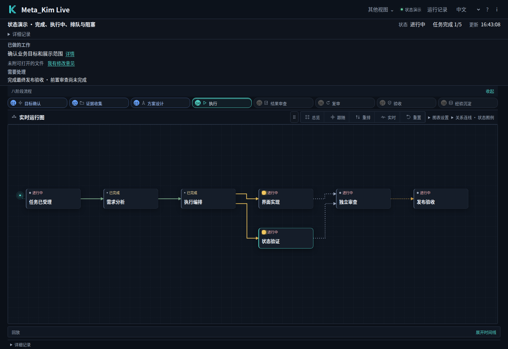
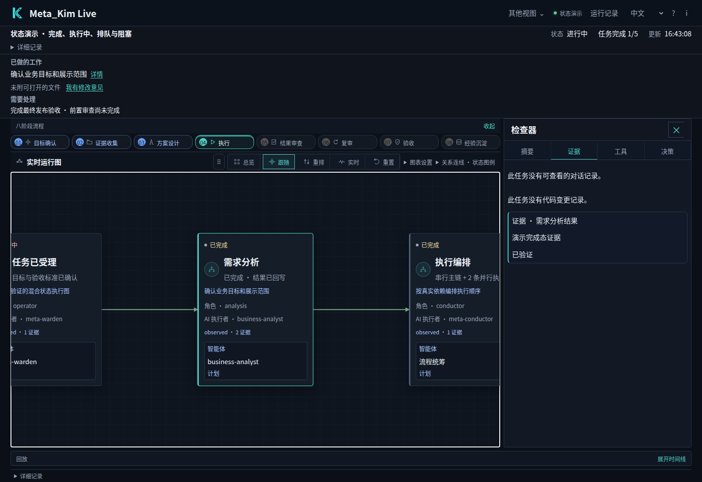

<div align="center">

# 元 · Meta_Kim

**说清你要的结果，让 AI 把调研、设计、协作、验收和下一轮改进接起来。**

[English](README.md) · [简体中文](README.zh-CN.md) · [日本語](README.ja-JP.md) · [한국어](README.ko-KR.md)

</div>

## 一句话提出需求，接下来发生什么？

> “我想做一个预约小工具。客人能在手机上选时段，店员能管理预约，重复点击也别生成两份订单。”

**Meta_Kim 帮 AI 把这句话变成一套能执行、能检查、能接着改的工作。** 它在你熟悉的 AI 客户端里组织全过程：先弄清要解决的问题，查现有项目和参考资料，比较真正影响体验的方案，再形成系统大纲、展开模块详情、安排协作、检查结果。

最终你应当能拿到具体产物：例如可运行的预约页面、管理入口、相关源码、启动方法，以及正常预约、重复提交、时段已满等场景的检查结果。下面用这个预约工具作为贯穿示例，说明系统每一步如何衔接。

实际使用时，在 AI 客户端里打开你的项目，把需求、现有资料和限制发给 AI；后续选择和反馈也在这里完成。**Live 是查看任务、进度和证据的面板**，下图先展示它能看到什么，安装与打开方法在后面。



*真实运行的 Live 界面，使用产品内置工作流演示数据。在 Live 中可以点开任务查看详情；下方动态图用预约工具解释运行机制。*

## 一张思维导图，先看清整套系统



**看图顺序：** 从用户目标出发，沿四条分支看清目标理解、设计、任务与交付的关系，同时看清分工：Meta_Kim 组织工作，专业能力完成具体任务。

- **目标**：谁在什么场景下使用，想得到什么结果，哪些条件必须满足。
- **方案**：查资料、比较可行做法，把重要决定写入同一份需求设计。
- **任务**：把模块拆成有输入、有负责人、有交付物的工作，按依赖组织串行和并行。
- **质量**：审查成果，再实际运行或检查，问题回到对应任务修正。
- **继续与改进**：保存决定、进度和结果，下次从有效成果继续，把经验证的好方法沉淀下来。

它的作用体现在这些连接上。某个模块改变了接口，相关任务会一起更新；一个分支等待你判断，独立工作仍可推进；某次方法无效，下一轮要有新的依据。

## 第一轮 PRD：从一句需求，形成系统框架和模块大纲

**PRD 就是产品需求文档：把“做什么、为什么做、怎样算做好”写清楚。** 在 Meta_Kim 里，系统大纲和模块详情是同一份 PRD 的两次展开，前面的决定会带进后面的设计。



**跟着动画看一次生成过程：** 一句需求先进入现状与调研，再比较方案，最后写入同一份 PRD 的四个部分：用户路径、技术与范围、模块大纲、共同约定。

### 先把场景走通，再决定系统怎么搭

1. **把口头需求翻成可观察的结果。** 谁预约、谁管理？客人选好时段后应看到什么？重复提交怎样处理？明确用户、主要流程、约束和验收要求。
2. **先看手头已有的东西。** 阅读项目结构、实际代码、已用技术及版本、已有数据和正在修改的内容。已有系统做得好的部分继续沿用。
3. **围绕重要未知去找参考。** 需要判断某个能力能否实现，就查对应官方文档；需要设计预约体验，就看完整流程和相关源码。GitHub 项目中的状态处理、接口和恢复方式，都可以成为方案依据。
4. **把真正不同的做法摆出来。** 比如接入现成预约服务、在现有应用里扩展、单独开发一个服务。比较同一使用场景下的体验、投入、维护和数据归属；需要你决定的产品方向，给出理由和建议。
5. **把选定方向整理成系统大纲。** 说明技术栈与版本、系统结构、模块职责、模块之间的接口和共享数据、主要验收要求，以及哪些问题还需要补证据或由你选择。

这时，预约工具的 PRD 大纲可能是：

- **用户路径**：查看可约时段，填写信息，确认预约；店员查看和调整预约。
- **系统结构**：展示层呈现页面和状态，应用层组织预约规则，数据层保存时段和预约记录。
- **模块清单**：时段查询、创建预约、后台管理；每个模块先写目的和边界。
- **共同约定**：谁维护剩余名额，预约状态有哪些，提交和取消接口怎样衔接。
- **本轮验收与待定项**：手机上可完成预约、重复提交结果一致；短信提醒是否进入首版，作为明确的产品选择保留。

例如，“重复点击也别生成两份订单”会先变成验收条件，再落到“创建预约”模块；“谁负责识别同一次提交、谁维护剩余名额”进入接口和共享数据约定。模块的边界由用户路径和这些责任推出来。

**你先看到整体怎么成立，再进入具体模块。** 探索期间可以保留待定项；准备执行某个模块时，它依赖的关键决定和接口必须明确。小修正则直接沿用已有设计，只展开受影响部分。

## 第二轮 PRD：把每个模块展开到能够开工

整体方向明确后，AI 继续补齐每个模块的详细设计，并把它们合成同一份 PRD。模块之间继续共享前面确定的概念、数据和接口。



**跟着动画看一次模块展开：** 带着上一轮的系统基线，选中“创建预约”，补齐操作、状态、规则和接口验收，再把这些内容交给下方的页面、接口和验证任务。

以“创建预约”模块为例，详情至少要回答这些实际问题：

- **用户怎样走完这一步？** 选时段、填信息、确认、得到结果；返回修改和取消后从哪里继续。
- **每个状态显示什么？** 正在加载时如何反馈，没有可约时段时如何引导，提交失败怎样重试，成功后显示什么。手机布局、键盘操作和辅助功能一起考虑。
- **业务规则是什么？** 一个时段能约多少人，重复点击如何识别，名额刚被占满时怎样处理，取消后怎样恢复名额。
- **和其他模块怎样连接？** 输入字段、返回结果、预约状态由谁维护，哪些操作需要权限；数据事务、重试和迁移按实际项目展开。
- **怎么证明做对了？** 每条验收要求都有对应任务和检查方法，覆盖正常流程及与产品相关的失败、恢复场景。

把详细设计交给执行者时，还要把需求和检查连上。以下是预约案例中的任务示例：

| 原始要求 | 设计落点与执行任务 | 怎样检查 |
| --- | --- | --- |
| 重复点击只生成一份预约 | 页面处理提交中状态；接口识别同一次提交并返回同一预约结果 | 连续点击、重发同一次请求，检查只增加一条预约记录 |
| 最后一个名额不会被超约 | 数据与接口任务保证名额扣减一致；页面显示名额已满的结果 | 同时提交两个请求，检查成功数不超过剩余名额 |
| 取消后恢复名额 | 取消接口更新预约状态和余位；页面显示取消后的结果 | 取消成功后再查询时段，检查状态与余位一致 |

每个执行者收到**当前系统基线、自己负责模块的完整设计、相关决定与接口、要交的产物和验收要求**。前后端先对齐共同字段和状态，再在各自范围内开展工作。

以后你把“取消后自动释放名额”改成另一条规则，系统会沿关联决定、模块和依赖找出受影响的任务。仍然有效的成果继续保留，修改集中在实际受影响的部分。

## 八个阶段：每一步留下什么，下一步接什么



**按 01 到 08 跟着高亮阅读。** 每张卡下面写着本阶段要留下的结果；下一阶段接着使用它，发现问题时再回到能解决问题的阶段。

| 阶段 | 接到什么、做什么 | 交给下一步什么 |
| --- | --- | --- |
| **01 Critical · 关键澄清** | 读取需求和项目现状，弄清用户、目标、范围与重要限制 | 明确的目标、成功标准、待解决的关键问题 |
| **02 Fetch · 调研与发现** | 围绕这些问题检查代码、参考资料和可用专业能力 | 有来源的发现、候选方法、具体事实缺口 |
| **03 Thinking · 思考与规划** | 结合目标与证据比较路线，展开两轮 PRD，安排任务及依赖 | 设计基线、负责人、专业方法、输入产物与验收安排 |
| **04 Execution · 执行** | 执行者按当前设计和任务范围完成工作 | 可查看的真实产物、执行记录、阶段合并结果 |
| **05 Review · 审查** | 将产物与目标对照，也检查前面的理解、调研和设计 | 具体问题、修改要求和审查结论 |
| **06 Meta-Review · 复核审查** | 检查审查是否采用合适标准、是否漏项、结论有无依据 | 对审查判断的复核结果，以及需补查的问题 |
| **07 Verification · 实际验证** | 对当前成果运行测试、实际操作或核验；预约案例要走通成功、重复提交和失败恢复 | 当前版本的检查证据、结果和剩余问题 |
| **08 Evolution · 经验改进** | 从实际结果中选择值得复用的发现，评估候选改法 | 经审阅后写回的方法，或本次无需写回的理由 |

这是运行的主骨架。**阶段按顺序衔接，同一阶段里的独立工作可以并行，合并后再进入下一阶段。** 发现目标误解就回到澄清，缺事实就补调研，设计不合适就重新规划，验证失败则让受影响任务修正。简单任务按实际需要准备，审查和复核的深度跟风险相称；没有可复用发现时，记录本次无需改进即可。

## 动态编排：看依赖和当前状态，决定谁现在开工

**动态编排，就是执行中持续判断“现在有哪些任务具备条件”。** 它同时看前置结果、文件范围、资源、权限和客户端当前能并行多少工作。



**先看顶部的共同接口，再同时看左右两条线。** 左侧页面任务暂时等待选择时，右侧接口仍在推进；左侧恢复后，两边在底部合并。这个等待过程正是动态编排要处理的变化。

预约工具可以这样推进：

1. **先把共同接口定好。** 例如提交需要哪些字段、成功和失败各返回什么，这是前端与后端共同的输入。
2. **独立工作同时展开。** 页面实现和预约接口实现如果工作范围彼此独立、客户端有可用执行能力，就可以同时进行；需要修改相同文件的任务协调顺序。
3. **前置结果完成，释放后续任务。** 连接页面与真实接口要等两边产物准备好。调度持续补上新就绪的工作，再把同阶段结果交给合并负责人。
4. **某条分支等待，其他分支继续。** 如果一个页面方案需要你决定，依赖它的页面任务先等待；共用字段和接口已确定的后端工作仍可推进。
5. **问题只回到相关任务。** 一条分支失败时保留独立的成功成果；先查失败原因，形成有依据的修正，再恢复受影响工作。

遇到相同依据下的反复无效尝试，系统会暂停对应任务，要求调整方法或补齐事实。你能看到卡在哪里、为什么等待、需要什么才能继续。

## 留白和节奏：该推进时推进，该让你判断时留出空间

**留白是给当前决策和用户注意力留出空间。** 它关注的是何时展示信息、何时少说、何时等待；PRD 中的待定项则关注信息和决定是否齐备，这两件事分别记录。



**从顶部的新信息往下看：** 系统判断它是否已解决、是否还缺事实、是否需要你选择、是否有紧急变化，再决定当前该推哪张卡。底部的 Pause 留出消化空间，并保存恢复条件。

例如你刚看完系统方案、比较过供应商，又处理了一次重要变更，下一条消息应先说清“已经定了什么、还剩哪个决定”。系统可以暂缓新的高注意力问题，把长材料留在文件里，让你消化当前结果。默认节奏规则会在连续三张高注意力卡后安排 Pause；恢复时重新核对当前状态和下一步。

暂停会留下原因、未完成事项和恢复条件。若只涉及这项页面选择，其他不依赖这个判断的已授权工作仍可推进；你明确要求整个项目暂停时，就按你的要求停止。

### 十张动作卡，处理执行中的变化

“发牌”表示根据当前情况选择一个动作。它们配合八阶段主流程使用，**每次按触发条件选卡，已经满足的卡直接跳过**。

| 动作卡 | 什么时候出现 | 预约案例里怎么用 |
| --- | --- | --- |
| **Clarify · 澄清** | 一个未知答案会改变方向 | 确认店员能否替客人取消预约 |
| **Shrink scope · 收缩范围** | 当前范围过大，影响本轮交付 | 先完成预约主流程，把后续扩展排到下一轮 |
| **Options · 方案选择** | 存在体验、成本或维护不同的可行路线 | 比较接入预约服务与在现有应用内实现 |
| **Execute · 执行** | 设计、输入和执行条件已就绪 | 完成预约页面与接口 |
| **Verify · 验证** | 已有需要核验的产物 | 实际检查预约、重复提交和取消 |
| **Fix · 修复** | 检查发现具体问题 | 修正取消后余位没有恢复的问题 |
| **Rollback · 回退** | 影响正在扩大，需要先恢复稳定状态 | 按恢复方案还原受影响的变更 |
| **Risk · 风险** | 权限、共享数据或其他重要风险出现 | 优先处理店员能否访问其他门店预约的问题 |
| **Nudge · 轻推** | 低风险的下一步暂时停住 | 提出先确认一个成功预约样例的建议 |
| **Pause · 留白** | 连续高注意力判断或信息过密 | 留下当前状态和恢复点，等你消化后继续 |

同一张卡也会有不同处理：现在适用就执行，已经满足就跳过，价值不足就不打扰，依赖未齐就延后，紧急问题插入当前流程，需要更高层判断时升级给负责人。**已经回答过的问题会被记住，内部如何分配 Agent 由系统处理，你关注会改变产品结果的选择。**

## 九个治理角色，怎样接上真正做事的专业能力

你通过 **meta-warden** 进入整套协作。九个角色各有明确分工：

- **meta-warden** 统筹方向、处理冲突，汇总最终结论。
- **meta-conductor** 安排阶段、任务依赖、串并行和交互节奏。
- **meta-genesis** 设计需要的 Agent 身份、职责和提示词结构。
- **meta-artisan** 为任务组合合适的 Skill、MCP 和工具。
- **meta-sentinel** 处理权限、风险、Hook 和恢复边界。
- **meta-librarian** 管理记忆、上下文和中断后的延续。
- **meta-prism** 审查质量、发现偏差，提出具体修正。
- **meta-scout** 搜索和评估外部能力与参考资料。
- **meta-chrysalis** 汇总改进信号，协调经过批准的经验写回。

这些角色按任务需要参与协作。**先确定要做什么，再找能完成它的能力，最后把负责人、方法、工具和验收放进同一张任务单。** 对预约工具来说，各种组件这样配合：

| 组件 | 解决什么问题 | 预约案例中的作用 |
| --- | --- | --- |
| **Agent · 执行者** | 谁负责产出，工作边界在哪里 | 页面和接口各有负责人，明确修改范围与交付物 |
| **Skill · 工作方法** | 按什么步骤和质量标准做 | 页面方法覆盖手机布局、状态反馈和易用性 |
| **专业资料与示例** | 这次需要参考什么知识 | 把适用的状态设计或接口处理示例交给对应任务 |
| **工具与 MCP** | 通过什么能力操作项目或服务 | 读取代码、修改文件、查看页面并检查实际结果 |
| **Command · 可复用入口** | 经常重复的操作怎样调用 | 将已有检查流程作为任务可调用的命令 |
| **Hook · 触发检查** | 在指定时机检查什么关键条件 | 发起操作时检查相关能力、任务范围与权限边界 |

具体能力先从项目和客户端中寻找，再考虑已接入的 Kim Service。合适的能力直接复用，需要适配的按项目调整，确有可复用缺口时再创建。任务单连同当前设计、所需资料和验收方式一起交给执行者，合并负责人汇总各任务结果。

## 中断后接着做，做完后还能变得更好



**沿着“本轮工作 → 保存记录 → 下次恢复”往下看。** 下方两条线分别处理继续完成当前任务，以及评估哪些经验值得留下，二者使用本轮的实际成果作为依据。

Meta_Kim 把计划、发现、进度、决定、产物和检查记录保存在项目中。下一次对话先核对当前文件与这些记录：哪些已经完成，哪个决定还在等待，哪一步的结果需要确认，然后从有效的继续点恢复。

你可以直接说：

> “继续预约工具。保留已经完成的预约流程，先看上次留下的待办，把取消预约后的提示和名额恢复做完，再带我验收。”

如果上次操作是否成功还不明确，会先查当前结果再决定是否重做。项目关系图帮助找到相关模块，记忆和运行记录帮助理解此前的决定；实际源文件与当前产物始终参与核对。

复用经验时，先记录遇到的问题和候选改法，再验证它是否改善结果、是否影响其他场景，经过相应审阅后更新方法或组件。**持续改进有具体样本、比较和恢复路径，下一次任务才能用上经过检验的经验。**

<a id="installation"></a>

## 在自己的项目里开始

先准备 **Node.js 22.13.0+**、Git，以及已经配置好模型连接的 AI 客户端。当前版本：**[v3.10.2](https://github.com/KimYx0207/Meta_Kim/releases/tag/v3.10.2)**。

### 1. 安装 Meta_Kim

```bash
git clone https://github.com/KimYx0207/Meta_Kim.git
cd Meta_Kim
npm install
node setup.mjs
```

按提示选择客户端和安装范围。**全局安装**让当前账号下的多个项目复用能力；**项目安装**会请你选择一个具体项目目录。保留 Meta_Kim 仓库，之后可用它更新。实际工作的项目可以放在另一个目录。

例如，只给某个项目安装 Codex 支持：

```bash
node setup.mjs --targets codex --scope project --project-dir "/path/to/your-project"
```

把引号中的路径换成项目的绝对路径。需要账号级安装时，改用 `--scope global` 并去掉 `--project-dir`；同时使用多个客户端，可以写成 `--targets codex,claude`。

也可以不保留源码副本，直接用 `npx --yes github:KimYx0207/Meta_Kim` 安装，以后用 `npx --yes github:KimYx0207/Meta_Kim update` 更新。这个入口接受相同的安装参数；下文以 `node bin/meta-kim.mjs` 开头的 CLI 命令，也可以换成这个 `npx` 前缀执行。

### 2. 打开项目，直接描述想要的结果

在刚才配置的客户端中打开实际工作的项目，像平时聊天一样提出需求：

> “帮我检查这个项目的注册流程，让手机上填写更顺手，保留现在的数据字段，改好后把流程和检查结果给我看。”

提供现有项目和重要约束，确认它提出的关键选择，再让它按方案推进。你随时可以问：现在改什么、为什么这样改、准备怎样检查。无需先记住某个启动口令。

### 3. 打开 Live，查看具体任务

在 Meta_Kim 仓库目录运行：

```bash
node bin/meta-kim.mjs live --project-root "/path/to/your-project"
```

打开命令打印的本地地址。Live 读取指定项目已保存的任务与执行记录。如果还没有项目记录，可以在地址后加上 `?demo=states`，先看本页截图中的内置演示。

**先看本页顶部的任务图**，沿连线了解前后依赖和正在推进的工作。**再点一个任务节点**，在详情面板选择 **证据**，查看已经记录的产物和检查结果。



*内置演示中，选中任务并打开证据页签后的真实界面。通过这些记录，可以理解任务为什么处于当前状态。*

顶部语言选择器支持中文、英文、日文和韩文，会记住你的界面语言；自己输入的任务原文保持不变。新的要求和反馈仍发给 AI 客户端，用 Live 跟进和查看已有记录。

<a id="clients"></a>

## 用你已经熟悉的客户端

交互安装器支持以下六个目标名称。安装时选择对应客户端，或在 `--targets` 后填写名称即可。

| 客户端 | 目标名称 | 安装内容 |
| --- | --- | --- |
| Claude Code | `claude` | Agent、Skill、命令和 Hook |
| Codex | `codex` | Agent、共用 Skill、配置和 Hook |
| Cursor | `cursor` | Agent、Skill、项目规则和 Hook |
| OpenClaw | `openclaw` | Agent 工作区、Skill 和配置模板 |
| Gemini CLI | `gemini` | Agent、共用 Skill、设置和 Hook |
| ZCode | `zcode` | Agent、Skill、MCP 配置及可选的用户级 Hook |

安装后，在工作项目中重新打开客户端，让它加载配置。工具访问和模型权限仍由客户端管理。需要启用 Meta_Kim 的全局 Hook 时，在安装命令中加上 `--with-global-hooks`；ZCode 从用户级配置读取 Hook。

**OpenClaw 还需要接上配置模板。** 安装会生成各 Agent 工作区和 `openclaw.template.json`：全局安装默认放在 `~/.openclaw/`，项目安装放在项目内的 `openclaw/`。把模板中的 `agents.list`、`skills.load.extraDirs` 合并进现有 OpenClaw 配置，保留原有 Agent、目录和设置。重启网关后，选择 `meta-warden` 作为入口 Agent。

**Qoder、Trae** 的 Beta 适配资源随包提供，需要明确配置后才启用，不是新增的 `--targets` 安装目标。DeepSeek Harness 使用下面的独立安装方式。依赖项目自己的客户端支持由上游维护。

## 需要专业方法时，接上 Kim Service

Meta_Kim 负责组织工作，**Kim Service 提供可复用的专业方法和材料**，用于设计、分析、内容交付等具体任务。接入之后，Meta_Kim 选择任务执行方法时，就能把这些能力纳入考虑；实际工作仍通过当前客户端已有的工具执行。

如果安装器已经登记了受管理的 Service 源码，且安装记录校验通过，Meta_Kim 可以直接使用这份登记。自己下载的副本则按下面的步骤明确绑定目录。

先把 Kim Service 下载到本地：

```bash
git clone https://github.com/KimYx0207/Kim_Service.git
```

在**实际工作的项目根目录**中创建 `.meta-kim/local.overrides.json`，写入 Kim Service 仓库的绝对路径：

```json
{
  "dependencyRoots": {
    "kim-service": "/absolute/path/to/Kim_Service"
  }
}
```

如果文件已经存在，只把 `kim-service` 合并进已有的 `dependencyRoots`，保留其他配置。这里指 AI 客户端当前打开的工作项目根目录，不是 Meta_Kim 安装器所在目录。Windows 路径可以使用正斜杠，例如 `C:/Projects/Kim_Service`。

如果用环境变量统一管理，也可在启动 AI 客户端的环境中设置 `META_KIM_KIM_SERVICE_ROOT`；它的优先级高于本地文件。仅把两个仓库放在同一父目录下，不会自动建立连接。配置好后，可以让 AI 检查可用的 Kim Service 能力，再为当前任务选择相关方法。

<a id="dsh"></a>

## DeepSeek Harness 接入

DSH 使用独立的 Beta 接入方式，通过原生 profile、Skill 和 MCP 配置工作。准备好 **DSH 0.2.2-rc.1** 和 **Node.js 24.9.0+** 后，在 Meta_Kim 仓库目录运行：

```bash
node bin/meta-kim.mjs dsh install
node bin/meta-kim.mjs dsh check
dsh --profile meta-kim
```

只配置一个项目时，在安装命令后加 `--scope project --project-root "/path/to/your-project"`，然后使用安装器打印的启动命令。检查时也指定同一个项目：

```bash
node bin/meta-kim.mjs dsh check --scope project --project-root "/path/to/your-project"
```

需要一并安装 Kim Service 的原生 DSH Skill，可以从 [Kim Service 发布页](https://github.com/KimYx0207/Kim_Service/releases/latest)下载并解压 DSH 包，安装或更新时加 `--service-package "/path/to/unpacked-service-package"`。

后续用 `node bin/meta-kim.mjs dsh update` 更新这套接入。更新会保留已有的 Service 投影；需要同时更新这些 Skill 时，再传入新版解压目录。卸载使用 `node bin/meta-kim.mjs dsh uninstall`。项目级更新或卸载时，带上安装时使用的同一组 `--scope project --project-root` 参数。

<a id="continue-work"></a>

## 继续任务、提出改进和更新安装

对话中断后，重新打开**同一个工作项目**，先让 AI 读取已经保存的计划、发现、进度和执行记录。例如：

> “继续注册流程的改进。先把已记录的决定和完成的工作与当前项目核对，确认中断操作的实际结果，再从下一项未完成任务接着做。”

继续迭代时，说清哪些保留、哪些改变，例如：“保留手机布局和现有字段，改进注册成功提示。” 这样，新的工作就能接着已认可的成果开展。可选的 Memory 服务可以帮助跨会话保存选定信息；当前任务的续接，本身已有项目记录作为依据。

源码安装的更新方式，在 Meta_Kim 仓库目录执行：

```bash
git pull --ff-only
node setup.mjs --update
node setup.mjs --check
```

安装或客户端加载出现问题时，可以运行 `node bin/meta-kim.mjs doctor` 检查配置并查看下一步建议。更新时保留工作项目的记录，后续对话才能继续使用。

## 源码与生成文件

共用的 Agent、Skill 和运行资源维护在 `canonical/` 中，机器可读配置位于 `config/`。`.claude/`、`.codex/`、`.cursor/` 等客户端目录由 `npm run meta:sync` 在本地生成，由 `.gitignore` 管理并保留在本地，不提交到 GitHub 源码；发布包携带对应的共用源文件。

## 联系方式


GitHub <a href="https://github.com/KimYx0207">KimYx0207</a> |
X <a href="https://x.com/KimYx0207">@KimYx0207</a> |
官网 <a href="https://www.aiking.dev/">aiking.dev</a> |
微信公众号：**老金带你玩AI**

飞书知识库：
<a href="https://my.feishu.cn/wiki/OhQ8wqntFihcI1kWVDlcNdpznFf">长期更新入口</a>

### 请我一杯咖啡

如果 Meta_Kim 帮到了你，欢迎请我喝杯咖啡，算是对持续维护的支持。

<table align="center">
<tr><th>微信支付</th><th>支付宝</th></tr>
<tr>
<td align="center"></td>
<td align="center"></td>
</tr>
</table>

### 方法依据

Meta_Kim 的方法论基础来自本项目维护者（KimYx0207）撰写的"基于元的意图放大"研究：

- 论文：<https://zenodo.org/records/18957649>
- DOI：`10.5281/zenodo.18957649`

---

## License

采用 [Apache License 2.0](LICENSE)，允许商业使用。再分发 Meta_Kim 或重要组成部分时保留 [LICENSE](LICENSE) 和 [NOTICE](NOTICE)；第三方能力遵循各自许可证。署名不代表作者为衍生项目背书。

建议署名：**Meta_Kim by KimYx0207 — https://github.com/KimYx0207/Meta_Kim**
