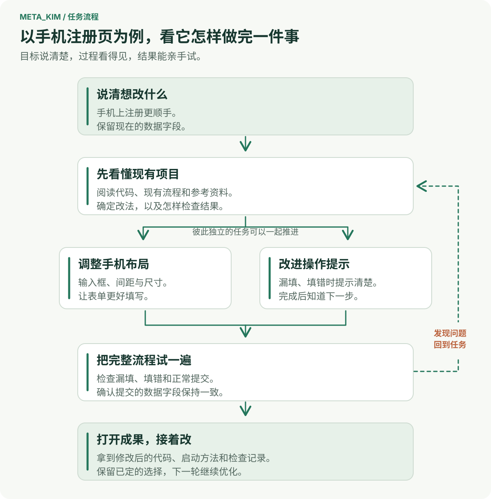
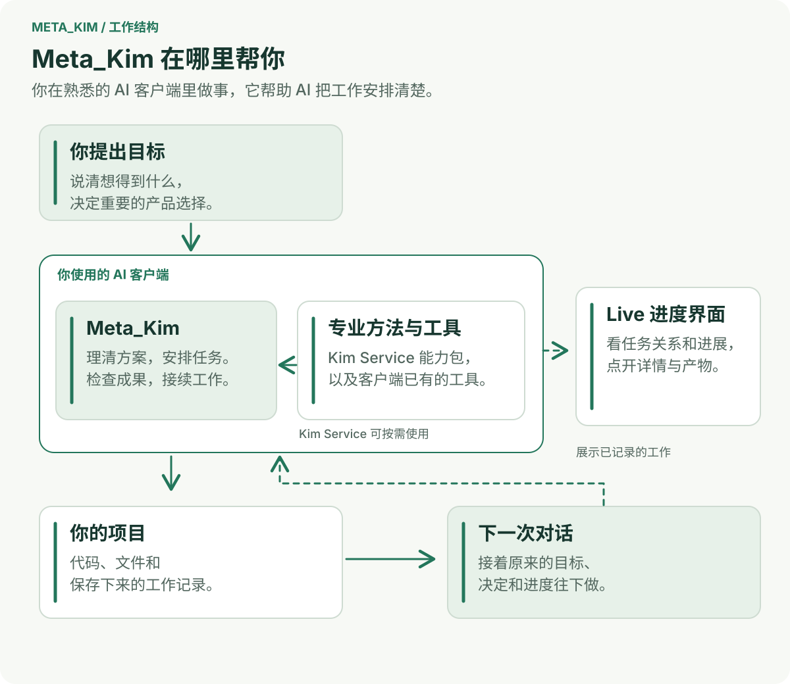

<div align="center">

# 元 · Meta_Kim

**把想做的事告诉 AI，让它从想法、动手到交付，接着做下去。**

[English](README.md) · [简体中文](README.zh-CN.md) · [日本語](README.ja-JP.md) · [한국어](README.ko-KR.md)

[](https://github.com/KimYx0207/Meta_Kim/stargazers)
[](LICENSE)

</div>

## 给 AI 一件事，让它有头有尾地做

**Meta_Kim 帮你的 AI 助手理清怎么做、找合适的能力、检查结果，并接着上次的进度继续。** 你仍然使用熟悉的 AI 客户端，目标、决定和任务记录会跟着项目一起积累。


*实际运行的 Live 内置演示。先看任务图了解工作之间的关系，再点开一个任务看细节。*

## 举个例子：把注册页面改得更适合手机

你已经有一个能用的网站，但手机上填注册表单不太顺手。你想把它改好，又不想动现在收集的数据字段。

你用自己的话说清楚想得到什么。**先说眼前的问题：** 输入框太挤、填错之后提示不明显，希望改好后能亲手试一遍。Meta_Kim 帮助 AI 读懂现有项目，把这件事整理成可执行的方案。

**确定怎么改，再看它一步步做。** 这个例子可能需要调整手机布局、改进字段提示，再检查提交的数据是否保持一致。每项工作会带上需要的文件、方法和完成标准。你可以在 Live 里看到任务之间的关系，以及现在做到哪里。

**拿到结果，试一遍，再接着改。** 让 AI 交付修改后的代码、启动方法和已经做过的检查。把页面切到手机尺寸，试试漏填、填错和正常注册。下一轮就能接着说：“保留现在的布局，把注册成功的提示再写清楚一点。” 已经确定的选择和任务记录，会帮助下一次对话接上这件事。



这是一个适合上手的小任务。开发新功能、修复问题，或分几次完成一个产品，也可以沿着同样的过程推进。

## 它怎样帮你把工作接起来



你提出目标，决定影响产品方向的重要选择。**Meta_Kim 在 AI 客户端里安排工作：** 先弄清什么，哪些任务已经可以开始，每项任务需要什么，以及怎样判断结果是否合格。

**[Kim Service](https://github.com/KimYx0207/Kim_Service) 提供设计、开发、分析等专业方法。** Meta_Kim 可以把这些方法与客户端已有的工具和技能一起使用。计划、产物和检查结果留在同一条工作记录里，后续对话就有具体的依据可以继续。

## 拿自己的项目试一次

需要 **Node.js 22.13.0+**，以及已经配置好的 AI 客户端。当前版本：**[v3.10.2](https://github.com/KimYx0207/Meta_Kim/releases/tag/v3.10.2)**。

### 1. 安装 Meta_Kim

```bash
git clone https://github.com/KimYx0207/Meta_Kim.git
cd Meta_Kim
npm install
node setup.mjs
```

按提示选择你使用的客户端。可以只为一个项目安装，也可以设置为多个项目共用。需要选择安装范围或配置可选服务时，再看[安装选项](docs/technical-notes.zh-CN.md#安装选项)。

### 2. 打开项目，说明想要的结果

在刚才配置好的客户端里打开目标项目。以上面的注册页为例，像平时聊天一样发出需求：

> “帮我检查这个项目的注册流程，让手机上填写更顺手，保留现在的数据字段，改好后把流程和检查结果给我看。”

AI 会先从现有项目出发。把保留字段、沿用产品风格等实际要求告诉它；遇到影响结果的选择，再一起确定。过程中可以查看它提出的方案，也可以继续补充想改的地方。

### 3. 打开 Live，点开一个任务

在 Meta_Kim 目录中运行：

```bash
node bin/meta-kim.mjs live --project-root "/path/to/your-project"
```

把引号里的路径换成目标项目的绝对路径，再打开命令输出的本地网址。Live 会读取项目已经保存的任务和执行记录。想先熟悉界面，可以在同一个网址后加上 `?demo=states`，打开产品自带的演示。

**先看本页开头的任务图。** 沿着任务之间的连线，可以了解哪些工作正在推进、哪些工作需要等待前面的结果。**再点一个任务节点。** 详情面板会展开这项工作的摘要；点击**证据**，继续查看已经记录的产物和检查。


*同一份内置演示，点开任务后的界面。先看清这一项工作，再回到全局任务图。*

要调整实际交付的结果，就回到 AI 客户端继续说需求。放到这个例子里，就是亲手试过注册流程后，告诉它下一步还想改什么。

### 已安装过，怎样更新

在 Meta_Kim 目录中运行：

```bash
git pull --ff-only
node setup.mjs --update
node setup.mjs --check
```

## 选择你使用的客户端

按自己的工作习惯选择即可。各接入方式使用对应客户端的配置和扩展格式。

| 客户端 | 接入方式与入口 |
| --- | --- |
| **Codex · Claude Code** | Agent、Skill、指令和 Hook；安装时选择对应客户端 |
| **Cursor** | Agent、Skill、项目规则和 Hook；安装时选择 Cursor |
| **OpenClaw** | Skill、Agent 工作区和配置模板；安装时选择 OpenClaw |
| **Gemini CLI** | Agent、共享 Skill、设置和 Hook；[接入指南](canonical/skills/meta-theory/references/runtime-gemini.md) |
| **ZCode** | Agent、Skill、MCP 和用户级 Hook；[接入指南](canonical/skills/meta-theory/references/runtime-zcode.md) |
| **DeepSeek Harness（DSH）** | Beta 接入：原生 Skill、独立配置或项目安装，以及 MCP；[接入指南](docs/technical-notes.zh-CN.md#deepseek-harness) |
| **Qoder · Trae** | Beta 兼容适配器；[接入详情](config/runtime-compatibility-catalog.json) |

[兼容性目录](config/runtime-compatibility-catalog.json) · [安装与技术说明](docs/technical-notes.zh-CN.md)。依赖项目自己的客户端支持由上游维护。

## 需要时再往下了解

安装范围、Hook 和可选服务的配置，见[安装与技术说明](docs/technical-notes.zh-CN.md)。想了解一个目标怎样变成具体工作，可以看[从意图到交付](canonical/skills/meta-theory/references/intent-to-delivery.md)。

参与开发或扩展功能时，再看[架构说明](docs/harness-architecture.md)、[Live SDK](docs/live-sdk.md)和[开发指南](AGENTS.md)。每个版本的变化都记在[更新日志](CHANGELOG.zh-CN.md)里。

## 联系方式


GitHub <a href="https://github.com/KimYx0207">KimYx0207</a> |
X <a href="https://x.com/KimYx0207">@KimYx0207</a> |
官网 <a href="https://www.aiking.dev/">aiking.dev</a> |
微信公众号：**老金带你玩AI**

飞书知识库：
<a href="https://my.feishu.cn/wiki/OhQ8wqntFihcI1kWVDlcNdpznFf">长期更新入口</a>

### 请我一杯咖啡

如果 Meta_Kim 帮到了你，欢迎请我喝杯咖啡，算是对持续维护的支持。

<table align="center">
<tr><th>微信支付</th><th>支付宝</th></tr>
<tr>
<td align="center"></td>
<td align="center"></td>
</tr>
</table>

### 方法依据

Meta_Kim 的方法论基础来自本项目维护者（KimYx0207）撰写的"基于元的意图放大"研究：

- 论文：<https://zenodo.org/records/18957649>
- DOI：`10.5281/zenodo.18957649`

---

## License

采用 [Apache License 2.0](LICENSE)，允许商业使用。再分发 Meta_Kim 或重要组成部分时保留 [LICENSE](LICENSE) 和 [NOTICE](NOTICE)；第三方能力遵循各自许可证。署名不代表作者为衍生项目背书。

建议署名：**Meta_Kim by KimYx0207 — https://github.com/KimYx0207/Meta_Kim**
