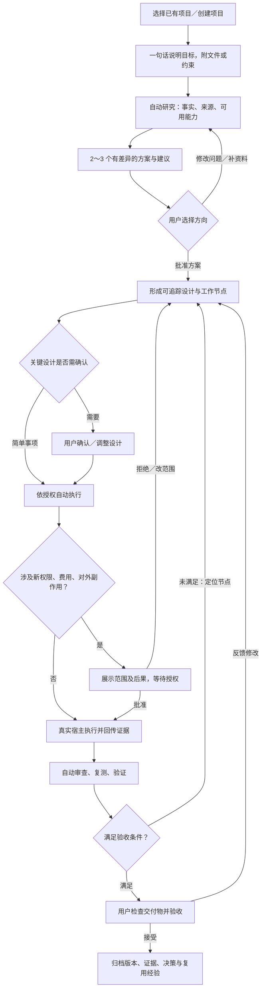
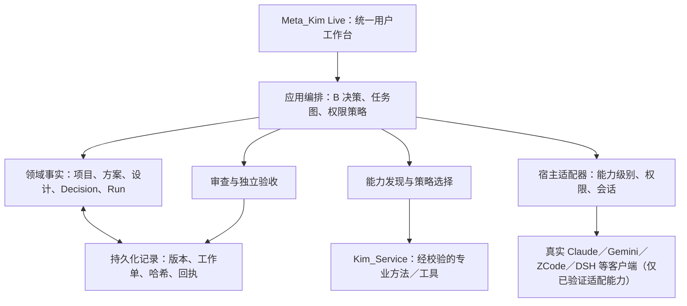
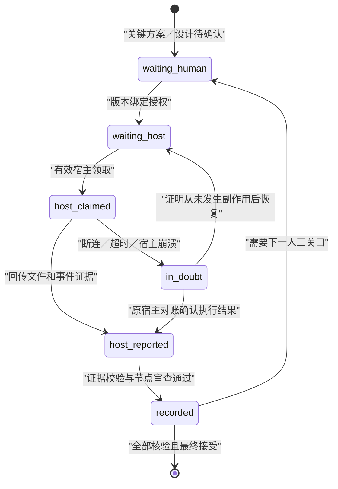
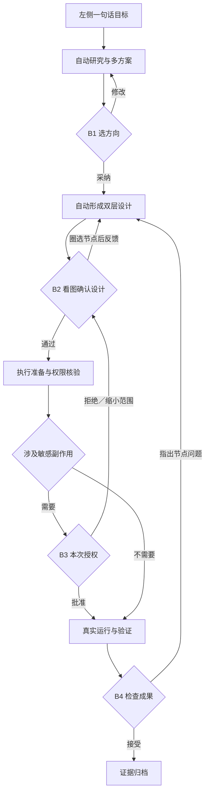

# Meta_Kim 统一 Agent 工作台｜B 路径产品与验收 PRD

> 文档状态：**已确认的产品设计与待验证验收合同**，不是“功能已经实现”的声明。
> 路径决策：**B — 关键节点人工确认**。
> 适用范围：`feature/unified-agent-desktop-20261116` 功能分支；未来是否进入 `main` 由实测证据决定。
> 依赖关系：**Meta_Kim 是面向用户的唯一产品、治理及交互入口；Kim_Service 提供可验证的专业方法和能力清单**。参考外部项目可以吸收机制，但首页、导航、安装包、流程中不应出现 CC Switch 等第三方产品入口。

## 一、先确定用户到底要得到什么

一个不熟悉命令行的用户，可以在 Meta_Kim 中说一句想做的事。系统先查现状、找来源、提出有差异的可行方案；用户选定方向后，系统给出必要设计，在被授权的真实客户端中执行，最终用**可以打开、检查、复现的成果**接受验收。除用户选择方向、确认关键设计、授权敏感操作、最后验收外，合规且低风险的中间工作自动推进。

用户必须随时回答五个问题：

1. **我现在在哪个项目？** 当前项目身份、路径、当前工作与已采用版本清晰可见。
2. **AI 现在在干什么？** 只显示有意义的进度、证据及下一次需要我做什么。
3. **我为什么要选这个方案？** 方案有对比、事实来源、限制、预算与所需权限。
4. **做错了我能改哪里？** 任一已完成或进行中的节点都能打开详情、修改、撤回受影响的下游产物并从该处继续。
5. **什么才叫完成？** 源码、文档、运行效果、测试、真实客户端记录及最终验收彼此对应。

### 非目标与不可越过的边界

- 不创建另一个 Agent 管理产品；不把 Kim_Service 伪装成一个常驻自主执行的 Agent。专业 Agent、Skill、MCP、Hook 是按项目需要择用的**能力**。
- 不接管或偷偷迁移用户已有密钥；不使用用户个人 Codex Token；未经授权不替用户购买、发消息、部署、改配置、合并或发布。
- 不承诺所有被检测到的客户端都能执行。**检测成功、支持只读研究、支持真实写入、完成验收是四种不同能力级别**。
- 不为每件小事强制生成复杂 PRD；简单事项可以简化设计，但仍经过必要的证据、授权和验收。
- 不将模型自述、上传日志、截图、`host_reported`、通过单测或宿主退出码单独认定为业务完成。

## 二、B 路径：用户只在真正需要决定时停下来

确认点是“**有选择权**”，不是要用户逐个批准普通自动化步骤：

| 关口 | 用户看到 | 用户可操作 | 不确认时系统行为 |
|---|---|---|---|
| **B1 选方向**（必经） | 方案 A/B/C：为什么、适合谁、证据、风险、成本、成功标准 | 选一个、合并两个、退回研究、补充条件 | 停在 `waiting_human`，不得进入真实写入 |
| **B2 定关键设计**（复杂任务必经） | 两层 PRD、模块图、依赖、哪些决策尚不确定 | 批准版本、修改单模块、改变模块顺序、退回方案 | 不允许执行依赖未批准设计的节点；无风险的小任务可使用简式任务单 |
| **B3 授权具体副作用**（按事件触发） | 将改变的资源、对象、范围、费用、可逆性、预览与回滚方式 | 本次授权、缩小范围、拒绝、延后 | 只阻塞受影响节点；其它独立安全节点可继续 |
| **B4 最终验收**（必经） | 可打开结果、关键指标、测试实际结果、失败项、证据链接 | 接受、指定节点返工、保留但不验收 | 不标记“已完成/已发布”，继续保留待验收状态 |

审批必须绑定**当前项目、run、决策类型、目标资源、设计／方案修订号及内容哈希、批准人、时间和权限范围**。修订后旧审批不得默默继续有效。`已批准的设计`与`已验收的运行结果`是两个不同事实。

### 用户看到 5 段，底层遵守现有 8 个规范阶段

| 用户能看懂的阶段 | Meta_Kim 已有规范阶段 | 界面里的可见成果 | 何时允许自动前进 |
|---|---|---|---|
| **1. 说清目标** | Critical | 一句话目标、成功标准、边界、哪些事不做 | 目标够明确；不清楚时问少量必要问题 |
| **2. 研究与选方案** | Fetch → Thinking | 来源证据、能力适配、2～3 方案、B1 决策 | 用户批准方案且证据／权限足够 |
| **3. 看设计** | Thinking 的设计定稿；执行前审视 | 架构级 PRD、必要的模块 PRD、节点依赖、B2 | 必要设计已确认，执行身份与能力已绑定 |
| **4. 让它做** | Execution | 实际宿主、正在做的节点、工作单、产物、B3 | 权限有效；无冲突；有真实可运行的宿主适配器 |
| **5. 检查并交付** | Review → Meta-Review → Verification → Evolution | 三层核验、缺陷修复、最终 B4、归档复用 | 有足够实测证据，用户最终接受 |

现有 **11 个业务阶段**可作为项目类型的细节模板；它不能替换上表的八个规范阶段，也不应强塞成 11 个首页导航项。高级用户可展开“详细执行视图”查看八阶段与 11 个业务步骤的对照。

## 三、产品结构与界面 PRD

### 唯一入口与信息架构

- **首页／项目**：最近项目（名称、位置、最后一次真实运行、风险提示）；“继续上次工作”“新建工作”；首次进入先确认项目根目录与可用环境。
- **项目工作台（Live）**：唯一主面板。默认视图是五阶段进度、当前节点、接下来用户要决定的事、能打开的结果。切换项目必须使会话、项目根、资料、运行记录与宿主配置同步切换；不得误把 A 项目的操作执行到 B。
- **方案**：2～3 张对比卡，“推荐理由”和“其他方案更合适的场景”均可查看；卡片底部直接选择／修改，不多跳一次页面。
- **设计**：第一层系统架构和技术栈；第二层按模块的输入、输出、依赖、边界、验收。图上点任意节点弹出**同页侧栏**修改，再计算影响范围。流程图与文档是同一个数据版本的两种视图。
- **执行**：当前真实宿主和运行身份、步骤状态、发生了什么、输入／输出证据、能否回滚。默认只展开当前节点和失败／待确认节点；复杂日志在详情内，减少正文堆叠。
- **交付**：产物列表、打开／下载／预览、自动核验记录、缺陷、批准版本及最后用户验收按钮。失败项不可藏在“已通过”总数里。
- **设置**：运行客户端及版本、能力级别、模型提供方、账号认证状态、Kim_Service 可用方法、项目授权与预算；普通用户无需理解插件路径。

**界面行为约束：** “编辑”直接编辑当前内容，“改变状态”由状态控件直接操作；不重复摆放几个功能相同的按钮。使用自己的品牌与 Logo。深色为基础，**金色仅标识当前运行节点、获选方案或最重要的操作**，其它为低对比中性层级；动效不得遮挡内容或重复拖慢每一次导航。鼠标悬停可解释复杂术语；触屏通过点击信息图标或卡片展开，不依赖 hover。桌面图表可拖动、缩放、重排；移动端采取单列阶段和底部操作区，不能靠横向溢出才能找到“批准”。键盘焦点、屏幕阅读、状态语义与颜色以外的文字／图标提示必须可用。

### 首次启动与离线行为

1. 首次启动检查**运行环境**与安装包实际安装能力（已存在、缺失、版本不兼容、需要授权），不把“安装器文件存在”当“原生客户端已加载配置”。
2. 显示宿主矩阵：`可用并实测`、`仅只读研究`、`仅检测到`、`未配置`、`不可用`，附原因和“检测／重新加载”操作。模型 API 提供方与宿主工具分开配置。系统不得因未登录某个宿主而卡死整个工作台。
3. 默认项目路径明确展示并确认；项目内生成有边界的记录，不悄悄覆盖全局配置。普通用户无需打开终端寻找项目根。
4. 无网络时允许打开最近项目、浏览缓存方案及已存证据、编辑未批准草稿；联网研究和真实远端模型运行标注 `需要连接`，不得显示虚假的新研究结果。断线不会丢失用户编辑。
5. 应用更新或崩溃后的首次启动优先**恢复上次真实任务**；如副作用状态不确定则进入 `in_doubt`，人工或宿主对账后才可重试。

## 四、系统与技术架构 PRD

**分层原则**：`presentation` 只负责渲染与交互；`application` 负责用例、权限、节点调度；`domain` 定义不可违反的事实、状态和版本；`data/repositories` 管理可恢复存储；`infrastructure` 管理 CLI/宿主、文件、网络与校验。所有层从单一能力索引和运行证据推导“能做什么”，不在 UI 中硬编码“所有客户端均可执行”。

**真相来源**：`config/capability-index/provider-registry.json` 是提供方能力登记的单一来源；`config/runtime-capability-matrix.json` 记录运行时已知能力；Live 的领域对象、Decision、工作单及文件证据按现有结构扩展，不另建一套与 Live 脱节的任务数据库。Kim_Service 的 `capability.json`／`method.json` 带来源与校验信息，作为外部专业方法输入，不能直接成为 Meta_Kim 最终执行或验收判定。

### “模型 / 宿主 / 专业能力”必须分清

| 类型 | 例子 | 决定什么 | 不能代替什么 |
|---|---|---|---|
| **模型提供方** | 用户指定的 MiniMax、DeepSeek、其他 API／本机模型 | 推理模型、成本、上下文、可用性 | 不天然拥有文件与终端写入权限 |
| **原生 Agent 宿主** | Claude Code、Gemini CLI、ZCode、DSH 等 | 工具调用、文件访问、执行生命周期、原生会话 | 不能只因“安装了”就宣称任务真正完成 |
| **专业方法包** | Kim_Service 行业 Agent／Skill／MCP／Hook | 怎么研究、怎么分工、怎么验证某行业问题 | 不等于一个独立后台任务管理器 |
| **治理与用户入口** | Meta_Kim | 目标、方案、审核、工作单、执行证据、可恢复状态 | 不应暗中替用户扩大授权范围 |

适配器必须声明 `detect`、`read_only_research`、`native_execute`、`resume`、`verify_side_effect` 等**逐项能力**及最后一次实测证据。发现能力 ≠ 自动准入；宿主工具版本变化应使旧适配结果待复核。运行应固定宿主、模型、方法包的具体版本和能力证据，失败不能偷偷切到另一家或使用个人 Token。替换可配置模型只影响兼容范围内的调用，不自动继承密钥／写权限。

## 五、模块级 PRD：每项都要能验收

以下是**目标模块合同**，不是当前代码已具备所有行为的断言。所有模块均需要 `projectId/root + profile + runId + revision`；文件／操作型节点还要带 `resourceId`，作为跨层冲突与回滚判断依据。

| 模块 | 输入 | 输出 | 状态、异常与边界 | 可重复的验收条件 |
|---|---|---|---|---|
| **M01 项目／安装绑定** | 已选项目、磁盘目录、宿主环境、安装记录 | 已验证 project/profile/session/版本身份 | `unbound → checking → ready / needs_setup / blocked`；切项目后旧会话不能误用；无网络也可查看历史 | 同时打开 A/B 项目，B 项目执行日志只落 B；真实客户端重新加载后功能生效；未配置时给明确修复动作 |
| **M02 目标澄清与研究** | 用户目标、附件、项目资料、允许搜索范围 | 目标与验收标准、来源摘要、时间戳和矛盾项、能力匹配 | `draft → researching → evidence_ready / needs_input / offline / failed`；不编造搜到的证据 | 新任务可展示外部资料来源、相互冲突的观点和可信度；断网明确暂停远端研究且本地草稿无损 |
| **M03 多方案与决策** | 已校验研究材料、成本／权限／风险边界 | 2～3 个真正不同的方案、推荐判断、B1 Decision 回执 | `proposed → waiting_human → approved / revision_requested`；哈希变更导致旧批准失效 | 未点击选择时无法启动有副作用执行；选中方案后能追溯取舍原因和最终版本 |
| **M04 双层 PRD 与可编辑任务图** | B1 选择、项目环境、专业方法、已有代码与依赖 | 仅按复杂度需要生成的系统 PRD、模块 PRD、工作节点与依赖、B2 回执 | `designing → reviewable → approved / stale / blocked`；单节点重写只废止真正依赖它的下游 | 改模块 X 后 X 的依赖节点自动标记失效，独立模块 Y 的审批、已验结果不受影响；图与文字同版本 |
| **M05 能力路由／宿主适配** | 固定宿主／模型、运行时检测、工具权限、方法包版本 | 可执行工作单或清楚的不可执行原因、真实会话标识 | `detected → eligible → authorized → launched / blocked / in_doubt`；禁止无授权切宿主、升级权限或读密钥 | 只读宿主仅研究；实际执行有系统级进程／会话及文件证据；Codex 个人 Token 永不被引用 |
| **M06 任务图执行与并行** | 已批准节点、依赖图、资源身份、范围授权 | 每节点执行事件、实际文件／副作用收据、下一个动作 | `ready → claimed → running → reported → verified / failed / in_doubt`；租约、幂等键与冲突集约束 | 同一文件互斥任务不并发；无共享资源节点并行；杀进程重启不重复发同一外部请求；无证据不算完成 |
| **M07 证据审查、验证与交付** | 产物、设计成功标准、运行收据、风险表 | Review／Meta-Review／Verification 结果、缺陷、交付包、B4 | `reviewing → needs_fix / verified → waiting_acceptance → accepted / rejected`；静态测试≠原生测试 | 缺陷可回跳到准确节点；测试有命令、环境、时间、结果；用户拒绝后不显示最终完成 |
| **M08 可恢复记忆与审计** | 所有项目事件、Decision、节点版本／哈希、宿主回执 | 跨会话重开、上次运行位置、采纳理由、可追踪审计 | `saved / stale / recovery_needed / in_doubt`；会话与 project/profile/run 强绑定 | 关闭应用、断网、切会话再回来仍恢复已批准方案和未完成节点；不丢失决策或混入别的项目 |
| **M09 可用性与展示** | 上述模块的同一持久状态 | 桌面／移动五阶段图、当前节点与简洁操作、必要的详情抽屉 | 加载／无数据／无权限／失败／等待确认均有清晰页面；触控与键盘可用 | 390px 手机与桌面均可读、点击直接操作、详情可关闭、无横向遮挡，金色只在真正活跃／强调对象使用 |
| **M10 方法与插件治理** | Kim_Service 能力清单、行业需求、来源／哈希、宿主支持 | 经核验的版本化方法选择、注入范围与验证说明 | `discovered → verified → selected / unsupported / rejected`；方法不跨项目乱写，冲突可定位 | 每个选用方法能找到来源、版本和适用边界；被篡改或缺依赖方法被阻止、清楚提示，不声称已执行 |

### 模块输出对象（最低字段，不另造重复真相）

| 对象 | 需要持久化的字段 | 关键约束 |
|---|---|---|
| `ProjectBinding` | 项目唯一标识、规范化 root、profile、可用会话引用、权限边界、绑定检测时间 | root/profile 必须真实核对；不同项目不能默认继承授权 |
| `PlanDecision` | 目标版本、方案候选与证据引用、selectedId、批准理由、批准者、时间、内容哈希 | 修改影响范围后 Decision 失效并要求重批 |
| `DesignNode` | 层级、输入／输出合同、依赖、资源 ID、状态、修订号、验收条件、批准引用 | 不可只按同名文件猜冲突；变更传播基于实际依赖边 |
| `ExecutionReceipt` | runId、nodeId、project/profile、宿主与模型及版本、原生命令／会话标识、幂等键、输入版本、事件、结果和材料哈希 | 失败和不确定必须显式；不上传个人密钥；回执不能自行替代验收 |
| `AcceptanceRecord` | 成功标准逐条结果、测试环境、真实 UI/CLI 证据、缺陷、用户结论、交付版本 | 用户批准要绑定确切交付版本；版本改变重新确认受影响验收 |

### 宿主交接与恢复状态语义

**复用**现有 Live 的 `waiting_host / host_claimed / host_reported / in_doubt / recorded` 工作单机制，以及 `scripts/live-workspace-host.mjs` 的检查、领取、回传接口，不在 Agent 入口另设长期内存任务队列。对用户展示：`等待你确认`、`等待客户端`、`正在执行`、`已回传待核验`、`需要核对`、`已验收`。

独立且无资源冲突的工作可以继续；**状态不确定**的同一副作用操作不得由自动重试再执行一次。执行前写入项目、资源、调用参数哈希、授权版本和幂等键；宿主报告附材料引用与 SHA-256；再次打开或续办先比较回执与实际目标状态，再决定是否恢复。副作用涉及部署、收费 API、外部消息、数据库删除、git 合并等，默认需要具有具体范围的 B3 授权。调用冲突与租约争夺返回可理解的“已有任务正在操作此文件／资源”，不能当作“完成”。

## 六、真实企业验收用例（禁止只演示几个假文件）

### E01：跨境电商企业的「经营与知识决策工作台」

这是**验收用合成／脱敏场景**，不是宣称 Meta_Kim 或用户已经持有这些数据。需准备至少两个批次、多来源、存在冲突的足够复杂数据；建议包括：万级以上 SKU、跨渠道订单及退货、广告消耗与转化、供应链成本、供应商合同、客服 FAQ、权限受限财务材料、历史活动方案、可复查外部行业来源。真实数据规模与生成种子必须在验收记录中写明。

业务需求示例：*“我们准备在欧洲上架三条产品线。研究平台、定价、退货、履约成本和风险；提出三种落地路径，让我选一种，再做可运行的内部分析工具和操作手册。”*

应当实测的完整路径：

1. **目标**：系统把国家／平台、成本范围、不可触碰的生产数据、验收指标提取为结构化约束；缺失关键合规前提时询问用户，不能自作主张。
2. **真实研究**：有时间戳的来源；展示有关平台条件、行业渠道及数据质量冲突；专业能力发现能找到相关 Kim_Service 方法，并说明适用度、依赖及版本；不得把“模型搜索过”当证据。
3. **多方案**：例如轻量单平台测试、双平台分阶段、跨平台统一运营；各自含成本、收益口径、失败模式与适用场景。用户选定方案并形成 B1 哈希绑定记录。
4. **双层设计**：系统层覆盖数据治理、检索／决策服务、权限、展示、部署、恢复；模块层至少包含数据接入与质量、商品／渠道分析、合同与知识检索（需要验证 BM25／向量／融合排序或合理替代）、经营建议与解释、权限隔离、可视化、导出及验收。
5. **真实执行**：只在隔离的测试项目、已授权客户端和测试数据中开发；依据资源冲突安全并行。一次故意杀掉宿主并重新启动，证明不会重复写库、重复支付或重复发布。对生产环境操作先触发 B3。
6. **验证与验收**：测试检索质量（分查询类型的命中与引用）、经营口径对账、受限材料不能越权引用、错误输入／重复订单处理、图表与导出一致、桌面与手机操作、真实启动重载、前后端实际功能、权限拒绝与恢复；用户在可预览结果上逐条验收 B4。

验收时不能用“多数据但只看 3 篇文本”的演示代替整个业务；应实际记录输入数量、缺失率、成本口径、检索评测集、测试通过／失败项、运行证据及最终成果链接。外部参考仅作为候选方法，具体落地仍须核对当时版本及权利／权限条件。

### E02：简单任务的差异化测试

“给现有 README 改一个错字。”无需两级大型架构 PRD，不应阻塞在漫长研究：识别项目 → 核对文件及上下文 → 给出修复与差异 → 用户按现有授权策略确认写入 → 真实客户端修改 → 查看 diff／测试 → 用户接受。它仍必须保留项目绑定、变更证据、失败回退与最终结果。这用于防止复杂系统拖垮普通小任务。

## 七、最终交付门槛与证据要求

下列是**未来必须实测的验收清单**。每一项记录：环境／版本与 commit、操作步骤、期待行为、实际结果、pass/fail、证据文件路径与哈希、操作者。若只有单元测试，应标注“自动测试通过，原生客户端尚未验证”。

| 编号 | 实测条件 | 必须看到的证据 | 不通过条件 |
|---|---|---|---|
| A01 | 新 Windows 安装或干净隔离配置启动，实际客户端重载 | 安装日志＋重载后的宿主能力输出＋工作台截图 | 只证明安装文件已复制 |
| A02 | 两个项目来回切换并继续任务 | 根目录／profile／run 绑定与真实目标文件差异 | A 项目回执、授权或文件流入 B |
| A03 | 从一句模糊需求得到研究及 2～3 可比较方案 | 有效来源、时间、对比依据、B1 Decision 修订与哈希 | 方案只是同义改写、来源伪造 |
| A04 | 用户不批准任何方案或设计 | 只读研究可见，写入／部署未发生 | 未授权却动到外部资源 |
| A05 | 复杂任务审批后进入两级 PRD 与图 | 一致的双层 PRD、B2、各节点 I/O/依赖/验收 | 图与文档版本矛盾，按钮只是外观 |
| A06 | 改动中间模块并再次执行 | 仅依赖的下游过期，能从该节点修订继续；独立模块保持有效 | 全局无差别清空，或继续使用过期批准 |
| A07 | Claude/Gemini/ZCode/DSH 等不同能力级别检测 | 宿主逐项状态、读写权限、实际原生运行 ID | 检测成功就标“完全支持”，或假装未接入客户端已调用 |
| A08 | 真实、允许写入的宿主执行测试项目 | OS/原生宿主事件、结果文件与哈希、回执、端到端效果 | 只有模型说“我做完了”或退出码 |
| A09 | 多节点并行、同文件冲突、故意断线和重启 | 幂等记录、租约、`in_doubt` 对账、无重复外部动作 | 无核对重试产生第二次副作用 |
| A10 | 高风险或增加费用操作 | B3 明确对象、范围、预算、影响及不可逆提示，未授权时阻断 | 静默扩权、支付、部署、发信或合并 |
| A11 | 验收材料含人为注入的缺陷与权限失败 | Review／Meta-Review／Verification 各自记录、缺陷返工，B4 | 有已知失败仍显示“全通过／已发布” |
| A12 | 实际桌面与 390px 手机操作 | 现版本操作截图／录屏、触控与键盘、无多余按钮及横向溢出 | 仅有设计稿或旧版截图 |
| A13 | 断网浏览、重开同一项目、跨会话接续 | 决策理由、节点修订、证据仍在，远端功能明确不可用 | 内存 Map 任务消失却显示运行成功 |
| A14 | Kim_Service 方法选择与校验 | 方法包来源、版本与哈希、受限依赖提示、实际执行范围 | 只展示行业 Agent 名字或伪造安装成功 |
| A15 | 不提供个人 Codex Token，其他宿主可用 | 完整流程不索取该 Token，禁止的适配器被正确阻断 | 自动探测、回退或复用用户 Token |
| A16 | 构建／打包／升级／回滚和安全退出 | 关联 commit 的测试日志、包产物、真实安装／卸载／重载、回滚证据 | 只改源码或 README 就标“发布完成” |

**阶段验收顺序：** 合同和状态测试 → 集成测试 → 可复现本地 UI 操作 → 原生 CLI／模型实测 → 真实安装重载 → 隔离企业案例从输入到成果 → 人工 B4 决定。现有 `npm run meta:verify:all` 与模块化测试属于必要但不足的技术证据；不得绕过现有门禁。每次提供截图必须来自当前构建和当前运行时，注明 commit/环境；界面生成图只标“设计预览”。

### 不应宣布“完成”的条件

- 还有临时内存任务无法重开，或只能给出 read-only planning 预览、没有真实写入宿主和持久回执。
- 设计审批未与实际工作节点／版本关联，某个节点修改后旧决策依然有效。
- 没有在真实安装后的客户端验证，或执行结果不确定却自动重试。
- 缺少企业规模场景、失败注入、权限核验、移动端及用户验收证据。
- 自动测试绿灯但安装、真实任务或产品交互失败。

## 八、仓库现状与目标的严格区分（写本文档时）

| 能力 | 已确认存在的基座 | 本 PRD 要补齐／实测 |
|---|---|---|
| Live 可视化与两层设计 | `docs/live-workspace.md`、`src/domain/live/` 与应用／展示模块已有单一 Live、PRD、Decision、工作单与回执概念 | 把普通用户五阶段、一键决策、任意节点编辑与真实执行证据统一成闭环 |
| 宿主研究入口 | Agent B1 研究、B2 自动草稿具备项目级持久化回执／幂等约束，`runId:null` 明确不冒充正式 Live Run；安全审阅后只允许符合条件的 Claude Code 只读启动 | 真实 Claude 客户端执行、持续研究证据质量、正式 Run 统一与恢复验收 |
| 研究后的“采纳” | B1 方案、选择理由与 `planDigest` 可持久化；B2 自动生成／人工修改的双层 PRD、依赖失效、逐模块批准、静态 handoff 有实现与自动测试，`executionAuthorized:false` | 正式可执行任务图、对已运行节点的精确返工，审批与真实执行完整绑定；真实设备验收 |
| 宿主广度 | Claude 有受限只读启动审阅；**Gemini 非交互 plan 模式可能自动退出计划并执行，因此已禁止启动**；Codex 个人 Token 使用被阻断；ZCode/DSH 等仅检测 | 对各宿主在隔离环境验证可执行能力、许可策略、真正的退出与失败恢复后再逐项准入 |
| Kim_Service | 具有专业方法清单、行业能力和来源校验机制；不是独立长期执行引擎 | 按项目选择真实可用方法、版本固定、宿主兼容及产物验证 |
| 崩溃后继续 | Live 宿主协议已有 `waiting_host`、`host_claimed`、`host_reported`、`in_doubt` 等，包含领取与文件证据 | Agent 入口任务不再靠短期内存状态；全过程一致恢复、对账与重试约束 |
| 视觉与安装 | 现有 Live UI、安装器与验证脚本构成可扩展起点 | 真实操作的桌面／手机验收、安装重载、空态与失败态；不会因风格截图误报功能完成 |

**阶段性实现注记（2026-11-17）：** 即使本分支中的 B1/B2 浏览器模拟验收与单元测试通过，现有静态 handoff 仍不启动原生 Run。B3 实际副作用逐项授权、B4 实际产物验收、执行节点返工和真实安装重载均未取得完成证据；自动化模拟模型输出只证明界面和协议可用，不等于真实 Claude/Gemini 已运行。此 PRD 和任何通过测试的截图都不得直接作为 A01～A16 全部通过的证明。

**源代码核对入口：** `docs/live-workspace.md`、`src/application/agent/agent-start-service.mjs`、`src/domain/runtime/agent-workflow-decision.mjs`、`src/infrastructure/live/live-control-room-server.mjs`、`src/presentation/live/live-workspace-view.mjs`、`src/presentation/live/live-workspace-client.mjs`、`config/agent-hosts.json`、`config/capability-index/provider-registry.json`、`config/runtime-capability-matrix.json`，以及 Kim_Service 仓库专业方法 `capability.json`／`method.json`。仓库状态和运行能力可能随合并变化，验收时以当前 commit 的实测为准。

## 九、实现顺序与最终定义

1. **守住单一身份和真相**：把 Agent 研究入口接到现有项目、Decision、工作单、持久化与 Live 组件；不产生两套流程。
2. **先打通纵向薄切片**：选择真实项目 → 只读研究 → 方案 B1 → 简式设计 B2（如有）→ 授权宿主执行 → 真实产物 → 自动核验 → 用户 B4 → 重启后仍在。
3. **再扩展复杂性**：专业方法、双层 PRD、并行工作图、任意节点修订、资源冲突、失败恢复、模型与宿主替换。
4. **再做真实企业验收和界面抛光**：以 E01 的高复杂场景与 E02 的小任务共同证明“既有深度又不费劲”；按 A01～A16 实测，补上截图／录屏和可恢复证据。

最终交付不是“有一个 PR”或“写好了方案”，而是功能分支上的代码、配置、安装包、测试、真实执行回执、界面截图和可操作成果**互相吻合**；只有通过 A01～A16 的适用条件且由用户完成 B4，才允许对外说“B 路径已完成验收”。

## 十、已确认的单一对话框 + Live 交互补充合同（2026-11-17）

本节落实用户最新确认的交互方式，并细化第三节的界面行为；**若第三节仍被理解为多页面、多输入框审批，以本节为准**。第二、四、五、七节的领域合同、执行授权与验收门槛不变。本文仍是设计和验收规范；截图或模拟回执不能单独证明业务闭环已实现。

### 10.1 用户只需要记住一件事：在聊天框说话

**首页主体 = 左侧通用 Agent 对话 + 右侧 Meta_Kim Live。** 登录、项目选择、会话历史和设置可在顶栏或抽屉访问，但普通工作不跳转多张表单，不要求用户先学会 PRD、Hook、MCP、节点编号等术语。

- **左侧对话区**：唯一可输入自由文本的可见编辑器，负责提出目标、上传资料、追问、修改方案、给圈选节点下评语和解释审批理由。决策候选、差异预览、证据摘要与 B1～B4 选择在对话内以**可点击卡片／按钮**出现；这些按钮不是另一套文本入口。
- **右侧 Live 区**：始终与当前项目及当前对话事项绑定，默认显示流程；同一画布可切换「执行流程」「知识图谱」「Agent 协作」，并在有可信数据时出现更细的知识关系视图。所有图都能随着真实事件更新，并允许选择或圈选节点。
- **反馈路径唯一**：在右侧点击／圈选节点 → 节点高亮 → 左侧输入框出现关联对象和当前版本 → 用户直接说“这里错了，改成……” → 由同一对话处理返工、重新研究或提出修改方案。取消关联不清除未发送文字。
- **确认路径 B**：AI 自动推进已授权的普通工作；只有方向取舍、必要设计、敏感副作用、最终验收在原对话中等待人。任何关键审批都应让人先看清**要批什么、为什么、批完会发生什么**。
- **同一输入体验**：发送与输入逻辑必须覆盖有无当前节点、有无等待审批、提交失败、网络恢复、会话重开五类情形；输入永远不被静默当作新的工作或批准。

上述每个节点的进度、证据与边界在右侧 Live 动态呈现；**对话和图是同一份项目事实的两个投影，不产生两套流程状态。**

### 10.2 画布的信息层级及知识图谱

| 右侧视图 | 首屏展示 | 点开节点后 | 数据不充分时 |
|---|---|---|---|
| **执行流程**（默认） | 目标、研究、方案、设计、执行、验证／验收的相邻关系；真实状态与下一人工关口 | 阶段输入／输出、责任角色、依赖、当前异常及来源回执 | 只显示「计划／等待」，不能根据页面加载或定时器制造「运行中」 |
| **系统与模块关系** | 系统级 PRD 与模块级 PRD、模块之间的先决依赖及批准状态 | 目标、架构、技术栈、输入／输出合同、风险边界、验收标准和对应设计版本 | 草稿标注「未经独立核验」；缺失模块、分页和未知依赖显式告知 |
| **证据与知识来源** | 已真实引用的资料、论点、互相冲突的结论和来源关系 | 原文定位、取得时间、适用范围、版本与可信度；可请求重新查证 | 没有来源就显示「尚无证据」，不拿示例实体或模型自述填图 |
| **能力与调用关系** | 本任务实际选择／加载的 Agent、Skill、MCP、命令、宿主及 Kim_Service 方法关系 | 选择依据、版本、运行时能力、使用时点及核验引用 | 仅检测到的能力与实际加载／调用严格分开 |
| **Agent 协作** | 真正参与当前 Run 的角色、任务及并行／等待／阻塞关系 | 工作单、输入输出、资源冲突、宿主接单和交接回执 | 没有已绑定的工作单就显示空态，不把已检测客户端算作已工作的 Agent |

交互细则：图形可平移、缩放，桌面有鼠标悬停说明，手机用点按获得同等信息；节点选择支持键盘。大量节点先按层级聚合，允许展开局部关系，保持标签可读。图谱按**源数据可得性**出现，不能为凑齐栏目而生成虚构数据。流程变化、知识关系变化和节点状态变化应使用轻量动画；金色只指向**经证据确认正在运行的节点／边**或当前被选中的重要对象，完成、计划、失败与待批准都有颜色之外的状态文字。尊重系统减少动画设置，避免装饰动画延误操作。

### 10.3 圈选和修改是正式工作，不是临时画个圈

一次反馈最少关联：`projectFingerprint`、当前任务／Run 身份、`nodeId`、`nodeKind`、`nodeRevision`、当前设计／方案摘要、原始反馈、操作者与时点，并记录后端幂等提交／回执号。前端可在发送前展示圈选框，但**仅保存在浏览器数组中的标注不能显示为「已提交修改」**。

| 节点类型 | 用户在唯一输入框提出意见后 | 可执行与不可执行的边界 |
|---|---|---|
| 研究／候选方案 | 形成绑定现有方案版本的补查或返工意见；原候选保留供对比 | 未返回新研究回执前不得宣称方案已经更新 |
| 系统级 PRD | 生成新的系统设计候选与影响清单，展示具体差异，由用户审批修订版本 | 不得自动继承受影响模块的旧批准 |
| 模块级 PRD | 基于原模块版本提出字段级修改；分析依赖路径，仅使受影响的下游审批／验证过期 | 不应清空没有依赖关系的其他模块 |
| 执行中的节点 | 先判断任务能否安全暂停、是否已有副作用和冲突资源，形成修复／接续工作单 | 结果不确定时保持 `in_doubt`，先对账再恢复；不能直接重复调用 |
| 交付／验收节点 | 把缺陷绑定到具体产物与验收条件，回到需要重做的源节点 | 未复测前不得仍称最终验收通过 |

用户必须在同一个位置查看「你的意见」「AI 拟改内容」「将受到影响的节点」「需要你确认的部分」「已生效回执」。反馈可撤回未提交草稿；已提交的修订通过新版本与撤销／重新确认操作处理，不能只改 CSS 状态。

### 10.4 界面状态和恢复约束

| 状态 | 左侧对话提示与操作 | 右侧 Live 呈现 |
|---|---|---|
| 首次打开／无目标 | 一句话欢迎语、已核验的项目身份和一个输入区；必要时提示连接权限 | 真实项目已知视图或明确空态，不放演示数据冒充运行 |
| 研究中 | 可继续发补充约束；显示接单回执、确切宿主与状态 | 实际 `accepted` 与 `running` 分开；仅收到执行证明才播放运行边动效 |
| B1 等待决定 | 在聊天中显示可比较方案、依据、取舍和「采纳／修改／放弃」；非结构化合法建议也能人工命名并采纳 | 选中的方案有明确标识，未审批的设计不显示为可执行 |
| B2 设计与审批 | 完整细节可读，系统与模块按依赖确认；在同一个输入框提交针对节点的修改意见 | 图与详情绑定同一设计版本，版本更新立即让失效节点显示待复核 |
| B3 权限事件 | 原位展示具体对象、范围、成本、后果及回滚，按钮仅允许本次事件范围 | 受影响节点等待授权，独立无冲突节点可按原策略继续 |
| 运行／核验／B4 | 清楚区分正在做、已回传、已验证、待最终验收；可预览或打开成果并反馈 | 真实 Agent 工作单、图谱状态和缺陷路径连续更新 |
| 断网／宿主失败／不确定 | 保留输入草稿及原请求号，先校验后允许重试；提供可理解错误和明确下一动作 | 不清空既有可信节点，不制造新完成事件 |
| 换项目／会话重开 | 仅载入与新项目身份匹配的历史会话、决策和待办；没有绑定就停止可写操作 | 不得混入侧栏所选历史 Run 或另一个项目的执行流 |

单一输入框原则不等于禁止附件选择、方案卡点击、版本确认按钮或设置抽屉；它禁止的是把同一工作切成多个**需要用户到处找文字框**的页面。成功、拒绝、失败与未授权状态都可通过屏幕阅读器播报，并能用键盘和触屏完成。

### 10.5 数据权威和实时更新

前端只能从既有应用接口的持久状态及服务端回执投影节点：`Agent request`／`PlanDecision`／`Design`／`Handoff`／正式 `Run`／`Task`／`Review`／`Verification`。状态转换由对应的领域契约决定。前端不得直接持久化另一份权威流程，也不得以“上一条聊天回复看起来完成了”推导任务完成。

Live 更新事件应携带足以去重与隔离的数据：项目身份、任务或 Run 身份、节点稳定 ID、版本／修订、权威事件号、状态、真实来源与证据引用、发生时间。事件顺序异常或版本后退时重新拉取快照；客户端断线可退化到有界轮询，但必须明确陈旧状态。实际流式推送、轮询间隔与动画节奏以测试环境约束为准，不把动画帧当服务端状态更新。一个节点跨多类图谱出现时复用同一节点身份与版本，避免重复数据源。

### 10.6 截图与实测增补项（承接第七节 A01～A16，不另设完成门禁）

- **单入口检查**：宽桌面与 390px 手机，全部正常工作态只存在一个可见自由文本输入区；任何 B1～B4 操作都能从此工作区完成，不出现需要用户自行寻找的第二张表单。
- **真实浏览器操作**：一句话发送 → B1 选择／修改 → B2 设计图出现 → 点击模块 → 在原输入框反馈 → 后端返回绑定版本的修改回执 → 图与详情同步。重新加载后记录仍在；重试不会产生重复副作用。
- **多图一致性**：打开流程、系统模块、证据、能力与 Agent 协作视图；核对相同 `nodeId`、来源和版本。缺少数据的视图保持诚实空态，不通过硬编码假节点来「补齐」。
- **关键人审阻断**：未审批 B1／B2、B3 拒绝、B4 未验收时均不能显示已完成；经过正式副作用批准后仍需要真实执行证据及独立验证。
- **异常与跨项目**：注入断网、宿主超时、回执不确定、设计版本冲突、历史 Run 混入、浏览器重启和移动端场景；验证身份隔离、草稿保存、同请求号对账及焦点／语义完整。
- **截图必须来自实际构建**：至少留存空态、研究中、B1 决策、知识图谱／圈选、B2 审批、Agent 协作、失败恢复和移动端截图，注明代码版本、测试 fixture／真实宿主来源及可信度。截图与自动测试通过不能替代原生宿主和业务最终验收。

**当前实现差距必须继续以第八节为准。** 只有上述单入口操作在浏览器实际跑通、后端已有同一任务的正式回执、最终验收条件满足时，才能称这套界面与执行闭环交付完成。
