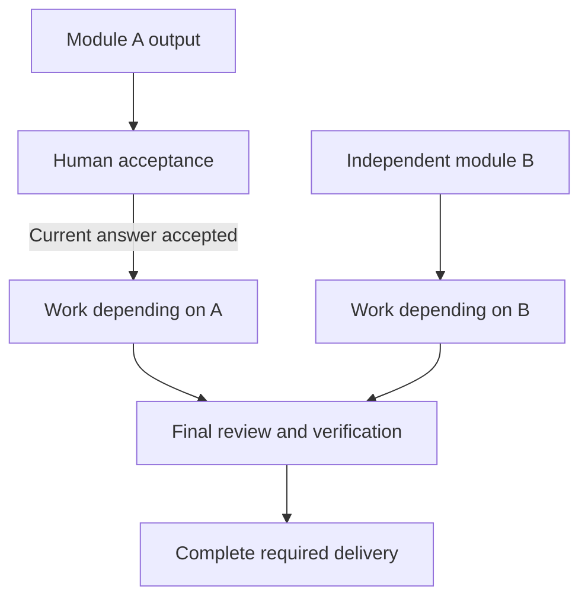

# Harness architecture and capability model

Meta_Kim coordinates the current goal, decisions, work dependencies, execution evidence and acceptance. Kim_Service supplies professional methods and knowledge. The active coding host supplies the model, native tools and actual permissions. Each layer has a distinct responsibility and a replaceable interface.

This document describes the Unreleased implementation. Installed projections and deterministic tests are separate from observed native execution and professional outcome quality.

## Capability, Skill, tool and MCP are different dimensions

| Concept | Question it answers | Example |
| --- | --- | --- |
| Capability | What result is needed? | Inspect a web journey; operate a desktop application; assess a data migration |
| Professional method | How should the work be understood, performed and checked? | A frontend method covers interaction states, accessibility, framework constraints and observable acceptance |
| Agent / Sub Agent | Who owns this bounded work in the current host? | A worker receives a relevant method, current inputs, allowed tools, deliverable and review criteria |
| Skill | Which reusable procedure or knowledge should be loaded? | An evidence-gathering or design-review procedure with task-selected references |
| Tool / engine | What performs an operation? | A browser CLI, an accessibility-tree desktop engine, a calculation helper |
| MCP | How does a host discover and call a tool or resource? | A browser engine exposed through a native MCP server |
| Hook | Which lifecycle event triggers an integration or check? | Before tool use, after a result, or session startup |
| Harness | How are all these parts governed across work and time? | Current source bindings, decisions, dependencies, progress, recovery and final verification |

The same capability may have several providers and interfaces. A browser engine can offer CLI, MCP and a Skill describing its workflow. Register the engine once, describe its interfaces, and select a current available interface for the task. Adding a wrapper does not create new professional competence or permission. Runtime projection support and individual tool support are also separate: the existing reviewed calculator keeps its own runtime allowlist; adding Gemini/ZCode installation does not expand that execution boundary.

Vercel's [agent-desktop](https://github.com/vercel-labs/agent-desktop) supplies desktop accessibility operations through a CLI and C library; it has no model inside. [agent-browser](https://github.com/vercel-labs/agent-browser) offers browser operations through its CLI and native `mcp` interface. [Playwright MCP](https://github.com/microsoft/playwright-mcp) is another browser provider; its maintainers explain the different tradeoffs of CLI with Skills and MCP. These are optional execution engines. Local PATH discovery records availability without launching a process, downloading a browser, starting an MCP server or granting desktop access.

## Layers and sources of truth

| Layer | Responsibility | Current source examples |
| --- | --- | --- |
| Domain | Pure design rules, decision validity, dependencies and outcome semantics | `src/domain/design/software-design.mjs`, `src/domain/scheduling/human-gate-progress.mjs`, `src/domain/decision/` |
| Application | Coordinate the existing use case and construct read models | `scripts/governed-execution/advance-goal.mjs`, existing governed entry, `src/application/live/` |
| Data | Persist the existing authoritative events, attempts, decisions and receipts | `src/data/repositories/`, `src/data/schemas/` |
| Infrastructure | Read source bytes, inspect optional tools and adapt host/filesystem interfaces | `src/infrastructure/capabilities/`, `src/infrastructure/project/`, `src/infrastructure/installer/`, `src/adapters/` |
| Presentation | Render observed or recorded state and collect an explicitly supported interaction | `src/presentation/live/`; it does not approve work or write scheduler state |
| Configuration | Declare policies, capabilities, compatibility and optional dependency choices | `config/contracts/`, `config/capability-index/`, `config/skills.json`, `config/live/` |
| Professional content | Own task methods, references, examples and quality cases | Kim_Service component directories; generated indexes are rebuilt from those directories |

The orchestration entry remains compatible while newly separated domain and I/O modules have one implementation owner. The old `scripts/dependency-source-integrity.mjs` path is a thin compatibility export. It contains no competing implementation. Runtime directories are generated projections and private run state stays outside published source.

Business-specific choices belong in the current task and component contract. Host support, optional installations and view policy belong in their existing configuration sources. Stable protocol identities, permission invariants and source-integrity checks remain code-level constraints; an editable option must not turn a declaration into authorization.

## One PRD, two views

The architecture view settles the system boundary, actual technology/version basis, constraints and material decisions. The module view supplies user flows, interfaces, shared state, business rules, implementation approach and acceptance. Both belong to the same design digest and task dependency graph.

Architecture exploration can have an empty module outline while choices remain open. Delivery requires concrete task coverage and consistent interface/state ownership. Workers receive only the relevant module, settled decision values, source-bound professional knowledge and current upstream materials. Changed decisions invalidate affected tasks through existing dependency relationships; they do not restart the whole interview.

## A human wait affects its branch

The existing durable coordinator can present A's review while B is still running and can start C after B finishes. A pending, returned or revision-required decision blocks A's true dependents. An explicitly paused project remains paused. Finalization still requires all required execution nodes, current necessary human acceptances and the existing final review/verification chain.

The Desktop adapter permits observation during unrelated work only after matching the current graph digest, stored claim definition and dependency relationship, and only for independent read-only claims. Unknown relationships, related claims, write effects and global blocking effects remain blocked.

The native host may return an immediate pending state or wait for the answer asynchronously. Pending state is persisted through existing decision records and receipts; a JavaScript promise is not a durable checkpoint. On reopening, completed B/C results remain committed. Old answers cannot approve a changed artifact or decision revision.

The Live page reads a bounded projection with public node identities. It distinguishes a pending human gate from independent work and prevents the run from looking complete merely because its workers returned. This is a saved-state view; real-time execution still requires fresh kernel/host observation. Raw artifact paths, questions and private task identifiers do not cross this projection.

## Professional depth is explicit and evaluated separately

A reusable professional package needs domain concepts, diagnosis, decision rules, required inputs, output checks, common failure modes, escalation boundaries and authored positive/negative cases. Existing specialist methods and deterministic helpers remain useful; absence of a `method.json` alone does not prove a package lacks knowledge.

Knowledge resources are selected by declared applicability, read as actual bounded UTF-8 bytes and bound to the current component hash. Contract validation checks integrity and compatibility. For calculation handoffs, explicit host-supplied typed inputs stay with the original private materials and current task/source bindings. The normal required-input validator still applies; conflicting inputs or changed materials cannot reuse an old work order. Public diagnostics contain bounded codes and detail digests, while complete diagnostic material remains available privately to the selected worker. Authored examples describe expected behavior; they are not executed model evaluations. A professional-effect claim needs separate observed outcomes and appropriate independent review. Missing knowledge causes further discovery or a bounded limitation, rather than a fabricated expert role.

## Absorb methods; retain engines where they add capability

The dependency disposition is recorded in the existing [absorption contract](../config/contracts/dependency-absorption-contract.json). Repeated workflow prompts can become original first-party methods with explicit acceptance; separately useful specialist packages remain opt-in. Actual execution engines retain their own implementations and licenses.

Removing an installation entry is only one step. Default discovery must still find an appropriate current provider, references and installers must agree, and existing copies can be retired only when ownership and current bytes are proven. User-modified copies stay available for review. Historical absorption evidence remains historical; a newly reviewed source receives its own evidence.

## Research decisions

Reviewed against primary sources on 2026-11-10:

| Source | Useful mechanism | Integration decision |
| --- | --- | --- |
| [LangGraph interrupts](https://docs.langchain.com/oss/javascript/langgraph/interrupts), [graph API](https://docs.langchain.com/oss/javascript/langgraph/graph-api), [persistence](https://docs.langchain.com/oss/javascript/langgraph/persistence) | Explicit dependencies, saved state and bound resume input | Retain the existing durable kernel. A single graph interrupt does not itself guarantee that every later independent branch step continues. |
| [Deep Agents architecture](https://github.com/langchain-ai/deepagents/blob/main/libs/ARCHITECTURE.md) | Separate planning, context, filesystem, Skills and delegation | Adopt the separation of responsibilities; do not add another default agent loop or state store. |
| [OpenHands software-agent-sdk](https://github.com/OpenHands/software-agent-sdk) | Explicit agents, tools and workspaces | Keep tools and workspace ownership explicit within the current host integration. |
| [MCP architecture](https://modelcontextprotocol.io/docs/learn/architecture) | A standard host/client/server interface for tools and resources | Model the interface separately from the provider's capability, quality and permissions. |
| [Vercel agent-desktop](https://github.com/vercel-labs/agent-desktop), [agent-browser](https://github.com/vercel-labs/agent-browser), [Playwright MCP](https://github.com/microsoft/playwright-mcp) | Concrete desktop/browser operations and native interfaces | Optional providers with observed local availability; no automatic installation or native-live certification. |

The earlier [intent-to-delivery reference](../canonical/skills/meta-theory/references/intent-to-delivery.md) covers specification, professional design, reflection and cleanup research. These are adaptation decisions, not imported frameworks or claims of equivalent performance.

## Verification and remaining limits

Use behavioral evidence for the property being claimed: real local subprocess rendezvous for scheduling; close/reopen for pending-decision recovery; full package extraction and lifecycle checks for installation; actual component bytes for knowledge delivery; and source/version-bound evaluation for RSI. Verify semantic outcome quality with the task's real materials and reviewers.

Exact baseline comparisons, repaired regressions, skipped platform checks and native-host limitations are recorded in [the verification record](verification/intent-to-delivery-20261110.md). No package installation, role name, authored example or structural check substitutes for professional judgment or final user acceptance.
