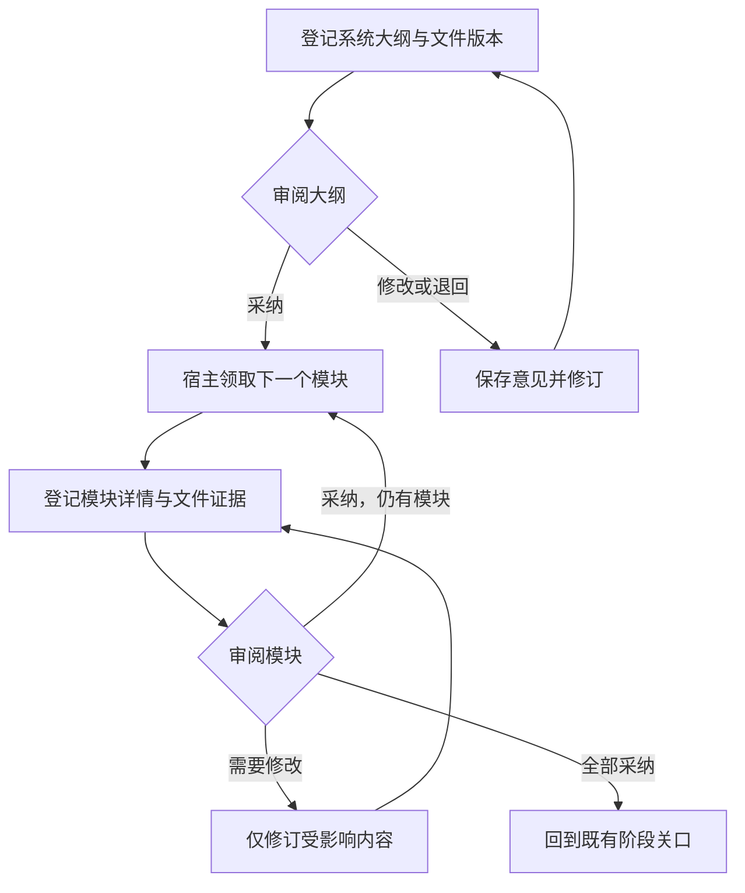

# Live：一个项目的统一工作区

Live 集中展示已登记项目的八阶段、工作项、系统模块大纲、逐模块详细设计、审阅结果、修改意见和回执。AI 客户端继续承担实际执行，Kim Service 提供可发现的专业方法与本地处理工具。持续工作的可视化入口统一放在 Live。

## 从哪里看、在哪里操作

| 入口 | 内容与操作 | 数据来源 |
| --- | --- | --- |
| 工作 | 当前下一步、任务列表、状态筛选、任务详情 | 当前运行的既有状态投影与工作区索引 |
| 八阶段 | Critical、Fetch、Thinking、Execution、Review、Meta-review、Verification、Evolution；逐项查看已有记录 | 当前运行保存的阶段状态 |
| PRD → 系统总览 | 第一轮系统大纲、模块边界、当前版本；采纳、要求修改、退回 | 宿主登记的真实文件及版本绑定的 Decision |
| PRD → 模块详情 | 第二轮详细设计、依赖、规则、状态和原始内容；针对模块提交反馈 | 同一设计基线下的模块文件 |
| 记录 | 审阅、反馈、宿主接单与回传的状态 | 持久工作单及运行回放 |
| 运行图 / 项目资料 | 既有任务依赖、证据面板和项目事实 | 既有 Live 读取接口 |

界面先显示索引和当前需要处理的内容。左侧模块导航、主内容和详情抽屉分别承担定位、阅读和核对；小屏幕使用折叠导航。空记录、等待、加载失败、旧版本和宿主尚未接单都有明确状态。刷新保留当前页面中的反馈输入；提交后的操作可以按原请求编号回查。

正文来自项目文件，不会由浏览器编造。未登记的产物不会凭空出现；只有当前运行拥有的文件、任务和可用投影能显示。历史运行保留只读查阅。界面上的验收样例会单独标记，样例不证明模型或原生宿主已执行。

## 大纲如何接到每个模块



大纲和模块审阅复用现有 Decision 领域模型。审阅绑定运行、产物、文件 SHA-256、设计边界和修订号。修改内容或模块依赖时，受影响的旧采纳失效；仍然有效的独立模块继续保留。并发修改用状态修订号比较交换，重复提交同一请求返回原回执，同一请求编号携带不同内容会被拒绝。

`nextAction` 从当前设计及有效审阅结果推导，不另设一套执行数据库。系统大纲采纳后得到第一个待设计模块；模块采纳后继续下一个。提交修改意见会保存原文并优先形成对应修订工作单。

这条接续由**当前宿主拉取工作单**完成。Live 不启动一个固定模型，也不因收到请求就宣称工作完成：

| 状态 | 含义 |
| --- | --- |
| `waiting_host` | 请求已保存，等待当前宿主接单 |
| `host_claimed` | 宿主已领取当前工作单 |
| `host_reported` | 宿主提交了可校验的文件证据，仍需审阅和后续验证 |
| `in_doubt` | 领取租约过期，实际执行结果尚不确定；先核对，避免重复执行 |
| `recorded` | 本地判断已记录 |

这些状态的 `completionVerified` 和 `nativeInvocationVerified` 保持为 `false`。它们证明本地工作单和文件交接，不代替原生宿主观察、业务验收或最终完成证据。当前宿主停止时，工作会保持等待；这里没有新增后台模型守护进程。

## 宿主怎样接入

正常 Thinking 检查点会读取已登记的工作区设计关口。尚未采纳的当前设计不能直接跳到 Execution；全部采纳后仍需通过既有 Thinking 和后续验证。Live 本地审阅不会冒充 Codex/Claude 的原生回答，也不会自动放行既有 P118 原生宿主关口。

宿主使用同一条 CLI 查看状态、登记文件、领取请求和提交回执。下列 `RUN_ID`、`CHAT_ID`、`REVISION`、`COMMAND_ID` 和 `CLAIM_TOKEN` 均取自当前运行或上一步返回值。`--project-root` 使用真实项目的绝对路径。`--profile` 必须使用本次登记设计时绑定的精确 profile；下面的 `default` 只是示例，不能替代项目实际使用的值。

正常宿主 handoff 返回已绑定的 `hostEntry` 和 `arguments`，可将它们原样传给 Node 进程执行；参数已经包含项目、profile、run 和会话。错误 profile 会被拒绝，旧记录没有绑定 profile 时会明确显示不可用，需要在已验证的当前 profile 中重新登记。不得尝试其他 profile，也不得回退到 `default` 或环境中的另一个档案。

```bash
node scripts/live-workspace-host.mjs \
  --project-root "/path/to/project" --profile default \
  --run-id RUN_ID --conversation-id CHAT_ID --inspect

node scripts/live-workspace-host.mjs \
  --project-root "/path/to/project" --profile default \
  --run-id RUN_ID --conversation-id CHAT_ID --list-requests

node scripts/live-workspace-host.mjs \
  --project-root "/path/to/project" --profile default \
  --run-id RUN_ID --conversation-id CHAT_ID \
  --publish-design --input "/path/to/project/.meta-kim/work/design-input.json" \
  --expected-revision REVISION

node scripts/live-workspace-host.mjs \
  --project-root "/path/to/project" --profile default \
  --run-id RUN_ID --conversation-id CHAT_ID \
  --claim-request --command-id COMMAND_ID --expected-revision REVISION

node scripts/live-workspace-host.mjs \
  --project-root "/path/to/project" --profile default \
  --run-id RUN_ID --conversation-id CHAT_ID \
  --complete-request --command-id COMMAND_ID --claim-token CLAIM_TOKEN \
  --input "/path/to/project/.meta-kim/work/receipt.json" \
  --expected-revision REVISION
```

`--inspect` 的 `requests` 是最新优先的一页请求索引，包含 `recorded` 等历史状态。它不是“所有待办已读取”的证明，同时返回以下字段：

| 字段 | 含义 |
| --- | --- |
| `requestsTotal` | 当前运行保留的请求总数，包括已记录的操作 |
| `requestsTruncated` | 本页是否仍有未返回的后续记录；原始历史没有因此丢失 |
| `requestsNextCursor` | 下一页的游标；没有下一页时为 `null` |
| `boundedRequestRead` | 可原样执行的 `hostEntry` 与 `arguments`，带精确 profile；有下一页时包含其游标，否则提供列表首页参数 |

完整列表使用 `--list-requests [--cursor CURSOR | --command-id COMMAND_ID]`：不带参数读取首页，`--cursor` 读取后续页，`--command-id` 从完整保留历史中查询某条回执。游标和请求编号不能同时使用。列表端口先验证当前宿主会话，再复用与 Live HTTP 相同的有界分页；运行修订变化后，旧游标会被拒绝，应重新读取首页。读取多条反馈不会把它们标成已落实，执行与回执仍须逐条真实完成。

输入 JSON 留在项目的 `.meta-kim/work/` 内，材料引用使用项目内的相对路径。下面是探索阶段的最小结构；交付模式继续遵守现有软件设计合约：

```json
{
  "schemaVersion": 1,
  "design": {
    "mode": "exploration",
    "userJourneys": [],
    "interfaces": [],
    "sharedState": [],
    "taskSlices": [],
    "settledDecisionRefs": [],
    "softwareDesign": {
      "schemaVersion": 1,
      "architecture": {
        "id": "booking",
        "revision": 1,
        "summary": "顾客预约与店员管理",
        "decisionRefs": [],
        "technologyChoices": [],
        "constraints": [],
        "moduleIds": ["availability", "booking-create"]
      },
      "modules": [
        {"id": "availability", "title": "可约时段", "purpose": "查询剩余时段"},
        {"id": "booking-create", "title": "创建预约", "purpose": "提交预约且避免重复", "dependsOn": ["availability"]}
      ]
    }
  },
  "materialRefs": {"outline": "outputs/prd-outline.md", "modules": {}}
}
```

展开模块时，在同一个模块中补充 `implementationNotes`、`businessRules`、`states`，并在 `materialRefs.modules` 登记真实详细设计文件。文件回执包含 `outcome`、`summary` 和 `evidenceRefs`；每个证据引用包含项目相对 `ref` 与实际 `sha256`。身份不匹配、来源漂移、文件不存在或旧修订号都会拒绝写入。

## 大项目怎样避免上下文膨胀

系统基线、模块索引、单模块正文和执行记录分开保存。完整原文保留，索引保存引用与哈希。Live 默认每次显示 32 个模块、每页最多 16 KiB 正文；读取下一页要求对应的文件版本保持一致。变化后的旧副本仍可查阅，但不能用它审批新内容。

所有工作区限制集中在 [`config/live/workspace.json`](../config/live/workspace.json)，由应用层读取和校验。当前上限包括 512 个模块、32 MiB 单份材料、8 MiB 设计输入、8 MiB 工作区状态、256 KiB 概览响应，以及反馈和工作单的独立限额。限额不足会给出错误；不会截断原文后声称已经完整保存。更大的项目应按子系统划分设计包，保持各包边界与引用。

长期计划使用现有 planning-continuity 的有界摘要与按哈希分页。Kim Service 的 `evidence-pack` 进一步提供源文件分块、原文哈希、引用索引和预算内的上下文组装。它接受已经提取的 UTF-8 文本；PDF/OCR 仍由实际可用的提取工具处理。

## 层次与单一来源

| 层 | 责任 | 主要位置 |
| --- | --- | --- |
| 领域 | 审阅、失效、模块进度和下一步推导 | `src/domain/live/live-workspace.mjs`、既有 Decision |
| 应用 | 登记设计、提交反馈、领取与回传、策略校验 | `src/application/live/live-workspace-*.mjs` |
| 数据 | 既有 spine 状态的比较交换、完整材料副本和分页 | `src/data/repositories/live-workspace-repository.mjs` |
| 接口 | 默认 Hub 的私有工作区路由与同源检查 | `src/infrastructure/live/live-control-room-server.mjs` |
| 展示 | 导航、布局、内容、四语言文案和请求状态 | `src/presentation/live/live-workspace-*.mjs` |
| 宿主 | 当前运行/会话绑定的拉取接口 | `scripts/live-workspace-host.mjs` |

工作区复用原运行状态，材料保存为内容寻址文件。默认 Hub 为工作区提供专用实例令牌；读取正文也需要该令牌。工作区私有材料不会混入既有公共快照、回放、项目列表和分享结果。公共分享与本地工作区继续保持各自的可见范围。

## 验证与参考

`tests/live/live-workspace-*.test.mjs` 验证接口与展示逻辑；`scripts/verify-live-workspace-browser.py` 在真实默认 Hub、正式宿主 CLI 和真实浏览器之间执行大纲采纳、文件回传、逐模块接续及反馈流程。后者由 README visuals 工作流运行，并保存桌面、平板、手机的原始截图及明确标记的验收数据来源。

布局参考了 [Langflow 的运行追踪详情](https://docs.langflow.org/traces)、[OpenHands AgentCanvas](https://github.com/OpenHands/docs/blob/main/openhands/usage/agent-canvas/overview.mdx) 和 [Plane 工作项详情](https://docs.plane.so/work-items/work-item-details)：先定位工作，再阅读当前内容，最后展开详情。这里只吸收交互方法；没有复制这些项目的源代码或素材。

## English summary

Live is the single visual workspace for a continuing Meta_Kim project: eight stages, work items, the system PRD, per-module detail, exact-version reviews, feedback and durable receipts. Kim Service supplies capabilities; the configured AI client performs the work.

The current host registers actual files with `live-workspace-host.mjs`, pulls the next work order, and returns file-backed evidence. Local reviews reuse the Decision domain and bind project/run, artifact hash, design context and revision. Changed dependencies invalidate affected reviews. Existing native-human gates and execution verification remain separate. `waiting_host`, `host_claimed` and `host_reported` do not certify native model execution or final completion.

Full materials stay on disk while the UI reads bounded, hash-bound pages. Policy is centralized in `config/live/workspace.json`; presentation, application, domain and storage are separate. Historic runs are read-only. Private documents require the instance workspace token and do not enter public snapshots or share payloads. See the command examples and layer map above for integration. The actual browser acceptance workflow records its fixture origin and tests desktop, tablet and phone layouts without claiming model quality or all-client certification.
